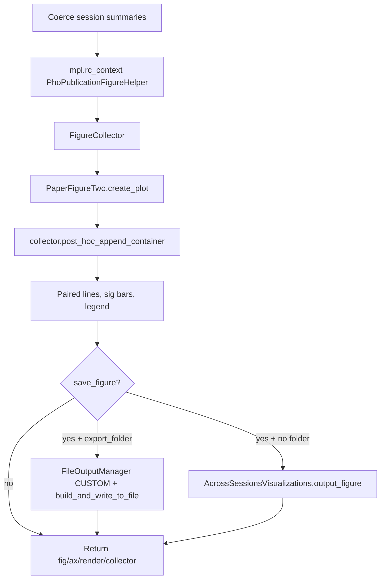

# Convert four-bar plot to FigureCollector publication save

The selected function in [`PhoDiba2023Paper.py`](h:\TEMP\Spike3DEnv_ExploreUpgrade\Spike3DWorkEnv\pyPhoPlaceCellAnalysis\src\pyphoplacecellanalysis\SpecificResults\PhoDiba2023Paper.py) already builds the panel via `PaperFigureTwo.create_plot` (which uses `FormattedFigureText`). Saving is the outdated part: a single `fig.savefig(export_folder / f'{fig_file_name}.pdf')` that requires `export_folder`.

The current best-practice matplotlib path (used by `_display_directional_track_template_pf1Ds`, `_display_measured_vs_decoded_occupancy_distributions`, `plot_pre_scatter_post_matplotlib`) is:

```python
with mpl.rc_context(PhoPublicationFigureHelper.rc_context_kwargs(prepare_for_publication=..., **{'figure.dpi': '220', 'figure.frameon': False})):
    with FigureCollector(name=..., base_context=display_context) as collector:
        # plot (or post_hoc_append a figure created inside a helper)
        AcrossSessionsVisualizations.output_figure(display_context, fig, write_vector_format=True, write_png=True)
```

`FigureCollector` is the capturer: it records figures/axes (`create_figure` / `subplots` / `post_hoc_append_container`). `CaptureNewFiguresContextManager` only diffs `plt.get_fignums()` and is unnecessary here because `create_plot` already returns a `MatplotlibRenderPlots` container.

## Changes (one method, keep plot logic)

In `PrePostDeltaDistributionComparison.plot_fig2_style_summary_four_bar` only:

1. **Wrap plotting in publication rc + collector.** After data prep / `active_context` setup, wrap the `create_plot` call and overlays in:

```python
with mpl.rc_context(PhoPublicationFigureHelper.rc_context_kwargs(prepare_for_publication=prepare_for_publication, **{'figure.dpi': str(dpi), 'figure.frameon': False})):
    with FigureCollector(name='fig4_summary_four_bar', base_context=active_context) as collector:
        render = PaperFigureTwo.create_plot(..., defer_show=True, **create_plot_kwargs)
        collector.post_hoc_append_container(render)
        # existing paired lines, significance bars, heuristic legend
```

Local imports inside the method (same style as sibling plotters): `FigureCollector`, `FileOutputManager` / `build_and_write_to_file`, `AcrossSessionsVisualizations`. `MatplotlibRenderPlots` and `PhoPublicationFigureHelper` are already in this file.

2. **Replace `fig.savefig` with context-based PDF+PNG write.** Keep `save_figure` as the gate (default still `False` so the notebook cell does not start writing unless asked). Add `write_vector_format=True` / `write_png=True` kwargs.

   - If `export_folder` is set: `FileOutputManager(figure_output_location=CUSTOM, context_to_path_mode=GLOBAL_UNIQUE, override_output_parent_path=export_folder)` then `build_and_write_to_file(...)`.
   - Else: `AcrossSessionsVisualizations.output_figure(active_context, fig, ...)`, which lands in the daily programmatic folder.

   Basename still comes from `IdentifyingContext` (`active_context` already includes `display_fn_name='pre_post_delta_summary_bars'`). `fig_file_name` remains as an optional context/basename override, not a hardcoded `.pdf` stem.

3. **Keep the public return dict.** Add `collector` and `saved_paths` (list of Path). Keep `fig` / `ax` / `render` so `_out_extra_plot['fig']` in the notebook still works. `saved_path` can stay as the first saved file (or `None`) for compatibility.

Plotting internals (heuristic split bars, paired lines, `add_significance_bars`) stay as they are.



## Not in scope unless requested

[`plot_four_distribution_hist_ecdf`](h:\TEMP\Spike3DEnv_ExploreUpgrade\Spike3DWorkEnv\pyPhoPlaceCellAnalysis\src\pyphoplacecellanalysis\SpecificResults\PhoDiba2023Paper.py) uses the same `fig.savefig` pattern a few lines below. Same conversion can be applied later.

No notebook edits unless you want the Figure 4/S8 cell to pass `save_figure=True, export_folder=figures_parent_folder`.
