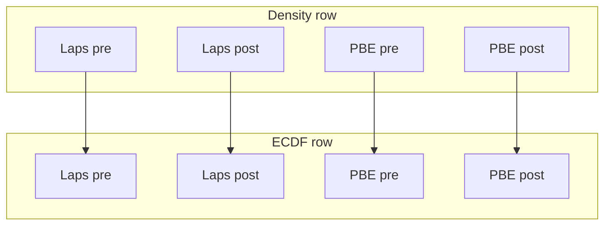

# Four-distribution hist/KDE + ECDF figure

The current 4-bar plot of session means cannot show that `P_Short` is U-shaped. Existing Figure 4 scatter+side histograms ([`_perform_matplotlib_SINGLE_SERIES_pre_post_scatter`](h:\TEMP\Spike3DEnv_ExploreUpgrade\Spike3DWorkEnv\pyPhoPlaceCellAnalysis\src\pyphoplacecellanalysis\SpecificResults\PhoDiba2023Paper.py)) are time-aligned and do not compare all four distributions on a shared density scale or show smoothing sensitivity.

**Why this layout, not violins:** split violins in the Fig2 4-bar positions would keep the spatial mapping, but they hide ECDF shape and bandwidth sensitivity. Hist+KDE (top) plus ECDF (bottom) is the right dedicated view for bimodality. Keep the bar plot as the mean-summary companion.

All edits in [`PhoDiba2023Paper.py`](h:\TEMP\Spike3DEnv_ExploreUpgrade\Spike3DWorkEnv\pyPhoPlaceCellAnalysis\src\pyphoplacecellanalysis\SpecificResults\PhoDiba2023Paper.py), a new classmethod immediately after `plot_fig2_style_summary_four_bar`.

## Data (raw values, not session means)

`run()` / `session_summary` only store means. Pull pre/post arrays from:

1. A `PrePostDeltaDistributionComparison` instance: `obj._y[obj._row_condition_code == 0/1]`
2. Else a DataFrame with `value_col` + `condition_col` (same labels as the constructor: `pre-delta` / `post-delta`)

Callers already have comparison objects from `FigureS8.main`:

```python
out = PrePostDeltaDistributionComparison.plot_four_distribution_hist_ecdf(
    pre_post_delta_stats_distribution_comparison_dict['_perTimeBin_Laps'],
    pre_post_delta_stats_distribution_comparison_dict['_perTimeBin_PBEs'],
    pbe_heuristic_passing=pre_post_delta_stats_distribution_comparison_dict.get('_perTimeBin_PBEs_heuristic_passing'),
)
```

Reuse the existing parent-dict heuristic unwrap (identity-match the PBE sibling when both `_perTimeBin` and `_perEpochs` keys exist).

## Figure layout

2 rows × 4 columns, shared x `[0, 1]`:

- Columns (Fig2 order/colors via `PaperFigureTwo.get_bar_colors()`): Laps pre-Δ, Laps post-Δ, PBE pre-Δ, PBE post-Δ
- Top row: density histogram (`density=True`, common bin edges `np.linspace(0, 1, n_bins+1)`, default `n_bins=25`) plus 3 KDE curves
- Bottom row: ECDF, y `[0, 1]`
- Shared density ylim across the four top axes (`nanmax` of all hists + KDEs)
- Dashed vertical lines at `0.25` and `0.75` (same thresholds as `compute_mode_ratio`)
- Column titles + n in each panel; one figure-level legend for KDE bandwidths



## KDE / smoothing sensitivity

`P_Short` piles up at 0 and 1, so a naive `gaussian_kde` leaks outside `[0, 1]` and underestimates the endpoint modes. Reflect the sample at 0 and 1, fit `scipy.stats.gaussian_kde`, evaluate on a grid in `[0, 1]`, and renormalize on that interval.

Bandwidths: Scott’s rule × `{0.5, 1.0, 2.0}` (thin / default / coarse). Same three factors on every panel. Lineweight/alpha increase with smoothness so the default (`1.0`) is the darkest.

## Optional heuristic overlay

If `pbe_heuristic_passing` is provided, draw it only on the two PBE columns in `#2ca02c`: step histogram outline, one KDE at Scott×1.0, dashed ECDF. Do not change the shared density ylim except to include these curves.

## Signature (grouped continuation lines)

```python
@classmethod
def plot_four_distribution_hist_ecdf(cls, laps_data, pbe_data,
    value_col: str = 'P_Short', condition_col: str = 'pre_post_delta_category',
    pre_label: str = 'pre-delta', post_label: str = 'post-delta',
    pbe_heuristic_passing=None, n_bins: int = 25, kde_bw_factors: Tuple[float, ...] = (0.5, 1.0, 2.0),
    low_threshold: float = 0.25, high_threshold: float = 0.75,
    group_labels: Tuple[str, str] = ('Laps', 'PBEs'), prepare_for_publication: bool = True,
    defer_show: bool = False, save_figure: bool = False, export_folder: Optional[Path] = None,
    fig_file_name: str = 'figure4_distribution_hist_ecdf', debug_print: bool = False, **kwargs) -> Dict[str, Any]:
```

Return `fig`, `axes` (2×4), extracted arrays, and `saved_path`. Show only after all artists are drawn (same `defer_show=True` into any helper, then `plt.show()` at the end).

Do not change `plot_fig2_style_summary_four_bar`.
