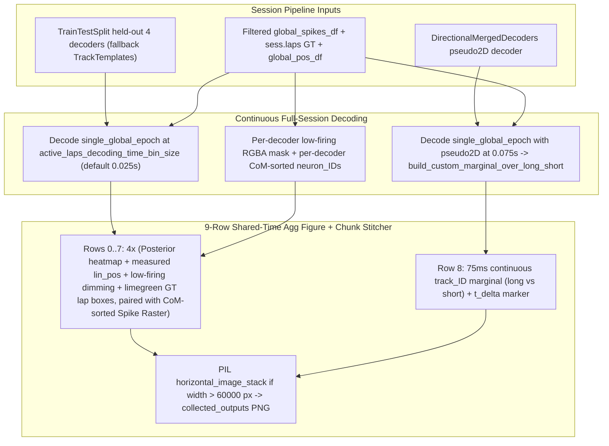

# Full-Session 4-Decoder Posteriors, Sorted Rasters, and 75ms Context Batch Export

## Goal
Create a self-contained top-level batch figure completion function `figures_export_continuous_4decoder_rasters_and_context_completion_function` in [batch_user_completion_helpers.py](h:/TEMP/Spike3DEnv_ExploreUpgrade/Spike3DWorkEnv/pyPhoPlaceCellAnalysis/src/pyphoplacecellanalysis/General/Batch/BatchJobCompletion/UserCompletionHelpers/batch_user_completion_helpers.py) suitable for `inspect.getsource` embedding on Great Lakes (GL) SLURM jobs, using only local imports and nested `_subfn_*` helpers.

## Architecture and Track Layout

- **Vertical stack (9 shared-time rows per time chunk, `hspace` tight within each decoder pair and slightly larger between decoders):**
  - **Rows 0 & 1 (`long_LR`):** `long_LR` continuous position posterior (`height_ratio=2.2`) directly above `long_LR` sorted spike raster (`height_ratio=1.5`).
  - **Rows 2 & 3 (`long_RL`):** `long_RL` continuous position posterior above `long_RL` sorted spike raster.
  - **Rows 4 & 5 (`short_LR`):** `short_LR` continuous position posterior above `short_LR` sorted spike raster.
  - **Rows 6 & 7 (`short_RL`):** `short_RL` continuous position posterior above `short_RL` sorted spike raster.
  - **Row 8 (Bottom context track):** `75ms` (`0.075s`) continuous `track_ID` marginal (`['long', 'short']`, `height_ratio=1.1`) with inner labels via `PlottingHelpers.helper_matplotlib_add_pseudo2D_marginal_labels` and `t_delta` vertical line.

## Files to Modify

- **[batch_user_completion_helpers.py](h:/TEMP/Spike3DEnv_ExploreUpgrade/Spike3DWorkEnv/pyPhoPlaceCellAnalysis/src/pyphoplacecellanalysis/General/Batch/BatchJobCompletion/UserCompletionHelpers/batch_user_completion_helpers.py)**
  - Add `figures_export_continuous_4decoder_rasters_and_context_completion_function` immediately after `figures_export_laps_correct_decoder_side_by_side_completion_function` (around line 4580), following the single-line/logical-group signature rule and local-import requirement for `inspect.getsource`.
  - Register `'figures_export_continuous_4decoder_rasters_and_context_completion_function'` in `MAIN_get_template_string` (around line 5444).
- **[ProcessBatchOutputs_qclus1246789_Only.ipy](h:/TEMP/Spike3DEnv_ExploreUpgrade/Spike3DWorkEnv/Spike3D/ProcessBatchOutputs_qclus1246789_Only.ipy)**
  - Import `figures_export_continuous_4decoder_rasters_and_context_completion_function` on line 70.
  - Add `--only` recipe `'figures_export_continuous_4decoder_rasters_and_context'` (plus `..._completion_function` alias) with prerequisites `['split_to_directional_laps', 'merged_directional_placefields', 'directional_train_test_split']` (same held-out `TrainTestSplit` setup as `figures_export_laps_correct_decoder_side_by_side`, with `active_laps_decoding_time_bin_size=laps_decoding_time_bin_size` and `context_decoding_time_bin_size=0.075`).
  - Add default kwargs entry in `custom_user_completion_function_override_kwargs_dict` and `--only` CLI help string.

## Implementation Details & Nested `_subfn_*` Design

All single-use helpers live inside `figures_export_continuous_4decoder_rasters_and_context_completion_function` as nested `_subfn_*` functions (with no live `@function_attributes` decorators on nested functions):

- **Prerequisite resolution & continuous decoding:**
  - Force headless backend (`MPLBACKEND='Agg'`, `matplotlib.use('Agg', force=False)`, `plt.ioff()`).
  - Resolve `minimum_inclusion_fr_Hz` and `included_qclu_values` from `RankOrder` or `computation_config.rank_order_shuffle_analysis`, then ensure `DirectionalLaps`, `DirectionalMergedDecoders`, and `TrainTestSplit` (via `TrainTestLapsSplitting.resolve_needs_train_test_split_recompute` with `active_laps_decoding_time_bin_size: float = 0.025`).
  - Build `single_global_epoch` spanning `[t_start, t_end]` from `curr_active_pipeline.find_LongShortDelta_times()` (or global session bounds for non-KDiba).
  - Extract held-out 4 decoders from `TrainTestSplit.train_lap_specific_pf1D_Decoder_dict` (restricted to `TrackTemplates` `neuron_IDs` on KDiba, falling back to `track_templates.get_decoders_dict()`, matching lines 11761-11776 of [DirectionalPlacefieldGlobalComputationFunctions.py](h:/TEMP/Spike3DEnv_ExploreUpgrade/Spike3DWorkEnv/pyPhoPlaceCellAnalysis/src/pyphoplacecellanalysis/General/Pipeline/Stages/ComputationFunctions/MultiContextComputationFunctions/DirectionalPlacefieldGlobalComputationFunctions.py)).
  - Decode `single_global_epoch` continuously across the full session for each of the 4 decoders at `active_laps_decoding_time_bin_size` (default `0.025`s).
  - Decode `single_global_epoch` continuously at `context_decoding_time_bin_size: float = 0.075` (`75ms`) using `directional_merged_decoders_result.all_directional_pf1D_Decoder` (reusing `DirectionalDecodersDecoded` cache when `(0.075, None)` is already present) and compute the `2 x T` `['long', 'short']` marginal via `DirectionalPseudo2DDecodersResult.build_custom_marginal_over_long_short`.

- **Nested `_subfn_*` helpers inside the completion function:**
  - `_subfn_build_laps_gt_df`: builds the ground-truth laps DataFrame (`start`, `stop`, `lap_id`, `truth_decoder_name`) via `add_laps_groundtruth_information_to_dataframe` (reusing the pattern from [DirectionalPlacefieldGlobalComputationFunctions.py](h:/TEMP/Spike3DEnv_ExploreUpgrade/Spike3DWorkEnv/pyPhoPlaceCellAnalysis/src/pyphoplacecellanalysis/General/Pipeline/Stages/ComputationFunctions/MultiContextComputationFunctions/DirectionalPlacefieldGlobalComputationFunctions.py) lines 11088-11099).
  - `_subfn_prepare_decoder_sorted_spikes`: for each decoder `a_name`, sorts `a_decoder.neuron_IDs` ascending by `a_decoder.pf.ratemap.peak_tuning_curve_center_of_masses` (`y = 0 .. n_cells - 1` matching `origin='lower'` position direction), assigns globally shared neuron colors via `build_shared_sorted_neuron_color_maps(..., return_255_array=False)`, and precomputes spike `(t, y_idx, rgba)` arrays for fast `LineCollection` rendering.
  - `_subfn_compute_low_firing_mask_rgba`: computes the `[1, n_bins, 4]` semi-transparent black `[0, 0, 0, 200]` mask per decoder using `spikes_df.spikes.compute_unit_time_binned_spike_counts_and_mask` (`min_num_spikes_per_bin_to_be_considered_active=1`, `min_num_unique_active_neurons_per_time_bin=1`).
  - `_subfn_draw_lap_gt_boxes_and_non_gt_dimming`: for every lap `[lap_start, lap_stop]`, draws a `limegreen` `Rectangle` around `[lap_start, lap_stop]` on the matching `truth_decoder_name` posterior (and lighter matching border on its paired raster, plus optional compact `Lap N` label at the top edge), and applies subtle non-GT lap dimming on the other 3 decoders during `[lap_start, lap_stop]` so GT laps pop visually like `*_laps_4decoder_gt_boxed.png`.
  - `_subfn_render_time_chunk_figure`: renders a contiguous session time slice `[chunk_t0, chunk_t1]` across all 9 tracks (`viridis` posterior `vmin=posterior_masking_value=0.0, vmax=1.0`, thin red measured `lin_pos` line `#ff0000` @ `alpha=0.45`, `LineCollection` sorted spike ticks, low-firing RGBA overlay, GT boxes, and bottom `75ms` `long`/`short` context heatmap).

- **Ultra-wide Figure Width & Safe Agg Rendering:**
  - Expose `inches_per_second: float = 0.15` (and `dpi: int = 150`, `figsize_height: float = 16.0`).
  - Because Matplotlib `RendererAgg` raises an error if a single canvas exceeds `65,535` pixels in width, automatically split `[t_start, t_end]` into contiguous time chunks whenever `total_width_px > max_chunk_width_px` (default `30000` px per chunk), render each chunk to a PIL image (keeping y-axis labels on the leftmost chunk and flush zero-gap axes on interior seams, or left+right labels), and stitch horizontally with `horizontal_image_stack(..., padding=0)` from `pyphocorehelpers.plotting.media_output_helpers`.
  - Save final PNG to `self.collected_outputs_path / 'continuous_4decoder_rasters_and_context' / f'{self.BATCH_DATE_TO_USE}-{animal_exper_session}_continuous_4decoder_gt_boxed.png'` (matching the flat `collected_outputs` subfolder convention of `laps_correct_decoder_side_by_side`), record `out_path` in `across_session_results_extended_dict`, and close all figures.

## Verification
- Compile-check modified Python files (`py_compile`) and run `ReadLints` on `batch_user_completion_helpers.py`.
- Verify `MAIN_get_template_string()` executes cleanly and `inspect.getsource(figures_export_continuous_4decoder_rasters_and_context_completion_function)` contains no unbound module-level references.
- Add or run a lightweight unit/smoke test with synthetic or fixture pipeline mocks if needed to verify the 9-row layout, chunk stitching, GT lap rectangles, and 75ms `track_ID` marginal output PNG generation.