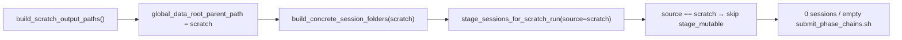
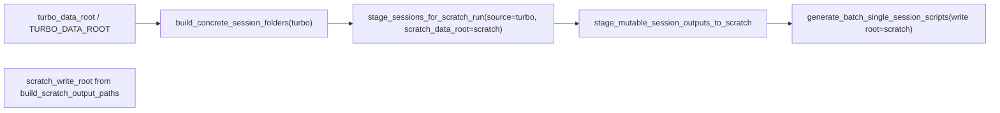

# Fix GL discovery / staging order in qclus1246789 `.ipy`

## Problem (current flow)



- [`ProcessBatchOutputs_qclus1246789_Only.ipy`](h:\TEMP\Spike3DEnv_ExploreUpgrade\Spike3DWorkEnv\Spike3D\ProcessBatchOutputs_qclus1246789_Only.ipy) line ~96 sets **`global_data_root_parent_path` to scratch** via `build_scratch_output_paths()`.
- Line ~203 discovers sessions with that scratch root (only folders already under scratch `KDIBA/...`).
- Line ~445 calls `stage_sessions_for_scratch_run(..., source_data_root=global_data_root_parent_path)` → still scratch, so [`stage_sessions_for_scratch_run`](h:\TEMP\Spike3DEnv_ExploreUpgrade\Spike3DWorkEnv\pyPhoPlaceCellAnalysis\src\pyphoplacecellanalysis\General\Batch\pythonScriptTemplating.py) hits the short-circuit at ~2010–2012 and **never** calls `stage_mutable_session_outputs_to_scratch`.

`turbo_data_root` is already computed at line ~85 but unused for discovery/staging.

## Target flow



No changes to [`pythonScriptTemplating.py`](h:\TEMP\Spike3DEnv_ExploreUpgrade\Spike3DWorkEnv\pyPhoPlaceCellAnalysis\src\pyphoplacecellanalysis\General\Batch\pythonScriptTemplating.py) required—the wrapper already stages when `source_data_root != scratch_write_root`.

## Edits (notebook only)

### 1. Path block (~lines 95–104)

When `use_scratch_writes`:

- Unpack third return as an explicit name, e.g. `scratch_write_root` (not overloaded as “discovery root”):
  - `scripts_output_path, collected_outputs_path, scratch_write_root = GreatlakesTurboToScratchHelpers.build_scratch_output_paths()`
- Set **`session_discovery_data_root = turbo_data_root`** with assert:
  - `assert turbo_data_root is not None and turbo_data_root.exists(), ...`
- Set **`global_data_root_parent_path = scratch_write_root`** (job write root for generated scripts and destination summary—unchanged semantics after staging).

When **not** `use_scratch_writes` (Apogee/Lab/Windows):

- Keep existing `find_first_extant_path` logic.
- Set **`session_discovery_data_root = global_data_root_parent_path`** (single root; no staging).

Optional: initialize `scratch_write_root = None` in the else branch for clarity.

### 2. Discovery block (~lines 201–205)

Replace the single-root print/assert with:

- Assert **`session_discovery_data_root`** exists.
- Print both when on GL scratch mode, e.g. discovery on Turbo vs write on scratch.
- Call:
  - `good_session_concrete_folders = ConcreteSessionFolder.build_concrete_session_folders(session_discovery_data_root, included_session_contexts)`

Keep `session_global_data_root_parent_paths = None` as today.

### 3. Main body staging (~lines 443–446)

Change the staging call to use Turbo as read source and scratch as dest:

```python
good_session_concrete_folders, session_global_data_root_parent_paths, global_data_root_parent_path = GreatlakesTurboToScratchHelpers.stage_sessions_for_scratch_run(
    turbo_session_folders=good_session_concrete_folders,
    source_data_root=session_discovery_data_root,
    pickle_suffix=override_custom_pickle_suffix,
    tbin_suffix=decoding_time_bin_filename_suffix,
    scratch_data_root=scratch_write_root,
    skip_if_dest_newer_or_equal=True)
```

After this, `global_data_root_parent_path` remains scratch (return value + per-session overrides)—compatible with existing `generate_batch_single_session_scripts(..., global_data_root_parent_path, session_global_data_root_parent_paths=...)` at ~513.

### 4. Optional guard (recommended, ~1 line after staging)

If `len(good_session_concrete_folders) == 0` after discovery, print a clear WARN naming `session_discovery_data_root` and `included_session_contexts` before staging (helps when Turbo paths or session names are wrong).

## Verification on GL login node

Re-run the large `.ipy` cell and confirm:

| Signal | Expected |
|--------|----------|
| Log after discovery | `2/2` sessions (for your current unconventional list), not `0/2` |
| Staging | `[SCRATCH STAGE] copied N file(s)...` per session, **not** “session discovery root is already scratch; skipping turbo copy” |
| Output | `submit_phase_chains_*.sh` contains `sbatch --parsable '.../run_kdiba_vvp01_one_2006-4-09_17-29-30/...'` lines |
| Manifest | `submit_phase_chains_*.json` has non-empty `"sessions"` |

Non-GL runs (`use_scratch_writes=False`): behavior unchanged—discovery and scripts use the same extant data root; staging block skipped.

## Scope

- **In scope:** [`ProcessBatchOutputs_qclus1246789_Only.ipy`](h:\TEMP\Spike3DEnv_ExploreUpgrade\Spike3DWorkEnv\Spike3D\ProcessBatchOutputs_qclus1246789_Only.ipy) only.
- **Out of scope:** Other `.ipy` files, library API changes, docs unless you want a one-line comment in the GL workaround section explaining Turbo discover → scratch stage.
