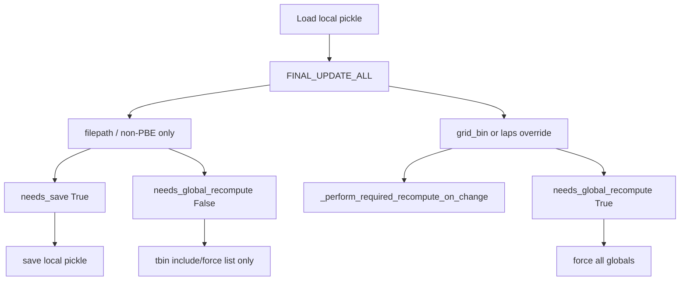

# Minimal GL-log global fixes

The 75ms handler path already wrote `-tbin_75ms.pkl`. These changes stop the rest of the pipeline from treating metadata as “local computations changed,” stop mangling dotted pickle names, and stop injecting the default mega completion set.

Out of scope (not sure, or session-specific): empty non-PBE, user-annotation index error, `'score_long_LR'`, measured-position length mismatch, `long_short_fr_indicies_analysis` without jonathan, maze_id actually missing (only the assert **message** is a confirmed bug).

## 1. Do not PF-recompute on filepath-only fixup

[`FINAL_UPDATE_ALL`](h:\TEMP\Spike3DEnv_ExploreUpgrade\Spike3DWorkEnv\pyPhoPlaceCellAnalysis\src\pyphoplacecellanalysis\General\Batch\BatchJobCompletion\UserCompletionHelpers\batch_user_completion_helpers.py) currently ORs filepath / non-PBE / laps / grid-bin into one `did_any_change`, then always calls `_perform_required_recompute_on_change` and prints “at least one grid_bin_bound was changed” even when grid bins did not change (this log).

Split:

- `did_any_computation_affecting_change` = grid_bin **or** laps override **or** directional-pipeline modified
- `did_any_change` = those **or** filepath **or** non-PBE (still persist paths / epoch tables)

Call `_perform_required_recompute_on_change` only when `did_any_computation_affecting_change or force_recompute`. Print the actual reason.

Return `(did_any_change, did_any_computation_affecting_change)` from `FINAL_UPDATE_ALL`. Update `run_as_batch_user_completion_function` to unpack.

## 2. Save pickle for metadata; do not force all globals

[`post_compute_validate`](h:\TEMP\Spike3DEnv_ExploreUpgrade\Spike3DWorkEnv\pyPhoPlaceCellAnalysis\src\pyphoplacecellanalysis\General\Batch\BatchJobCompletion\BatchCompletionHandler.py) and [`on_complete_success_execution_session`](h:\TEMP\Spike3DEnv_ExploreUpgrade\Spike3DWorkEnv\pyPhoPlaceCellAnalysis\src\pyphoplacecellanalysis\General\Batch\BatchJobCompletion\BatchCompletionHandler.py) treat any `was_updated` as “local functions changed” → `force_global_recompute=True` → `pf_computation` / `split_to_directional_laps` re-run despite not being on the force list.

- `post_compute_validate` returns `(was_updated, needs_global_recompute)`
- `needs_global_recompute` = preprocessing-param / filtered-context updates **or** computation-affecting fixup
- `on_complete`: keep save-mode override on `was_updated`; set `force_global_recompute` only on `needs_global_recompute`
- Unpack in [`pipeline_ipywidgets.py`](h:\TEMP\Spike3DEnv_ExploreUpgrade\Spike3DWorkEnv\pyPhoPlaceCellAnalysis\src\pyphoplacecellanalysis\GUI\IPyWidgets\pipeline_ipywidgets.py) (save still uses `was_updated`)

Path-only jobs still rewrite the local pickle once so GPFS paths persist. After that, later jobs skip this cascade.

## 3. Unique temp names: last suffix only

[`AutoVersionedUniqueFilenameParser.build_unique_filename`](h:\TEMP\Spike3DEnv_ExploreUpgrade\Spike3DWorkEnv\pyPhoCoreHelpers\src\pyphocorehelpers\Filesystem\path_helpers.py) uses `Path.suffixes`. `frateThresh_2.0-tbin_75ms.pkl` becomes suffixes `['.0-tbin_75ms', '.pkl']`, producing `...-tbin_75ms.0-tbin_75ms.pkltmp`. This was already wrong for `frateThresh_2.0`; tbin made it obvious.

Use `stem` + last `suffix` only. If `additional_postfix_extension` is `'tmp'` (no leading dot), concatenate to get `.pkltmp` as callers already expect.

## 4. Do not double-append `-tbin_`

[`_append_tbin_to_global_and_h5`](h:\TEMP\Spike3DEnv_ExploreUpgrade\Spike3DWorkEnv\pyPhoPlaceCellAnalysis\src\pyphoplacecellanalysis\General\Pipeline\NeuropyPipeline.py) has no `'tbin_' in stem` guard; [`global_computation_results_pickle_path`](h:\TEMP\Spike3DEnv_ExploreUpgrade\Spike3DWorkEnv\pyPhoPlaceCellAnalysis\src\pyphoplacecellanalysis\General\Pipeline\Stages\Computation.py) already does. Skip append when `-tbin_` is already in the stem.

## 5. maze_id assert message

In [`batch_user_completion_helpers.py`](h:\TEMP\Spike3DEnv_ExploreUpgrade\Spike3DWorkEnv\pyPhoPlaceCellAnalysis\src\pyphoplacecellanalysis\General\Batch\BatchJobCompletion\UserCompletionHelpers\batch_user_completion_helpers.py) line 520, `{print(list(laps_df.columns))}` always interpolates `None`. Use `{list(laps_df.columns)}`. Do not change `Laps.update_maze_id_if_needed` in this pass.

## 6. Notebook: explicit tbin completions (not None)

[`ProcessBatchOutputs_qclus1246789_Only.ipy`](h:\TEMP\Spike3DEnv_ExploreUpgrade\Spike3DWorkEnv\Spike3D\ProcessBatchOutputs_qclus1246789_Only.ipy) sets `phase_any_run_custom_user_completion_functions_dict = None`, then `MAIN_get_template_string` fills the mega default (rank-order, alternative_replay, backup, inst-FR, PF-peaks, clusterless, …). That is why `save_custom` wrote `-tbin_laps250ms_ripple25ms.pkl` after alternative_replay nulled decoding bins.

Set an explicit dict (the functions already imported / kwargs already present):

- `perform_sweep_decoding_time_bin_sizes_marginals_dfs_completion_function`
- `compute_and_export_decoders_epochs_decoding_and_evaluation_dfs_completion_function`
- `compute_and_export_session_wcorr_shuffles_completion_function`
- `generalized_decode_epochs_dict_and_export_results_completion_function`
- `save_custom_session_files_completion_function`

Keep rank-order / alternative_replay / backup / inst-FR / PF-peaks / trial-by-trial / first-spikes / Bapun-NWB-clusterless out.

In `custom_user_completion_function_override_kwargs_dict['save_custom_session_files_completion_function']` add `enable_save_pipeline_pkl=False` (handler already writes `-tbin_75ms.pkl`; do not rewrite shared local pickle). Keep `should_write_posterior_h5=True`. Set `enable_save_h5=False` for this tbin-only pickle (no jonathan / `long_short_fr_indicies_analysis`).

Do not change `MAIN_get_template_string(None)` default semantics.
