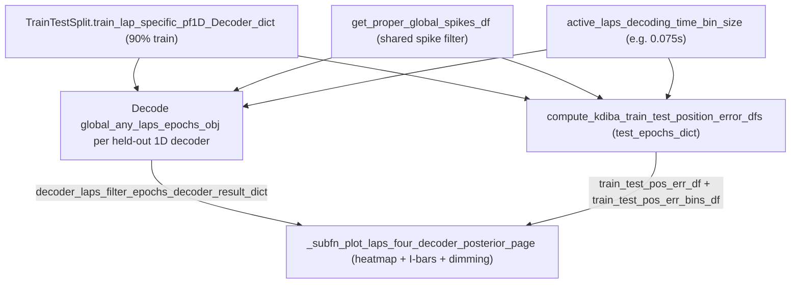

# Use 90%-Train Held-Out Decoders for Lap Background Heatmaps (Bug 1)

## Root Cause
`_display_laps_correct_decoder_side_by_side_posteriors` in [DirectionalPlacefieldGlobalComputationFunctions.py](h:/TEMP/Spike3DEnv_ExploreUpgrade/Spike3DWorkEnv/pyPhoPlaceCellAnalysis/src/pyphoplacecellanalysis/General/Pipeline/Stages/ComputationFunctions/MultiContextComputationFunctions/DirectionalPlacefieldGlobalComputationFunctions.py) currently takes `decoder_laps_filter_epochs_decoder_result_dict` from `global_computation_results.computed_data['DirectionalDecodersEpochsEvaluations']`, which is:
- Decoded with `track_templates.get_decoders_dict()` (trained in-sample on 100% of laps, including the held-out test segments).
- Cached at whatever `laps_decoding_time_bin_size` was stored in `DirectionalMergedDecoders` (e.g. `0.025 s`), because `figures_export_laps_correct_decoder_side_by_side_completion_function` in [batch_user_completion_helpers.py](h:/TEMP/Spike3DEnv_ExploreUpgrade/Spike3DWorkEnv/pyPhoPlaceCellAnalysis/src/pyphoplacecellanalysis/General/Batch/BatchJobCompletion/UserCompletionHelpers/batch_user_completion_helpers.py) never forwards `active_laps_decoding_time_bin_size` into `display(...)`.

Meanwhile, the white I-beams and left-box error metrics come from decoding `test_epochs_dict` with `TrainTestSplit.train_lap_specific_pf1D_Decoder_dict` (the 90%-train held-out decoders) at `active_laps_decoding_time_bin_size` using `get_proper_global_spikes_df(...)`.



## Planned Changes

### 1. Decode background lap posteriors from `TrainTestSplit.train_lap_specific_pf1D_Decoder_dict`
- **File**: [DirectionalPlacefieldGlobalComputationFunctions.py](h:/TEMP/Spike3DEnv_ExploreUpgrade/Spike3DWorkEnv/pyPhoPlaceCellAnalysis/src/pyphoplacecellanalysis/General/Pipeline/Stages/ComputationFunctions/MultiContextComputationFunctions/DirectionalPlacefieldGlobalComputationFunctions.py) (`lines 10944-10953`, `11484-11515`, `11560-11619`)
- Add `active_laps_decoding_time_bin_size: Optional[float] = None` to `_display_laps_correct_decoder_side_by_side_posteriors` (keeping the single/grouped line signature convention) and update `@function_attributes` `input_requires` to `['DirectionalLaps', 'TrainTestSplit']`.
- Load `train_test_split_result = global_computation_results.computed_data.get('TrainTestSplit', None)`; if missing in interactive usage, run `owning_pipeline_reference.perform_specific_computation(computation_functions_name_includelist=['directional_train_test_split'], enabled_filter_names=None, fail_on_exception=False, debug_print=False)` before re-fetching.
- Resolve `effective_laps_tbin` in priority order:
  1. Explicit `active_laps_decoding_time_bin_size` argument (when not `None` and `> 0`)
  2. `train_test_split_result.laps_decoding_time_bin_size`
  3. `DirectionalMergedDecoders.laps_decoding_time_bin_size`
  4. `0.025` fallback
  clamped via `min(float(effective_laps_tbin), find_minimum_time_bin_duration(global_any_laps_epochs_df['duration'].to_numpy()))` (matching `_compute_lap_and_ripple_epochs_decoding_for_decoder`).
- Compute `global_spikes_df = deepcopy(get_proper_global_spikes_df(owning_pipeline_reference, minimum_inclusion_fr_Hz=minimum_inclusion_fr_Hz, included_qclu_values=included_qclu_values))` once and reuse it for both held-out lap decoding and `spikes_df_for_dimming` (same spike source used by `_do_train_test_split_decode_and_evaluate`).
- Build `decoder_laps_filter_epochs_decoder_result_dict` by decoding `global_any_laps_epochs_obj = deepcopy(owning_pipeline_reference.computation_results[global_epoch_name].computation_config.pf_params.computation_epochs)` for each decoder in `train_test_split_result.train_lap_specific_pf1D_Decoder_dict`:
  ```python
  for a_name, a_decoder in heldout_decoders_dict.items():
      active_spikes_df = None if is_clusterless_position_decoder(a_decoder) else deepcopy(global_spikes_df)
      decoder_laps_filter_epochs_decoder_result_dict[a_name] = a_decoder.decode_specific_epochs(spikes_df=active_spikes_df, filter_epochs=deepcopy(global_any_laps_epochs_obj), decoding_time_bin_size=laps_decoding_time_bin_size, debug_print=False)
  ## END for a_name, a_decoder in heldout_decoders_dict.items()...
  ```
  (Retain a `WARN` fallback to `DirectionalDecodersEpochsEvaluations.decoder_laps_filter_epochs_decoder_result_dict` only if `train_lap_specific_pf1D_Decoder_dict` is unavailable.)
- Pass `active_decoders_dict=heldout_decoders_dict` into `_subfn_export_laps_four_decoder_gt_boxed_combined_figure` so `decoder_xbin_dict` is built from the held-out decoders' `.xbin` (falling back to `a_result.pos_bin_edges` / `track_templates.get_decoders_dict()`), guaranteeing spatial bin edges match `curr_posterior`.

### 2. Forward `active_laps_decoding_time_bin_size` from batch figure completion
- **File**: [batch_user_completion_helpers.py](h:/TEMP/Spike3DEnv_ExploreUpgrade/Spike3DWorkEnv/pyPhoPlaceCellAnalysis/src/pyphoplacecellanalysis/General/Batch/BatchJobCompletion/UserCompletionHelpers/batch_user_completion_helpers.py) (`lines 4470`, `4537-4542`)
- Update `@function_attributes` `input_requires` on `figures_export_laps_correct_decoder_side_by_side_completion_function` to `['DirectionalLaps', 'TrainTestSplit']`.
- Pass `active_laps_decoding_time_bin_size=float(active_laps_decoding_time_bin_size)` into `curr_active_pipeline.display('_display_laps_correct_decoder_side_by_side_posteriors', ...)` so `--tbin` (e.g. `0.075`) governs both the held-out error CSV/I-bars and the held-out background heatmap.

### 3. Drop unused `directional_decoders_evaluate_epochs` prerequisite from `--only` recipe
- **File**: [ProcessBatchOutputs_qclus1246789_Only.ipy](h:/TEMP/Spike3DEnv_ExploreUpgrade/Spike3DWorkEnv/Spike3D/ProcessBatchOutputs_qclus1246789_Only.ipy) (`lines 239-248`)
- Remove `'directional_decoders_evaluate_epochs'` from `_ONLY_MODE_RECIPES['figures_export_laps_correct_decoder_side_by_side']['extended_computations_include_includelist']` (leaving `['split_to_directional_laps', 'merged_directional_placefields', 'directional_train_test_split']`, matching `export_train_test_pos_err`) and update its recipe comment/description accordingly.

## Verification
- Run syntax compilation (`py_compile`) and `ReadLints` on [DirectionalPlacefieldGlobalComputationFunctions.py](h:/TEMP/Spike3DEnv_ExploreUpgrade/Spike3DWorkEnv/pyPhoPlaceCellAnalysis/src/pyphoplacecellanalysis/General/Pipeline/Stages/ComputationFunctions/MultiContextComputationFunctions/DirectionalPlacefieldGlobalComputationFunctions.py) and [batch_user_completion_helpers.py](h:/TEMP/Spike3DEnv_ExploreUpgrade/Spike3DWorkEnv/pyPhoPlaceCellAnalysis/src/pyphoplacecellanalysis/General/Batch/BatchJobCompletion/UserCompletionHelpers/batch_user_completion_helpers.py), plus verify `inspect.getsource(figures_export_laps_correct_decoder_side_by_side_completion_function)` remains self-contained for SLURM script embedding.
- Run a focused unit/smoke check verifying that `_display_laps_correct_decoder_side_by_side_posteriors` decodes laps via `TrainTestSplit.train_lap_specific_pf1D_Decoder_dict` at `active_laps_decoding_time_bin_size` without requiring `DirectionalDecodersEpochsEvaluations`.