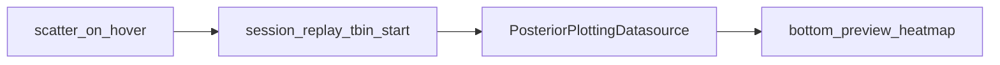

# DataFrameFilter hover posterior preview

Keep the preview **next to the stats table** (bottom row). The empty white space in the screenshot is that already-created `hover_posterior_preview_figure_widget` with no traces and no hover wiring.

## Why it does not appear today

In [`PhoDiba2023Paper.py`](h:/TEMP/Spike3DEnv_ExploreUpgrade/Spike3DWorkEnv/pyPhoPlaceCellAnalysis/src/pyphoplacecellanalysis/SpecificResults/PhoDiba2023Paper.py) and [`data_exporting.py`](h:/TEMP/Spike3DEnv_ExploreUpgrade/Spike3DWorkEnv/pyPhoPlaceCellAnalysis/src/pyphoplacecellanalysis/Pho2D/data_exporting.py):

- `display()` already puts `(table_widget, hover_posterior_preview_figure_widget)` in a bottom HBox, but the preview is a bare `go.FigureWidget()` with no axes/heatmap, so it looks like blank white.
- Its ipywidgets `layout` flex is commented out, so it can collapse beside the table.
- Hover handlers only attach when `should_prepare_full_hover_click_interactivity=True` (default **False**). Passing `hover_posterior_data` does nothing.
- Even if attached, update is **click-only**, uses scatter `point_inds` as HDF5 epoch index (wrong after filter/group/sample), and `get_posterior_data()` builds the wrong session key (`session_name.replace('_', '/', 3)` on `'2006-6-09_1-22-43'`).
- `add_heatmap` never clears previous traces.



## 1. Lookup: HDF5 posteriors by session / replay / tbin / start

Extend [`PosteriorPlottingDatasource`](h:/TEMP/Spike3DEnv_ExploreUpgrade/Spike3DWorkEnv/pyPhoPlaceCellAnalysis/src/pyphoplacecellanalysis/Pho2D/data_exporting.py) (minimal; do not rewrite `LoadedPosteriorContainer` load):

- Add `from_loaded_containers(all_sessions_exported_posteriors_dict, ...)` that wraps `LoadedPosteriorContainer.load_batch_hdf5_exports` output (and optionally the raw `ripple_data_field_dict`).
- Include **time_bin_size** in the key (parse `_tbin-0.025` from the `.h5` filename). Current `full_complete_context_key` omits tbin, so same session+replay files overwrite each other.
- Replace `get_posterior_data(..., last_selected_idx=)` with lookup by:
  - session path from `format_name/animal/exper_name/session_name` when those DF columns exist, else reconstruct from `session_name`
  - `custom_replay_name`
  - `time_bin_size`
  - epoch **start** matched to stored `time_bin_edges[0]` (or `t_bin_centers[0]`) with a small tolerance — not scatter index
- Return `p_x_given_n_grey` for the four decoders (`long_LR`, `long_RL`, `short_LR`, `short_RL`). Missing epoch → `None` (preview shows a “no posterior” annotation, no exception spam).

## 2. Preview widget: visible even before first hover

In `DataFrameFilter._setup_widgets` / `display()`:

- Build the preview as a 4-row stacked heatmap figure (one decoder per row) with a placeholder title, not an empty `FigureWidget()`.
- Set ipywidgets layout so it actually occupies the bottom-right: `flex='1 1 auto'`, min width ~500px, height matching the 300px HBox.
- `update_preview_heatmap(images_by_decoder, title=...)` **replaces** heatmap `z` (or rebuilds the four traces) instead of `add_heatmap`.

## 3. Hover wiring without the slow full-interactivity flag

In `_build_plot_callback`:

- If `df_filter.hover_posterior_data is not None`, attach `on_hover` (and keep existing click selection) **even when** `should_prepare_full_hover_click_interactivity` is False.
- Put identifying fields on scatter `customdata` (`session_name`, `format_name`, `animal`, `exper_name`, `custom_replay_name`, `time_bin_size`, `start`) and read those from the hovered point — never `active_plot_df.iloc[ind]`.
- Debounce hover (~50–100 ms) so fast mouse motion does not flood FigureWidget updates.
- Unhover can leave the last posterior (simpler than clearing).

Do **not** turn on the rest of “full hover/click interactivity” by default (hovertemplate / selection bookkeeping stays behind that flag).

## 4. How the caller passes HDF5 data

Keep `hover_posterior_data: Optional[PosteriorPlottingDatasource]`. Accept also a `Dict[str, LoadedPosteriorContainer]` and wrap it in `__attrs_post_init__`.

Notebook usage (no notebook edits unless you ask):

```python
all_sessions_exported_posteriors_dict, _ = LoadedPosteriorContainer.load_batch_hdf5_exports(decoded_posteriors_h5_files)
posterior_datasource = PosteriorPlottingDatasource.from_loaded_containers(all_sessions_exported_posteriors_dict)
df_filter = DataFrameFilter(..., hover_posterior_data=posterior_datasource)
```

When `hover_posterior_data` is `None`, behavior stays as today (blank/hidden preview, no hover handlers).

## Files

- [`pyphoplacecellanalysis/Pho2D/data_exporting.py`](h:/TEMP/Spike3DEnv_ExploreUpgrade/Spike3DWorkEnv/pyPhoPlaceCellAnalysis/src/pyphoplacecellanalysis/Pho2D/data_exporting.py) — keying + `get_posterior_data` by start time
- [`pyphoplacecellanalysis/SpecificResults/PhoDiba2023Paper.py`](h:/TEMP/Spike3DEnv_ExploreUpgrade/Spike3DWorkEnv/pyPhoPlaceCellAnalysis/src/pyphoplacecellanalysis/SpecificResults/PhoDiba2023Paper.py) — preview layout, hover callback, replace heatmap

Out of scope: shuffle-plan work, notebook mass-edits, overlaying on the scatter figure itself.
