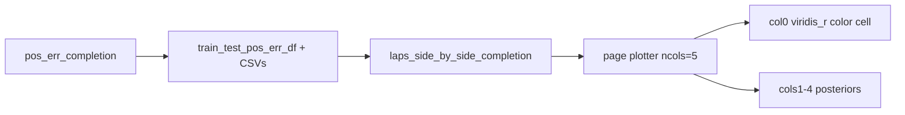

# Laps figure: pos-err dependency + left metrics column

## Dependency model

There is no formal `depends_on` graph; completion functions run in list order. Concrete approach:

1. At the start of [`figures_export_laps_correct_decoder_side_by_side_completion_function`](h:/TEMP/Spike3DEnv_ExploreUpgrade/Spike3DWorkEnv/pyPhoPlaceCellAnalysis/src/pyphoplacecellanalysis/General/Batch/BatchJobCompletion/UserCompletionHelpers/batch_user_completion_helpers.py), call `compute_and_export_kdiba_train_test_position_error_completion_function(...)` first (same `self` / pipeline / `across_session_results_extended_dict`), then proceed to the figure export.
2. Expand the `--only figures_export_laps_correct_decoder_side_by_side` recipe in [`ProcessBatchOutputs_qclus1246789_Only.ipy`](h:/TEMP/Spike3DEnv_ExploreUpgrade/Spike3DWorkEnv/Spike3D/ProcessBatchOutputs_qclus1246789_Only.ipy) to also include `directional_train_test_split` in `extended_computations_include_includelist` (keep evaluate_epochs chain). Figure completion still owns the inline pos-err call so `--only` remains a single completion entry.

Forward shared kwargs: `active_laps_decoding_time_bin_size` (from recipe/`--tbin` or default 0.025), and the same low-firing mask kwargs already used by both functions.

## Enrich pos-err rows with `lap_id`

Today each epoch error row only has `t`, `err_cm`, etc. — no `lap_id` ([`diff_row` ~5347](h:/TEMP/Spike3DEnv_ExploreUpgrade/Spike3DWorkEnv/pyPhoPlaceCellAnalysis/src/pyphoplacecellanalysis/General/Pipeline/Stages/ComputationFunctions/MultiContextComputationFunctions/DirectionalPlacefieldGlobalComputationFunctions.py)).

In the function that builds per-epoch diffs (same loop that creates `diff_row`), copy identity from the corresponding `test_epochs` / `active_filter_epochs` row into `diff_row`: at least `lap_id`, and `start`/`stop` when present. `compute_kdiba_train_test_position_error_dfs` then exports CSVs that can join to figure rows.

## Pass metrics into the display / page plotter

After pos-err completes (or via `compute_kdiba_train_test_position_error_dfs` if you want an in-memory DF without relying on re-read):

- Prefer returning/reusing the in-memory `train_test_pos_err` DataFrame from `compute_kdiba_train_test_position_error_dfs` inside the figure completion (call dfs helper for the figure join; still call the completion function so CSVs are written as the dependency).
- Or: have `export_kdiba_train_test_position_error_csvs` / the completion function also stash the DF under `across_session_results_extended_dict[...]['train_test_pos_err_df']`.

Chosen concrete path: **extend the pos-err completion callback_outputs with `train_test_pos_err_df`** (and keep CSV export). Figure completion reads that DF and passes `train_test_pos_err_df=` into `display('_display_laps_correct_decoder_side_by_side_posteriors', ...)`.

Join key per figure row: `(lap_id, decoder_name == truth_decoder_name)`. Metrics are **held-out test-segment** errors (not full-lap).

## Left column UI (color-coded like across-session heatmap)

Match the style of the paper notebook cell in [`PhoDibaPaper2024_FULL_ARCHIVE_2026-08-31.ipynb`](h:/TEMP/Spike3DEnv_ExploreUpgrade/Spike3DWorkEnv/Spike3D/EXTERNAL/PhoDibaPaper2024Book/PhoDibaPaper2024_FULL_ARCHIVE_2026-08-31.ipynb) (session×decoder heatmap): **`viridis_r` fill + annotated value + contrast text**.

In [`_subfn_plot_laps_four_decoder_posterior_page`](h:/TEMP/Spike3DEnv_ExploreUpgrade/Spike3DWorkEnv/pyPhoPlaceCellAnalysis/src/pyphoplacecellanalysis/General/Pipeline/Stages/ComputationFunctions/MultiContextComputationFunctions/DirectionalPlacefieldGlobalComputationFunctions.py):

- Change layout to `ncols = 1 + len(decoder_names)` (5 columns) with `gridspec_kw={'width_ratios': [0.55, 1, 1, 1, 1]}`.
- Col 0: narrow metrics cell (not a decoder posterior):
  - Pick metric column with the same preference order as the notebook: `abs_err_cm_1D_median` → `abs_err_cm_median` → `err_cm_1D` → `err_cm` (first present on the joined GT-decoder test row).
  - Compute a **page-global** (or session-global) `vmin`/`vmax` from the set of matched GT-decoder metric values on that page / all laps so colors are comparable across rows.
  - Fill the axes face (or a full-axes `imshow`/`Rectangle`) with `viridis_r` mapped from that value.
  - Annotate centered text `f'{value:.1f}'` (cm); set text color white if normalized `(v-vmin)/(vmax-vmin) > 0.55` else black (same rule as the notebook).
  - Small label above or below: `Lap {lap_id}` and `test` (held-out segment).
  - Spines/ticks off for the metrics column.
- Cols 1–4: existing four decoder posteriors (shift GT box / brackets / measured-line / ylabel logic by +1 column index).
- If no matching metrics row: grey face + `—` annotation.

## Files to touch

- [`DirectionalPlacefieldGlobalComputationFunctions.py`](h:/TEMP/Spike3DEnv_ExploreUpgrade/Spike3DWorkEnv/pyPhoPlaceCellAnalysis/src/pyphoplacecellanalysis/General/Pipeline/Stages/ComputationFunctions/MultiContextComputationFunctions/DirectionalPlacefieldGlobalComputationFunctions.py): add `lap_id` (+ start/stop) on diff rows; 5-col page plotter + metrics panel; thread `train_test_pos_err_df` through export/display.
- [`batch_user_completion_helpers.py`](h:/TEMP/Spike3DEnv_ExploreUpgrade/Spike3DWorkEnv/pyPhoPlaceCellAnalysis/src/pyphoplacecellanalysis/General/Batch/BatchJobCompletion/UserCompletionHelpers/batch_user_completion_helpers.py): stash DF on pos-err callback; figure completion calls pos-err first then passes DF into display; update `uses` / `related_items` / `input_requires` metadata.
- [`ProcessBatchOutputs_qclus1246789_Only.ipy`](h:/TEMP/Spike3DEnv_ExploreUpgrade/Spike3DWorkEnv/Spike3D/ProcessBatchOutputs_qclus1246789_Only.ipy): add `directional_train_test_split` to the figure `--only` recipe prereqs and note that pos-err is invoked by the figure completion.
