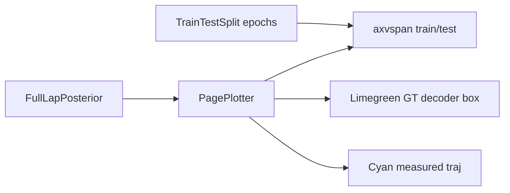

# Laps figure: colormap contrast + Train/Test spans

## Why the current figure is hard to read

[`_subfn_plot_laps_four_decoder_posterior_page`](h:/TEMP/Spike3DEnv_ExploreUpgrade/Spike3DWorkEnv/pyPhoPlaceCellAnalysis/src/pyphoplacecellanalysis/General/Pipeline/Stages/ComputationFunctions/MultiContextComputationFunctions/DirectionalPlacefieldGlobalComputationFunctions.py) defaults to **Oranges** + a **red** measured-position line — same hue family, so decode–trajectory distance is hard to see.

Existing posterior export formats (`greyscale`, `greyscale_shared_norm`, `viridis_shared_norm`) already prefer cooler/perceptually uniform maps; this display path never used them.

**Chosen defaults (not a menu of options):**
- Posterior cmap: `viridis` via `get_heatmap_cmap(cmap='viridis', bad_color='black', under_color='black', over_color='white')`
- Measured line: solid cyan `#00e5ff` at alpha `0.85` (high contrast on viridis; does not collide with limegreen GT boxes)

Both remain overridable via existing `cmap` / post-plot line styling kwargs.

## Train / Test annotation (within-lap)

KDIBA default split is **within each lap** (`train_test_full_lap=False`): each `lap_id` has a train fragment and a test fragment in `TrainTestSplitResult.train_epochs_dict` / `test_epochs_dict` (keyed by decoder name). A whole-row “Train”/“Test” badge would be wrong.

Reuse the matplotlib debug palette from `TrainTestLapsSplitting.debug_draw_laps_train_test_split_epochs`:
- **test** = purple `axvspan` (alpha ~0.12)
- **train** = light green `axvspan` (alpha ~0.08) — distinct from limegreen GT decoder box
- Left-column ylabel: `Lap {lap_id}` (no Train/Test word on the row)

If `computed_data['TrainTestSplit']` is missing, skip spans and print a one-line warn; still export the figure.

## Implementation (display path only)

Edit nested helpers inside `_display_laps_correct_decoder_side_by_side_posteriors` in [`DirectionalPlacefieldGlobalComputationFunctions.py`](h:/TEMP/Spike3DEnv_ExploreUpgrade/Spike3DWorkEnv/pyPhoPlaceCellAnalysis/src/pyphoplacecellanalysis/General/Pipeline/Stages/ComputationFunctions/MultiContextComputationFunctions/DirectionalPlacefieldGlobalComputationFunctions.py):

1. **Colormap + measured line** in `_subfn_plot_laps_four_decoder_posterior_page` (~10766, ~10789–10794):
   - Change default `get_heatmap_cmap(...)` to `viridis` as above
   - After `plot_1D_most_likely_position_comparsions`, set measured line color/alpha to cyan `#00e5ff` / `0.85`

2. **Resolve train/test intervals per lap** in `_subfn_export_laps_four_decoder_gt_boxed_combined_figure` / page plotter:
   - Pull `TrainTestSplit` from `global_computation_results.computed_data` (already available in the outer display fn)
   - For each page row’s `lap_id` (from `laps_epochs_df`), look up matching start/stop rows in `test_epochs_dict[truth_decoder_name]` and `train_epochs_dict[truth_decoder_name]` (same intervals apply across the four columns)
   - Pass those intervals into the page plotter; after each axis is drawn, `axvspan` train/test over the shared time xlim

3. **Docstring / completion kwargs**: note new defaults in the display docstring; no required change to [`figures_export_laps_correct_decoder_side_by_side_completion_function`](h:/TEMP/Spike3DEnv_ExploreUpgrade/Spike3DWorkEnv/pyPhoPlaceCellAnalysis/src/pyphoplacecellanalysis/General/Batch/BatchJobCompletion/UserCompletionHelpers/batch_user_completion_helpers.py) unless you want an explicit `cmap=` passthrough later (kwargs already forward).

