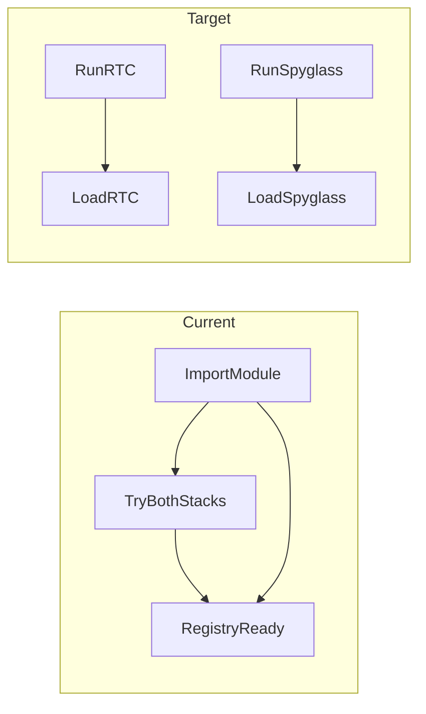

# Lazy clusterless imports in DefaultComputationFunctions

## Problem

Module import currently runs one combined `try`/`except` ([lines 19–45](h:\TEMP\Spike3DEnv_ExploreUpgrade\Spike3DWorkEnv\pyPhoPlaceCellAnalysis\src\pyphoplacecellanalysis\General\Pipeline\Stages\ComputationFunctions\DefaultComputationFunctions.py)) that pulls in:

- `replay_trajectory_classification` via [`rtc_clusterless_decoder.py`](h:\TEMP\Spike3DEnv_ExploreUpgrade\Spike3DWorkEnv\pyPhoPlaceCellAnalysis\src\pyphoplacecellanalysis\Analysis\Decoder\rtc_clusterless_decoder.py) / [`rtc_clusterless_adapters.py`](h:\TEMP\Spike3DEnv_ExploreUpgrade\Spike3DWorkEnv\pyPhoPlaceCellAnalysis\src\pyphoplacecellanalysis\Analysis\Decoder\rtc_clusterless_adapters.py)
- `non_local_detector` via [`spyglass_clusterless_decoder.py`](h:\TEMP\Spike3DEnv_ExploreUpgrade\Spike3DWorkEnv\pyPhoPlaceCellAnalysis\src\pyphoplacecellanalysis\Analysis\Decoder\spyglass_clusterless_decoder.py) / [`spyglass_clusterless_adapters.py`](h:\TEMP\Spike3DEnv_ExploreUpgrade\Spike3DWorkEnv\pyPhoPlaceCellAnalysis\src\pyphoplacecellanalysis\Analysis\Decoder\spyglass_clusterless_adapters.py)

That runs whenever the computation registry loads, even for pipelines that never call `position_decoding_clusterless` or `position_decoding_spyglass_clusterless`. A failure in either stack also disables both steps via `_CLUSTERLESS_DECODER_AVAILABLE`.



## Implementation (single file)

**File:** [`DefaultComputationFunctions.py`](h:\TEMP\Spike3DEnv_ExploreUpgrade\Spike3DWorkEnv\pyPhoPlaceCellAnalysis\src\pyphoplacecellanalysis\General\Pipeline\Stages\ComputationFunctions\DefaultComputationFunctions.py)

### 1. Delete module-level optional block

Remove the unified `try`/`except`, all `None` fallbacks, and `_require_clusterless_decoder_imports()`.

### 2. Add two cached lazy loaders (module level, after standard imports)

Replace with small helpers (~25 lines total):

- **`_get_rtc_clusterless_imports()`** — on first call, import and cache a tuple:
  - `ClusterlessRTCPositionDecoder` from `rtc_clusterless_decoder`
  - `ClusterlessDecodingParameters`, `build_multiunits_from_spike_events`, `load_clusterless_spike_events` from `rtc_clusterless_adapters`
  - On `ImportError`, raise with message naming **`replay_trajectory_classification`** (and chained `from e`).

- **`_get_spyglass_clusterless_imports()`** — on first call, import and cache:
  - `SpyglassClusterlessDecoder` from `spyglass_clusterless_decoder`
  - `SpyglassClusterlessDecodingParameters`, `build_is_training_mask`, `clusterless_events_to_spyglass_spike_lists`, `epochs_from_pfnd`, `pfnd_to_spyglass_position_info` from `spyglass_clusterless_adapters`
  - On `ImportError`, raise with message naming **`non_local_detector`**.

Use module-level `_rtc_clusterless_imports_cache: Optional[tuple] = None` and `_spyglass_clusterless_imports_cache: Optional[tuple] = None` so repeated pipeline runs pay import cost once per process.

Keep signatures on one line per project rules; group return tuple unpacking on one line in each computation function if under 400 chars.

### 3. Wire RTC computation function

In `_perform_clusterless_position_decoding_computation`:

- Replace `_require_clusterless_decoder_imports()` with unpacking from `_get_rtc_clusterless_imports()` at the top of the method body (before nested `_build_decoder_for_pf`, so closure sees real names).
- Keep existing in-function `from replay_trajectory_classification import ...` (already lazy); no behavior change there.

**Annotation fix (minimal):** Line 173 uses `ClusterlessSpikeEvents` in an annotation but nothing defines it at class body time. Add a lightweight always-available import next to other NeuroPy imports:

`from neuropy.core.clusterless_spike_events import ClusterlessSpikeEvents`

(NeuroPy is already required for this module; this does not pull optional decoder stacks.)

### 4. Wire Spyglass computation function

In `_perform_spyglass_clusterless_position_decoding_computation`:

- Replace `_require_clusterless_decoder_imports()` with unpacking from `_get_spyglass_clusterless_imports()`.
- Extend the existing in-function NeuroPy import to include **`load_clusterless_spike_events`** so Spyglass no longer depends on `rtc_clusterless_adapters` for event loading (avoids dragging `replay_trajectory_classification` into the Spyglass path).

```python
from neuropy.core.clusterless_spike_events import ClusterlessSpikeEvents, default_clusterless_spike_events_path, load_clusterless_spike_events
```

### 5. What stays unchanged

- `@function_attributes(..., uses=[...])` metadata strings — no import needed.
- Decoder modules themselves — still eager-import their backends (out of scope).
- Other call sites ([`reconstruction.py`](h:\TEMP\Spike3DEnv_ExploreUpgrade\Spike3DWorkEnv\pyPhoPlaceCellAnalysis\src\pyphoplacecellanalysis\Analysis\Decoder\reconstruction.py), batch completion helpers) — already import decoders locally when needed.
- Existing AST registration tests in [`test_rtc_clusterless_decoder.py`](h:\TEMP\Spike3DEnv_ExploreUpgrade\Spike3DWorkEnv\pyPhoPlaceCellAnalysis\tests\test_rtc_clusterless_decoder.py) / [`test_spyglass_clusterless_decoder.py`](h:\TEMP\Spike3DEnv_ExploreUpgrade\Spike3DWorkEnv\pyPhoPlaceCellAnalysis\tests\test_spyglass_clusterless_decoder.py) — only assert method names in source; no test updates required.

## Verification

From `pyPhoPlaceCellAnalysis` project root (with env synced):

1. **Import smoke:** `python -c "from pyphoplacecellanalysis.General.Pipeline.Stages.ComputationFunctions.DefaultComputationFunctions import DefaultComputationFunctions"` — should succeed without `replay_trajectory_classification` / `non_local_detector` if those are absent (main win).
2. **Optional stack tests (if extras installed):** `uv run pytest tests/test_rtc_clusterless_decoder.py tests/test_spyglass_clusterless_decoder.py -q --tb=short` (or subset: registration tests + any integration tests you normally run).
3. **Behavior spot-check:** If both optional deps are present, run one pipeline step or existing test that exercises `_perform_clusterless_position_decoding_computation` / `_perform_spyglass_clusterless_position_decoding_computation` to confirm lazy path matches prior behavior.

## Risk notes

- **Pickle/dill:** Unpickling saved `SpyglassClusterlessDecoder` / `ClusterlessRTCPositionDecoder` objects still requires importing those decoder modules in the unpickling process — unchanged from today.
- **Independent failures:** After this change, missing `non_local_detector` no longer blocks RTC clusterless registration/import of `DefaultComputationFunctions`, and vice versa.
