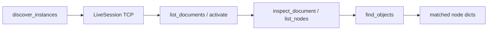

# Live VectorCraft Scripting Bridge

## Context

Headless CLI already lives in [`EXTERNAL/VectorCraft_Scripting/src/vectorcraft_scripting/`](h:\TEMP\Spike3DEnv_ExploreUpgrade\Spike3DWorkEnv\Spike3D\EXTERNAL\VectorCraft_Scripting\src\vectorcraft_scripting\) (`VectorCraftClient`). Live GUI automation uses `vectorcraft --control PORT` on `127.0.0.1` (default **7979**): one JSON request line → one reply line (`{"id", "method", "params"}` → `{"id", "ok", "result"|"error"}`).

Relevant engine commands (from installed `vectorcraft-cli commands`):

| Need | Protocol / command |
|------|-------------------|
| Instance | TCP connect + `ui.inspect` handshake |
| Open docs | Probe `document.activate {index}` then `file.info` / `document.inspect` (no dedicated docs-list API) |
| Contents | Control method `document.inspect` (`depth`, `childLimit`, `kind`, `ids`, `limit`, `offset`) and `document.node` |
| Search | Engine `document.find {name?, kind?, text?, limit?}` plus client-side **bounds/size** filters |

Prerequisite: the desktop app must be started with control enabled, e.g. `vectorcraft --control 7979`. Discovery will not launch the GUI.

## Architecture



New modules under the existing package (keep `VectorCraftClient` for headless):

```
src/vectorcraft_scripting/
  control.py      # low-level JSON-lines TCP client
  discovery.py    # find listening VectorCraft control ports (Windows-aware)
  live.py         # LiveVectorCraft high-level API
  find.py         # ObjectQuery + client-side size/bounds matching
  errors.py       # add ControlError / NoInstanceError
  __init__.py     # export live API
```

## Implementation

### 1. `control.py` — `ControlConnection`

- Connect to `127.0.0.1:port` with connect/read timeouts (default connect 0.5s, request 60s matching protocol).
- `call(method, params=None, id=...)` writes one JSON line, reads one reply line, raises `ControlError` if `ok` is false.
- Context manager / explicit `close()`; reconnect-friendly (protocol closes on bad lines).
- Helpers: `ui_inspect()`, `engine_execute(command, params)`, `engine_commands()`.

### 2. `discovery.py` — running instances

`discover_instances(...) -> list[LiveInstance]` where each entry has `host`, `port`, optional `pid`, and a short `ui_inspect` snapshot.

Resolution order:

1. Explicit `ports=` argument
2. `VECTORCRAFT_CONTROL_PORT` / `VECTORCRAFT_CONTROL_PORTS` (comma-separated)
3. Default `7979`
4. On Windows: PowerShell `Get-NetTCPConnection -State Listen -LocalAddress 127.0.0.1` joined to processes named `vectorcraft` / `VectorCraft` to collect candidate ports
5. For every candidate, TCP handshake with `{"method":"ui.inspect","id":1,"params":{}}`; keep only successful replies

`connect_first(...)` returns a `LiveVectorCraft` for the first healthy instance (or raises `NoInstanceError` with searched ports).

### 3. `live.py` — `LiveVectorCraft`

Wraps `ControlConnection`:

- `list_documents()` — walk `index = 0, 1, …` with `engine.execute document.activate {index}` until failure; for each success call `file.info` (empty params) and record `{index, title, colorMode, units, artboards, objects, …}`; restore the originally active index afterward.
- `activate_document(index)` / `active_document_info()`
- `inspect_document(**params)` → control method `document.inspect` (layer tree / scoped `nodes`)
- `list_nodes(*, kind=None, depth=0, child_limit=None, limit=None, offset=None)` — thin wrapper preferring scoped inspect
- `get_node(id, summary=True, ...)` → `engine.execute document.node`
- `find_objects(query: ObjectQuery | dict)` — see below
- `execute(command, params)` / `call(method, params)` for escape hatches

### 4. `find.py` — search criteria

`ObjectQuery` fields:

- Native `document.find`: `name` (substring), `kind` (exact panel label: Path, Group, Type, Image, …), `text` (type substring), `limit`
- Client-side (after find and/or `document.inspect` node list): `name_regex`, `min_width` / `max_width` / `min_height` / `max_height` (from node `bounds`), `visible` / `locked` booleans

Flow:

1. If name/kind/text present → `document.find`, then optionally `document.inspect {ids: [...]}` to attach bounds/paint.
2. Else if kind-only via inspect paging, or size-only → page `document.inspect {kind?, limit, offset}` / depth-sliced tree and filter locally.
3. Apply size/visibility filters in Python; return list of node dicts (`id`, `name`, `kind`, `path`, `bounds`, …).

### 5. Exports + docs

- Update [`__init__.py`](h:\TEMP\Spike3DEnv_ExploreUpgrade\Spike3DWorkEnv\Spike3D\EXTERNAL\VectorCraft_Scripting\src\vectorcraft_scripting\__init__.py) to export `LiveVectorCraft`, `discover_instances`, `connect_first`, `ObjectQuery`, new errors.
- Expand [`README.md`](h:\TEMP\Spike3DEnv_ExploreUpgrade\Spike3DWorkEnv\Spike3D\EXTERNAL\VectorCraft_Scripting\README.md) with live section: start app with `--control`, discovery, list docs, inspect, find-by-size example.
- Append a short **Live session** section to [`notebooks/VectorCraft_Scripting.ipynb`](h:\TEMP\Spike3DEnv_ExploreUpgrade\Spike3DWorkEnv\Spike3D\EXTERNAL\VectorCraft_Scripting\notebooks\VectorCraft_Scripting.ipynb) using the same import style (guarded if no instance is running).

## Smoke check

With VectorCraft running as `vectorcraft --control 7979`:

```python
from vectorcraft_scripting import discover_instances, connect_first, ObjectQuery
print(discover_instances())
live = connect_first()
print(live.list_documents())
print(live.inspect_document(depth=0, child_limit=20))
print(live.find_objects(ObjectQuery(kind="Path", min_width=100, max_width=400)))
```

Without a live app, `discover_instances()` returns `[]` and `connect_first()` raises `NoInstanceError` (documented).

## Out of scope

- Auto-launching the GUI
- MCP stdio client
- Mutating/place/export via live session (can use existing `execute` escape hatch; dedicated helpers later)