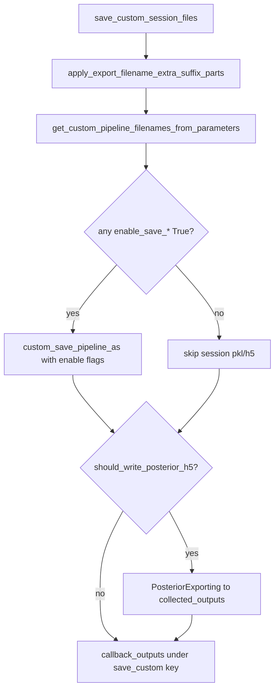

# Merge export_session_h5 into save_custom_session_files

Target checkout: [H:\TEMP\Spike3DEnv_ExploreUpgrade\Spike3DWorkEnv\pyPhoPlaceCellAnalysis](H:\TEMP\Spike3DEnv_ExploreUpgrade\Spike3DWorkEnv\pyPhoPlaceCellAnalysis) (`develop`) plus batch scripts under [H:\TEMP\Spike3DEnv_ExploreUpgrade\Spike3DWorkEnv\Spike3D](H:\TEMP\Spike3DEnv_ExploreUpgrade\Spike3DWorkEnv\Spike3D). That is the live ExploreUpgrade workenv matching the failing log. Do not change the separate `C:\Users\pho\repos\Spike3DWorkEnv` paper/release checkout in this pass.

## Behavior after merge

[`save_custom_session_files_completion_function`](H:\TEMP\Spike3DEnv_ExploreUpgrade\Spike3DWorkEnv\pyPhoPlaceCellAnalysis\src\pyphoplacecellanalysis\General\Batch\BatchJobCompletion\UserCompletionHelpers\batch_user_completion_helpers.py) becomes the single session-file completion function:

```python
def save_custom_session_files_completion_function(
    self, global_data_root_parent_path, curr_session_context, curr_session_basedir,
    curr_active_pipeline, across_session_results_extended_dict: dict,
    export_filename_extra_suffix_parts: Optional[List[str]] = None,
    enable_save_pipeline_pkl: bool = True,
    enable_save_global_computations_pkl: bool = True,
    enable_save_h5: bool = True,                 # session pipeline_*.h5 (was should_write_pipeline_h5)
    should_write_posterior_h5: bool = True,      # collected_outputs decoded_posteriors H5
) -> dict:
```



### H5 path conventions (preserve exactly)

- **Session pipeline H5:** via `custom_save_pipeline_as(..., enable_save_h5=True)` → same custom-suffix names already used by `save_custom` (e.g. `pipeline_withNormalComputedReplays-qclu_...-frateThresh_2.0.h5` under session `output/`).
- **Posteriors H5:** copy the block from `export_session_h5` unchanged:
  - `active_export_parent_output_path = self.collected_outputs_path.resolve()`
  - `PosteriorExporting.build_custom_export_to_h5_path(..., data_identifier_str='(decoded_posteriors)', a_tbin_size=ripple_decoding_time_bin_size, parent_output_path=...)`
  - `perform_save_all_decoded_posteriors_to_HDF5(...)`

### Implementation details in `save_custom`

1. **Wire kwargs for real:** pass `enable_save_pipeline_pkl`, `enable_save_global_computations_pkl`, `enable_save_h5` into `custom_save_pipeline_as` (today they are printed but hardcoded `True`).
2. **Skip session save when all three `enable_save_*` are False** so posterior-only runs stay cheap (parity with old `should_write_pipeline_h5=False`).
3. **Move posterior export body** from `export_session_h5` into `save_custom` behind `should_write_posterior_h5` (default `True` so phase3 still writes posteriors after removing the old function).
4. **callback_outputs** stay under `'save_custom_session_files_completion_function'` and add:
   - `hdf5_output_path` when `enable_save_h5` and path present in `custom_save_filepaths_dict`
   - `posteriors_h5` when posterior export succeeds
5. **Delete** `export_session_h5_file_completion_function` entirely (definition + all registrations).

Kwarg mapping for callers: `should_write_pipeline_h5` → `enable_save_h5`; keep `should_write_posterior_h5` name.

## Call-site / registration updates

| File | Change |
|------|--------|
| [`batch_user_completion_helpers.py`](H:\TEMP\Spike3DEnv_ExploreUpgrade\Spike3DWorkEnv\pyPhoPlaceCellAnalysis\src\pyphoplacecellanalysis\General\Batch\BatchJobCompletion\UserCompletionHelpers\batch_user_completion_helpers.py) | Merge logic; remove function; drop from `MAIN_get_template_string` catalog (~5067) |
| [`pythonScriptTemplating.py`](H:\TEMP\Spike3DEnv_ExploreUpgrade\Spike3DWorkEnv\pyPhoPlaceCellAnalysis\src\pyphoplacecellanalysis\General\Batch\pythonScriptTemplating.py) | Drop import + phase3 entry (~222); update `enable_hdf5_output=False` comments to point at `save_custom` |
| [`pipeline_ipywidgets.py`](H:\TEMP\Spike3DEnv_ExploreUpgrade\Spike3DWorkEnv\pyPhoPlaceCellAnalysis\src\pyphoplacecellanalysis\GUI\IPyWidgets\pipeline_ipywidgets.py) | Update comment ~139 |
| [`ProcessBatchOutputs_qclus1246789_Only.ipy`](H:\TEMP\Spike3DEnv_ExploreUpgrade\Spike3DWorkEnv\Spike3D\ProcessBatchOutputs_qclus1246789_Only.ipy) | Replace override ~417 with `'save_custom_session_files_completion_function': dict(enable_save_h5=True, should_write_posterior_h5=False, ...)` (merge with any existing `export_filename_extra_suffix_parts` override) |
| Other `ProcessBatchOutputs*.ipy` | Remove `export_session_h5` from imports / commented override dicts |

After library change, regenerate batch per-session scripts if you rely on embedded sources from `MAIN_get_template_string` (next script-gen run picks this up).

## Out of scope

- Mass-editing archival `ReviewOfWork_*.ipynb` cells that still call/read `export_session_h5_file_completion_function` (no runtime consumers in `.py`). When those notebooks are reused, switch to `save_custom` and read `across_session_results['save_custom_session_files_completion_function']` for `posteriors_h5` / `hdf5_output_path`.
- Fixing the separate `_VersionedResultMixin_version` HDF write error from the log (unchanged by this merge).
