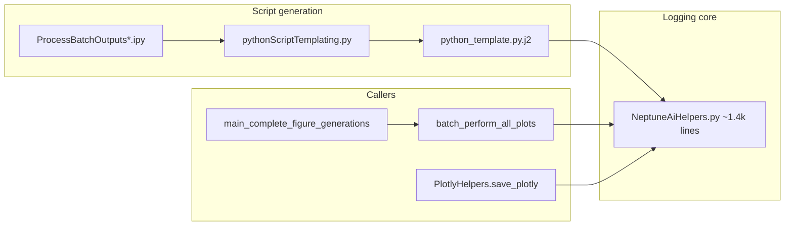

# Neptune.ai → CoreWeave W&B migration

## Current architecture

Neptune is not scattered across the monorepo; almost all runtime behavior lives in one module and flows through batch script generation.



**What Neptune does today (must be preserved in W&B terms):**

| Capability | Neptune today | W&B target (Forge cloud) |
| --- | --- | --- |
| Batch Slurm scripts | [`python_template.py.j2`](h:\TEMP\Spike3DEnv_ExploreUpgrade\Spike3DWorkEnv\pyPhoPlaceCellAnalysis\src\pyphoplacecellanalysis\Resources\Templates\python_template.py.j2): init run, log `parameters/*`, `outputs/*`, upload `outputs/log` | `wandb.init` + `run.config` / `run.summary` + **Artifacts** (log file, large outputs) + optional `wandb.log` for scalars |
| Figure batch upload | `Neptuner.upload_figures` → nested `outputs/figures/{context path}` | `wandb.log({key: wandb.Image(path)})` or artifact per session; **tags** + **job_type** (`run` vs `figures`) |
| Interactive figure pipeline | `batch_perform_all_plots(..., enable_neptune=True)` | Same flow with `enable_wandb=True` |
| Result fetching / log browser | `Neptuner.get_most_recent_session_runs`, `NeptuneRunCollectedResults`, `PhoDibaProjectsNeptuner` (2 Neptune projects), ipywidgets tree | `wandb.Api().runs(f"{entity}/{project}")`, filter/group on `config.session_descriptor_string`; single project per your choice |
| Local log VSCode workspace | [`build_vscode_log_browsing_workspace`](h:\TEMP\Spike3DEnv_ExploreUpgrade\Spike3DWorkEnv\pyPhoPlaceCellAnalysis\src\pyphoplacecellanalysis\General\Batch\NeptuneAiHelpers.py) under `data/neptune/` | Same helper, default paths → `data/wandb/logs` (keep accepting old paths if passed explicitly) |

**Auth (per [CoreWeave W&B quickstart](https://docs.coreweave.com/products/wandb/quickstart.md) and [environment variables](https://docs.coreweave.com/products/wandb/track/environment-variables)):**

- **`WANDB_API_KEY`** only for Forge multi-tenant cloud (no `WANDB_BASE_URL` required).
- **`WANDB_ENTITY`** and **`WANDB_PROJECT`** for the consolidated project (your choice: one project, distinguish runs via `job_type`, `group`, and `tags`).
- **Remove all hardcoded Neptune JWT tokens** from [`NeptuneAiHelpers.py`](h:\TEMP\Spike3DEnv_ExploreUpgrade\Spike3DWorkEnv\pyPhoPlaceCellAnalysis\src\pyphoplacecellanalysis\General\Batch\NeptuneAiHelpers.py), the Jinja template, and [`LibrariesExamples/Neptune/test_neptune.py`](h:\TEMP\Spike3DEnv_ExploreUpgrade\Spike3DWorkEnv\Spike3D\LibrariesExamples\Neptune\test_neptune.py).

**Dependencies:**

- [`Spike3D/pyproject.toml`](h:\TEMP\Spike3DEnv_ExploreUpgrade\Spike3DWorkEnv\Spike3D\pyproject.toml): drop `neptune>=1.2.0,<2` ( **`wandb>=0.26.1` already present** ).
- [`pyPhoPlaceCellAnalysis/pyproject.toml`](h:\TEMP\Spike3DEnv_ExploreUpgrade\Spike3DWorkEnv\pyPhoPlaceCellAnalysis\pyproject.toml): add `wandb` so batch helpers work when the package is used outside Spike3D.
- Run `uv sync --all-extras` in Spike3D after dependency edits.

---

## Implementation plan

### 1. New module: `WandbHelpers.py`

Add [`General/Batch/WandbHelpers.py`](h:\TEMP\Spike3DEnv_ExploreUpgrade\Spike3DWorkEnv\pyPhoPlaceCellAnalysis\src\pyphoplacecellanalysis\General\Batch\WandbHelpers.py) by porting structure from `NeptuneAiHelpers.py` with these types (rename for clarity, keep shared NewTypes like `SessionDescriptorString`, `RunID`):

| Old | New |
| --- | --- |
| `KnownNeptuneProjects` | `KnownWandbProjects` — returns `{entity, project}` from env with defaults (e.g. project `PhoDibaBatch`) |
| `set_environment_variables(..., enable_neptune=)` | `set_wandb_environment_variables(..., enable_wandb=)` — sets `WANDB_API_KEY`, `WANDB_ENTITY`, `WANDB_PROJECT` when provided |
| `AutoValueConvertingNeptuneRun` | `WandbRunHelper` — wraps active `wandb.sdk.wandb_run.Run`: config updates (DataFrame → `wandb.Table` or CSV artifact), Path → string, `IdentifyingContext` → description string |
| `Neptuner` | `WandbLogger` — `init_with_pipeline`, `run_with_pipeline`, `upload_figures`, `get_runs_table`, `get_most_recent_session_runs`, `stop` |
| `NeptuneRunCollectedResults` | `WandbRunCollectedResults` — rebuild using `wandb.Api` run history + downloaded log artifacts |
| `PhoDibaProjectsNeptuner` | `PhoDibaProjectsWandbLogger` — **collapse to single project**: same API surface for notebooks but one underlying `WandbLogger` (batch vs figure distinguished by `job_type` / tags, not separate projects) |
| `neptune_output_figures` | `wandb_output_figures` |

**Neptune-specific code to drop or replace:**

- `neptune.Project`, `run.print_structure()` parsing, `monitoring/.../stdout` StringSeries → rely on **uploaded batch log artifact** + optional `WANDB_CONSOLE` for live capture.
- `run.sync()` → W&B flush via `run.finish()` / context manager exit.

**Keep unchanged (move as-is):** `flatten_context_nested_dict`, `build_vscode_log_browsing_workspace` (update default path comments only), ANSI/quote utilities, ipywidgets tree builder (parameter renames only).

### 2. Compatibility shim: `NeptuneAiHelpers.py`

Replace body with thin deprecated re-exports to `WandbHelpers` (e.g. `Neptuner = WandbLogger`, `KnownNeptuneProjects` → `KnownWandbProjects` with renamed methods aliased) so existing notebooks and EXTERNAL docs keep working until updated. Emit `DeprecationWarning` on import.

Then delete direct `import neptune` from the shim once callers are migrated.

### 3. Batch script template and templating API

**[`python_template.py.j2`](h:\TEMP\Spike3DEnv_ExploreUpgrade\Spike3DWorkEnv\pyPhoPlaceCellAnalysis\src\pyphoplacecellanalysis\Resources\Templates\python_template.py.j2):**

- Replace `` blocks with `should_use_wandb_logging`.
- Pattern:

```python
import wandb
from pyphoplacecellanalysis.General.Batch.WandbHelpers import WandbLogger, WandbRunHelper, wandb_stringify_unsupported

wandb_logger = WandbLogger.init_for_batch_script(
    curr_session_context=..., script_type=..., job_suffix=..., script_file_path=...,
)
wandb_run = wandb_logger.run
# log config/summary equivalents; upload final_log_file_path as Artifact at end
wandb_logger.finish()
```

- Map old fields:
  - Session context keys → `wandb.config`
  - Tags / group_tags → `tags=` and `group=` on `wandb.init`
  - `outputs/*` → `run.summary` + artifacts for bulky objects
  - Figures namespace → `wandb.log` keys mirroring prior path strings (slashes → W&B-safe keys)

**[`pythonScriptTemplating.py`](h:\TEMP\Spike3DEnv_ExploreUpgrade\Spike3DWorkEnv\pyPhoPlaceCellAnalysis\src\pyphoplacecellanalysis\General\Batch\pythonScriptTemplating.py):**

- Rename `should_use_neptune_logging` → `should_use_wandb_logging` (default `True` where Neptune defaulted).
- **`get_batch_neptune_kwargs`** → **`get_batch_wandb_kwargs`** (return entity/project from `KnownWandbProjects`).
- Accept `should_use_neptune_logging=` as deprecated kwarg alias mapping to `should_use_wandb_logging` so existing [`.ipy` batch drivers](h:\TEMP\Spike3DEnv_ExploreUpgrade\Spike3DWorkEnv\Spike3D\ProcessBatchOutputs.ipy) need no immediate edits.

### 4. Downstream callers (minimal signature renames)

| File | Change |
| --- | --- |
| [`NonInteractiveProcessing.py`](h:\TEMP\Spike3DEnv_ExploreUpgrade\Spike3DWorkEnv\pyPhoPlaceCellAnalysis\src\pyphoplacecellanalysis\General\Batch\NonInteractiveProcessing.py) | `batch_perform_all_plots`: `enable_neptune` → `enable_wandb`, `neptuner` → `wandb_logger`; import `WandbLogger` |
| [`PhoDiba2023Paper.py`](h:\TEMP\Spike3DEnv_ExploreUpgrade\Spike3DWorkEnv\pyPhoPlaceCellAnalysis\src\pyphoplacecellanalysis\SpecificResults\PhoDiba2023Paper.py) | `enable_default_neptune_plots` → `enable_default_wandb_plots` (+ deprecated alias) |
| [`plotly_templates.py`](h:\TEMP\Spike3DEnv_ExploreUpgrade\Spike3DWorkEnv\pyPhoPlaceCellAnalysis\src\pyphoplacecellanalysis\Pho2D\plotly\plotly_templates.py) | `neptuner_run` kwarg → `wandb_run` (keep `neptuner_run` alias); upload via `wandb.Image` / artifact |

### 5. Repo hygiene (Spike3D)

- Replace [`LibrariesExamples/Neptune/`](h:\TEMP\Spike3DEnv_ExploreUpgrade\Spike3DWorkEnv\Spike3D\LibrariesExamples\Neptune) with a small `LibrariesExamples/Wandb/` smoke script using `WANDB_API_KEY` + `wandb.init(mode="disabled")` for CI-safe import test.
- **Notebooks:** [`EXTERNAL/PhoDibaPaper2024Book/neptune_result_fetching.ipynb`](h:\TEMP\Spike3DEnv_ExploreUpgrade\Spike3DWorkEnv\Spike3D\EXTERNAL\PhoDibaPaper2024Book\neptune_result_fetching.ipynb) and paper notebook cells — update imports to `WandbHelpers` and rename notebook only if you want (optional rename to `wandb_result_fetching.ipynb`). Per workspace rules, confirm before editing `.ipynb` files not opened in this chat; plan assumes **one dedicated follow-up pass** on those notebooks after core helpers land.

### 6. Verification

- `uv run python -c "from pyphoplacecellanalysis.General.Batch.WandbHelpers import WandbLogger"` (import smoke).
- Generate one batch script with `should_use_wandb_logging=True` and inspect emitted code (no `neptune`, no embedded secrets).
- Optional integration: `WANDB_MODE=offline` run of a tiny script that mimics template init/finish.
- Grep repo for `import neptune` / `NEPTUNE_` — expect zero outside deprecation shim and historical notebooks until notebook pass.

---

## Config you will set locally (not committed)

```powershell
$env:WANDB_API_KEY = "<Forge user or service account key>"
$env:WANDB_ENTITY = "<your-forge-entity>"
$env:WANDB_PROJECT = "PhoDibaBatch"
# Optional on Great Lakes / Slurm job prolog:
# export WANDB_API_KEY=... WANDB_ENTITY=... WANDB_PROJECT=PhoDibaBatch
```

On login nodes: `wandb login --cloud` per [CoreWeave CLI docs](https://docs.coreweave.com/products/wandb/ref/cli/wandb-login.md) if not using env-only auth.

---

## Risk notes

- **Historical Neptune runs** are not auto-migrated; W&B will only receive new runs. Keep Neptune read-only access separately if you still need old figure/log downloads.
- **Run table column names** in fetching helpers will change from Neptune `sys/*` columns to W&B run attributes (`config.*`, `summary.*`); notebook cells that assume Neptune column names need updating in the notebook pass.
- **`stringify_unsupported`**: implement a small local helper (JSON-safe repr) where the template currently uses Neptune’s utility.
