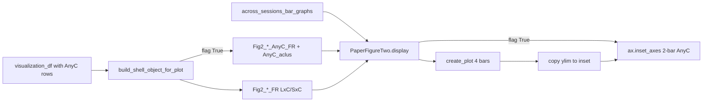

# Non-XdC Fig2 Bar Inset

## Decisions (locked)
- Inset: 2-bar AnyC only (Δ− vs Δ+), mean±err + scatter; main 4-bar LxC/SxC unchanged
- Data: attach AnyC shell fields only when the flag is True (option B)
- Y-scale: share the main axes ylim (set inset ylim to match after main plot)

## Data flow



## 1. Flag entry point — [`AcrossSessionResults.py`](h:\TEMP\Spike3DEnv_ExploreUpgrade\Spike3DWorkEnv\pyPhoPlaceCellAnalysis\src\pyphoplacecellanalysis\SpecificResults\AcrossSessionResults.py)

In `across_sessions_bar_graphs` (~3787):
- Add explicit param `include_non_XdC_cells_as_inset: bool = True` (also accept via kwargs for callers that only pass `**fig2_kwargs`)
- Pop from kwargs before `display(...)` so it does not leak into `create_plot`
- Pass it through to `PaperFigureTwo.display(...)`

Docstring note: when True, expects `Fig2_Laps_AnyC_FR` / `Fig2_Replay_AnyC_FR` (or live `AnyC_*` trends) on the computation result.

## 2. Flag-gated shell AnyC — same file, `build_shell_object_for_plot` (~280)

Add param `include_non_XdC_cells_as_inset: bool = False` (default False here so existing shell builds stay LxC/SxC-only unless requested).

When True and membership column has `'AnyC'`:
- `AnyC_df = grouped_df.get_group('AnyC')` (empty-safe if group missing)
- Build `AnyC_aclus`, muted scatter props (same marker pattern as LxC/SxC)
- Build 2-element lists:
  - `Fig2_Laps_AnyC_FR`: AnyC `lap_delta_minus` / `lap_delta_plus`
  - `Fig2_Replay_AnyC_FR`: AnyC PBE columns (same `PBE_col_variable_names` as main)
- Attach on `_shell_obj`: `AnyC_aclus`, `Fig2_Laps_AnyC_FR`, `Fig2_Replay_AnyC_FR`

Update the publication usage example (~323–327) to pass the flag into both shell builder and `across_sessions_bar_graphs` when desired.

## 3. Live computation path — [`LongShortTrackComputations.py`](h:\TEMP\Spike3DEnv_ExploreUpgrade\Spike3DWorkEnv\pyPhoPlaceCellAnalysis\src\pyphoplacecellanalysis\General\Pipeline\Stages\ComputationFunctions\MultiContextComputationFunctions\LongShortTrackComputations.py) / display helper

For non-shell objects that already have `AnyC_Theta*` / `AnyC_Replay*`:
- In `PaperFigureTwo.display`, if flag True and `Fig2_*_AnyC_FR` missing, derive 2-bar `SingleBarResult` lists from `AnyC_*` `cell_agg_inst_fr_list`, excluding LxC/SxC aclus (mirror `get_summary_dataframe` ~3388–3390)
- Do not change `_perform_compute_spike_rate_bars` / main `Fig2_*_FR` (still LxC/SxC only)

## 4. Plot inset — [`PhoDiba2023Paper.py`](h:\TEMP\Spike3DEnv_ExploreUpgrade\Spike3DWorkEnv\pyPhoPlaceCellAnalysis\src\pyphoplacecellanalysis\SpecificResults\PhoDiba2023Paper.py) `PaperFigureTwo`

In `display` (~1175):
- `include_non_XdC_cells_as_inset = kwargs.pop('include_non_XdC_cells_as_inset', True)`
- After main theta/replay plots (+ stats overlays so significance bars stay on main):
  - If flag and AnyC data present: call new helper `add_non_XdC_inset(ax, anyc_bar_results, ...)`
- Helper behavior:
  - `ax_inset = ax.inset_axes([0.62, 0.55, 0.35, 0.40])` (top-right; tweak if needed)
  - 2 bars + scatter using same style as `create_plot` but muted colors / smaller markers
  - Labels: `$AnyC$` Δ− / Δ+ (reuse `delta_minus_str` / `delta_plus_str`)
  - `ax_inset.set_ylim(ax.get_ylim())` — shared y-scale
  - No stats overlays / connection lines on inset
  - Store inset axes on the figure container (`plot_objects['anyc_inset']`)

## 5. Minimal call-site wiring

Only update the documented `fig2_kwargs` / shell-build path that already demonstrates Fig2 so callers can opt in with:

```python
fig2_kwargs = dict(..., include_non_XdC_cells_as_inset=True)
shell_obj, viz_df = build_shell_object_for_plot(..., include_non_XdC_cells_as_inset=True)
AcrossSessionsVisualizations.across_sessions_bar_graphs(shell_obj, ..., **fig2_kwargs)
```

No notebook edits unless a notebook is explicitly in scope later.

## Out of scope
- Changing main 4-bar layout or `pho_stats_bar_graph_t_tests`
- Always-on AnyC shell fields when flag is False
- Independent inset y-scale
