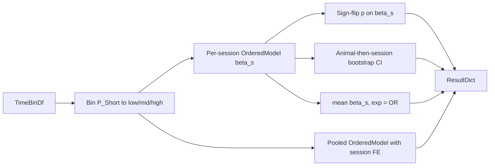

# Ordinal (low/mid/high) mode-shift model

All edits go in [PhoDiba2023Paper.py](h:\TEMP\Spike3DEnv_ExploreUpgrade\Spike3DWorkEnv\pyPhoPlaceCellAnalysis\src\pyphoplacecellanalysis\SpecificResults\PhoDiba2023Paper.py), inside `PrePostDeltaDistributionComparison`. `statsmodels.api as sm` is already imported at line 85. I'll use `statsmodels.miscmodels.ordinal_model.OrderedModel`.

## Why the inference works this way

Python has no ordinal mixed model equivalent to R's `ordinal::clmm`. Time bins within a lap or PBE are dependent, so the naive model-based standard errors from a pooled fit would be too small. I'll use the same **two-stage, session-as-unit** logic your existing `sampling_unit='session'` path uses:

1. **Per session:** fit `OrderedModel(category ~ is_post, distr='logit')` and keep `beta_s`, the shift in cumulative log-odds toward higher `P_Short` categories.
2. **Headline effect:** the mean of `beta_s` across sessions, so each session gets equal weight.
3. **p-value:** an exact or Monte Carlo sign-flip test on `beta_s`, matching `_paired_sign_permutation_test`.
4. **Confidence interval:** a hierarchical bootstrap that resamples animals, then sessions within animals, on `beta_s`. This is cheap because there is no refitting.
5. **Descriptive pooled fit:** `OrderedModel(category ~ is_post + session dummies)`, a within-session shift with session baselines absorbed. It is reported as `pooled_beta_session_fe` plus its naive standard error, flagged as anti-conservative.

`exp(beta)` is reported as the proportional odds ratio.



## 1. New classmethod (self-contained)

It goes right after `compute_mode_ratio` (around line 1534):

```python
@function_attributes(short_name=None, tags=['stats', 'fig4', 'P_Short', 'ordinal', 'proportional-odds', 'mode-ratio'], input_requires=[], output_provides=[], uses=['OrderedModel'], used_by=['run'], creation_date='2026-10-28 08:00', related_items=['compute_mode_ratio'])
@classmethod
def compute_ordinal_mode_shift(cls, df: pd.DataFrame, value_col='P_Short', condition_col='pre_post_delta_category', animal_col='animal', session_col='session_name', pre_label='pre-delta', post_label='post-delta', low_threshold: float = 0.25, high_threshold: float = 0.75, distr: str = 'logit', min_bins_per_condition: int = 10, n_bootstrap: int = 1000, n_permutations: int = 2000, random_state=None) -> Dict:
```

What it does:
- Validates the columns and thresholds, keeps only rows with the pre or post labels, and drops NaNs.
- Builds an ordered categorical with codes 0 for low (`< low_threshold`), 1 for mid, and 2 for high (`> high_threshold`).
- Loops over each `(animal, session)` group. It skips a session, recording the reason, when:
  - either condition has fewer than `min_bins_per_condition` bins, or
  - fewer than 2 categories are present.

  For eligible sessions it fits `OrderedModel(endog, exog=is_post[:, None], distr=distr).fit(method='bfgs', disp=False)` inside `try/except`. It records `beta`, `se`, `converged`, the category counts and fractions per condition, and `abs(beta) > 20` as a quasi-separation flag. Separated or non-converged sessions are excluded from inference but kept in the table.
- Runs the sign-flip test on the valid `beta_s` values, using its own `np.random.default_rng(random_state)`. It is exact when `2**n <= n_permutations`, mirroring lines 514-539.
- Runs the bootstrap: for each iteration, resample animals with replacement, then each animal's valid sessions with replacement, and take the mean of `beta_s`. The 95% interval is the 2.5% and 97.5% quantiles.
- Fits the pooled model with session fixed effects inside `try/except`.
- Includes `compute_mode_ratio(...)` output for each condition as a descriptive table.

It returns a dict with these keys:
- `mean_beta_post_minus_pre`, `odds_ratio`, `beta_bootstrap_95ci`, `odds_ratio_bootstrap_95ci`
- `p_value`, `p_value_method` (`exact` or `monte_carlo`), `n_sessions_used`, `n_sessions_skipped`, `n_animals_used`
- `animal_summary`: the mean `beta_s` per animal
- `session_summary`: a per-session `DataFrame` with the betas, counts, fractions, and status
- `pooled_beta_session_fe`, `pooled_se_naive`, `pooled_status`
- `category_fractions`: low/mid/high fractions per condition, pooled
- `low_threshold`, `high_threshold`, `distr`, `status`

The method uses `## END for ...` loop comments, one-line signatures, and two blank lines between methods.

## 2. Wire it into `run(...)` (lines 674-781)

- Extend the signature on one line: `def run(self, perform_block_permutation_test=False, n_permutations=2000, sampling_unit=None, perform_ordinal_mode_model: bool = True, ordinal_mode_kwargs: Optional[Dict] = None) -> Dict:`
- Before `return results`, add the following. `self._data` already holds the value, condition, animal, and session columns.

```python
if perform_ordinal_mode_model:
    _ordinal_kwargs = dict(value_col=self.value_col, condition_col=self.condition_col, animal_col=self.animal_col, session_col=self.session_col, pre_label=self.group_values[0], post_label=self.group_values[1], n_bootstrap=self.n_bootstrap, n_permutations=n_permutations, random_state=self.rng.integers(0, 2**32 - 1))
    _ordinal_kwargs.update(ordinal_mode_kwargs or {})
    try:
        results['ordinal_mode_model'] = self.compute_ordinal_mode_shift(self._data, **_ordinal_kwargs)
    except (ValueError, np.linalg.LinAlgError) as e:
        results['ordinal_mode_model'] = {'status': f'failed: {e}'}
```

- Add one docstring line noting the new `ordinal_mode_model` key.
- Existing keys and behavior are unchanged, so `FigureS8._compute_pre_post_delta_stats` and `_stats_output_keys` (around line 2172) keep working. No figure annotation changes are planned; the new results are available in `pre_post_delta_stats_results_dict[...]['ordinal_mode_model']`.

## Notes and caveats to keep in the docstring

- The proportional-odds assumption is that the post-delta shift is the same for the low-to-mid and mid-to-high cutpoints. The session table includes per-category fractions so this can be eyeballed.
- With 3 animals, an animal-level sign-flip has a p-value floor of 0.25, so the test is at the session level, matching the existing default.
- The threshold-sensitivity sweep is left to the caller via `ordinal_mode_kwargs`.
