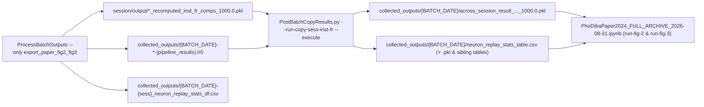

# Paper Figure 2 & Figure 3 Export Recipe and PostBatchCopyResults Fixes

## End-to-End Data Flow

## 1. Add Multi-Function `--only` Support + `export_paper_fig2_fig3` Recipe

In [`ProcessBatchOutputs_qclus1246789_Only.ipy`](h:\TEMP\Spike3DEnv_ExploreUpgrade\Spike3DWorkEnv\Spike3D\ProcessBatchOutputs_qclus1246789_Only.ipy):

- **Support multi-completion-function recipes** in the `--only` overlay logic (lines 381–406 and 603–620), backward-compatible with existing single-function recipes:
  - Read `completion_functions: Dict[str, Callable]` when present, else fall back to `{recipe['completion_fn_name']: recipe['completion_fn']}`.
  - Apply per-function `completion_fn_override_kwargs_dict: Dict[str, Dict]` when present, in addition to existing single-function `completion_fn_override_kwargs`.
- **Add `_ONLY_MODE_RECIPES['export_paper_fig2_fig3']`** (with aliases `'export_fig2_fig3'`, `'paper_fig2_fig3'`):
  - `phases`: `[ProcessingScriptPhases.final_run]`
  - `extended_computations_include_includelist`: `['long_short_decoding_analyses', 'long_short_fr_indicies_analyses', 'jonathan_firing_rate_analysis', 'long_short_post_decoding', 'long_short_inst_spike_rate_groups', 'split_to_directional_laps']`
  - `extra_extended_computations_include_includelist`: `[]`
  - `should_freeze_pipeline_updates`: `False` (compute-if-missing only; `final_run` still never rewrites local `loadedSessPickle`)
  - `force_recompute_override_computations_includelist`: `[]` (skips tbin force-recompute of heavy decoders/shuffles)
  - `completion_functions`:
    - `'compute_and_export_session_instantaneous_spike_rates_completion_function'`: writes per-session `output/{date}{full_custom_suffix}_recomputed_inst_fr_comps_1000.0.{pkl,h5}`
    - `'save_custom_session_files_completion_function'`: writes `collected_outputs/{BATCH_DATE_TO_USE}-...-(pipeline_results).h5` with `enable_save_pipeline_pkl=False, enable_save_global_computations_pkl=False, enable_save_h5=True, should_write_posterior_h5=False`
    - `'compute_and_export_session_extended_placefield_peak_information_completion_function'`: writes per-session `collected_outputs/{BATCH_DATE_TO_USE}-{session_name}_neuron_replay_stats_df.csv` (`save_csv=True, save_json=False`)
  - `completion_fn_override_kwargs_dict`: explicit kwargs for the three completion functions above.
- **Update call examples and `--only` CLI help string** (lines 75–128) to document `export_paper_fig2_fig3` and the follow-up `PostBatchCopyResults.py --run-copy-sess-inst-fr --execute` command.

## 2. Fix `PostBatchCopyResults.py` to Discover/Pair `(pipeline_results).h5` & Accept `--tbin`

In [`PostBatchCopyResults.py`](h:\TEMP\Spike3DEnv_ExploreUpgrade\Spike3DWorkEnv\Spike3D\PostBatchCopyResults.py):

- **Fix H5 discovery in `collect_and_filter_collected_h5_paths` (lines 558–619)**:
  - Add `'*(pipeline_results)*.h5'` to the dated subfolder globs alongside `'*_pipeline_with*.h5'` and `'*_pipeline_results*.h5'`.
  - Add root-level globs for `save_custom_session_files_completion_function(enable_save_h5=True)` outputs:
    - `f'{self.batch_date_to_use}-*-(pipeline_results)*.h5'`
    - `f'{self.result_date_to_use}_{self.host_tag}-*-(pipeline_results)*.h5'`
    while preserving the existing `*_pipeline_with*.h5` globs as fallback.
- **Fix session pairing in `pair_collected_h5_paths_to_sessions` (lines 511–555)**:
  - Extend `_subfn_h5_path_matches_session` to also match `{batch_date_to_use}-{session_context_descr}__...` / `_{session_name}__` filenames (from `build_complete_session_identifier_filename_string`), so `(pipeline_results).h5` files in `collected_outputs/` pair reliably with each `IdentifyingContext` in `included_session_contexts`.
- **Add `--tbin` CLI argument (default `'0.025'`)** using `parse_decoding_time_bin_size_str`:
  - Pass `decoding_time_bin_size` into `configure_run_main` (lines 360–433) so `laps_decoding_time_bin_size`, `ripple_decoding_time_bin_size`, and `job_suffix` reflect `--tbin` instead of being hardcoded to `0.025`.
  - This ensures `run_copy_sess_inst_fr_data_to_across_session_pkl` (`full_custom_suffix = f"{self.override_custom_pickle_suffix}-tbin_{tbin_ms}ms"`) finds the right per-session inst-FR pickle for any `--tbin`.

## 3. Resulting Workflow for Paper Figures 2 & 3

1. **Generate & run per-session batch jobs** (e.g. Great Lakes):
   `ipython ProcessBatchOutputs_qclus1246789_Only.ipy -- --date 2026-11-26 --computer GL --tbin 0.025 --only export_paper_fig2_fig3`
2. **Aggregate across sessions** (produces both `neuron_replay_stats_table.csv` + sibling tables AND `across_session_result_long_short_recomputed_inst_firing_rate_{DATE}_1000.0.pkl` under `collected_outputs/{DATE}_GL/`):
   `python PostBatchCopyResults.py --run-copy-sess-inst-fr --data-root /scratch/kdiba_root/kdiba99/halechr/Data --batch-day-date 2026-11-26 --host-tag GL --result-date 2026-11-26 --tbin 0.025 --execute`
   *(omit `--execute` first to preview dry-run)*
3. **Render publication Figure 2 & Figure 3** in `PhoDibaPaper2024_FULL_ARCHIVE_2026-08-31.ipynb` by setting `active_figure_export_folder_date` / `target_folder_date_name` to the batch date and running the `run_for_publication`, `run-fig-2`, and `run-fig-3` cells.

## Verification

- Dry-run syntax/import verification of `ProcessBatchOutputs_qclus1246789_Only.ipy` (parse + recipe resolution for `--only export_paper_fig2_fig3` and an existing single-fn `--only` recipe to confirm backward compatibility).
- Unit/smoke check on `PostBatchCopyResults.py` helper methods (`parse_args(['--run-copy-sess-inst-fr', '--tbin', '0.075'])`, `collect_and_filter_collected_h5_paths`, and `pair_collected_h5_paths_to_sessions`) against synthetic `(pipeline_results).h5` filenames and legacy `pipeline_with*.h5` filenames.
