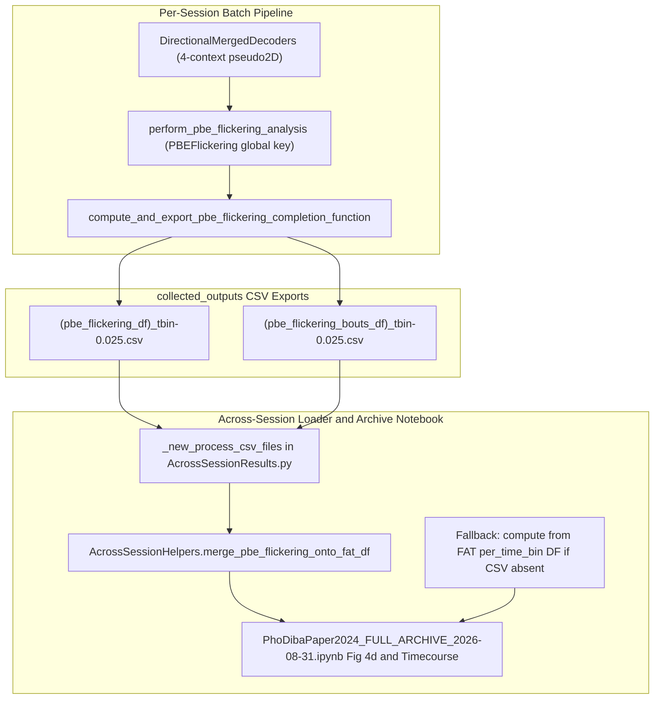

# Quantifying and Visualizing Within-PBE Context Flickering Across Time

## Architecture and Data Flow

## 1. Core Flickering and Pause-and-Resume Module

Create [pyPhoPlaceCellAnalysis/src/pyphoplacecellanalysis/Analysis/Decoder/pbe_flickering.py](h:/TEMP/Spike3DEnv_ExploreUpgrade/Spike3DWorkEnv/pyPhoPlaceCellAnalysis/src/pyphoplacecellanalysis/Analysis/Decoder/pbe_flickering.py) consolidating and extending `WithinEpochTimeBinDynamics` in [PendingNotebookCode.py](h:/TEMP/Spike3DEnv_ExploreUpgrade/Spike3DWorkEnv/pyPhoPlaceCellAnalysis/src/pyphoplacecellanalysis/SpecificResults/PendingNotebookCode.py) and `TransitionMatrixComputations` in [transition_matrix.py](h:/TEMP/Spike3DEnv_ExploreUpgrade/Spike3DWorkEnv/pyPhoPlaceCellAnalysis/src/pyphoplacecellanalysis/Analysis/Decoder/transition_matrix.py):

- **Input handling and active-bin gating**:
  - Operate on 4-context `pseudo2D` `DecodedFilterEpochsResult` (`p_x_given_n_list` with shape `(n_pos_bins, 4, n_t_bins)` across `['long_LR', 'long_RL', 'short_LR', 'short_RL']`) for both `pbe` (`ripple`) epochs and `laps` epochs (as a behavioral single-context control).
  - Gate low-firing time bins using `min_num_unique_active_neurons_per_time_bin=2` and `min_num_spikes_per_bin=1` (matching manuscript methods) so silent/single-cell bins do not create artificial crossings around `0.5`; require `min_valid_bins=4` for sequence-transition classification while recording `n_total_bins` and `n_valid_bins`.
- **Method 1: Dragoi et al. (2024) Multi-Track Hysteresis Dynamics**:
  - Compute per-bin track posteriors `P_Long(t) = P_long_LR(t) + P_long_RL(t)`, `P_Short(t) = P_short_LR(t) + P_short_RL(t)`, and difference curve `delta_P(t) = P_Short(t) - P_Long(t)` in `[-1, 1]`.
  - Evaluate state transitions under two symmetric deadband baselines `[-b, +b]` (holding the last committed state while `|delta_P(t)| <= b`):
    - **Adaptive Dragoi SE baseline**: `b_dragoi = 0.5 * SE(delta_P)` within the event, yielding `dragoi_n_transitions`, `dragoi_transition_hz` (`n_transitions / duration_s`), `dragoi_dynamic_class` (`Dominant` for `0` transitions, `Biphasic` for `1` transition, `Flicker` for `>= 2` transitions), `dragoi_mean_bout_ms`, `prob_preference` (`|sum(P_Short) - sum(P_Long)| / sum(P_Short + P_Long)`), and `duration_preference`.
    - **Confidence deadband baseline**: `b_conf = 2 * conf_thresh - 1` (default `conf_thresh = 0.65`, `b_conf = 0.30`; plus strict `0.75`), yielding `conf_n_transitions`, `conf_transition_hz`, `conf_dynamic_class` (`Dominant_Long`, `Dominant_Short`, `Biphasic`, `Flicker`, or `Ambiguous` when no valid bin exceeds `conf_thresh`), and contiguous bout durations (`conf_mean_bout_ms`, `conf_max_bout_ms`, `n_long_bouts`, `n_short_bouts`).
- **Method 2: Log-Odds, Bimodal Co-Representation vs. Ambiguity, and Markov/Sticky-HMM Persistence (Jezek et al. 2011; Posani et al. 2018; Tirole et al. 2022)**:
  - Clipped per-bin log-odds `L(t) = log(P_Short(t) / P_Long(t))`: `log_odds_mean`, `log_odds_std`, `log_odds_range`, `log_odds_mean_abs_step`, and `lag1_autocorr_delta_p` (capturing multi-bin bout inertia vs. memoryless alternation).
  - **Bimodal Co-Representation Score** (disambiguating true Long-and-Short flickering PBEs whose whole-epoch `P_Short` averages near `0.5` from genuinely flat `~0.5` PBEs):
    - `max_P_Long`, `max_P_Short`, `has_both_confident_contexts` (`(max_P_Long >= 0.75) & (max_P_Short >= 0.75)`), `bimodal_co_rep_min_conf = min(max_P_Long, max_P_Short)`, and `bimodal_flicker_score = 4.0 * max(0.0, min(max_P_Long, max_P_Short) - 0.5) * std(P_Short)`.
    - Discordant-context bin fraction (`frac_discordant_bins`: confident `Short` bins pre-delta and confident `Long` bins post-delta, per Jezek et al. 2011).
  - **Soft Markov and 2-State Sticky-HMM Viterbi**:
    - Soft `2x2` (`Long`, `Short`) and `4x4` (`long_LR`, `long_RL`, `short_LR`, `short_RL`) transition matrices via `TransitionMatrixComputations.estimate_transition_matrix_weighted_avg`, extracting `markov_p_stay_long`, `markov_p_stay_short`, `markov_p_switch_track`, and `markov_p_flip_dir_same_track`.
    - Exact 2-state sticky-HMM Viterbi path (`self_stay_prob = 0.80`) on log-marginal emissions, producing `hmm_n_transitions`, `hmm_dynamic_class`, and `hmm_mean_bout_ms`.
- **Method 3: Spatial Pause-and-Resume Sub-Trajectory Scoring (Manuscript Fig. 4d)**:
  - Segment each PBE into contiguous committed context bouts `(B_0, B_1, ..., B_{K-1})`. For each bout `B_k`, extract the dominant directional decoder `c_k` within that bout's track, conditional 1D posterior `P(x | c_k, t)`, and MAP positions `x_cm(t)` from `xbin_centers`, recording `bout_span_cm`, `bout_mean_jump_cm`, `bout_vel_cm_s`, and `bout_direction_sign`.
  - For every alternating `A -> B -> A` bout triplet `(B_{k-1}, B_k, B_{k+1})` (context `A` interrupted by opposite track `B` and returning to `A`):
    - Compute `pause_resume_abs_jump_cm = |x_A(t_resume_start) - x_A(t_pause_end)|` (paused-and-resumed proximity), `extrapolated_resume_err_cm` (constant-velocity continuation across the gap), `is_resume_dir_congruent`, and `pause_resume_continuity_score = clip(1.0 - pause_resume_abs_jump_cm / track_len_cm, 0.0, 1.0)`.
  - Emit per-PBE summary columns (`n_aba_triplets`, `min_pause_resume_jump_cm`, `max_pause_resume_continuity_score`, `has_paused_resumed_trajectory`) on `pbe_flickering_df` and one row per bout on `pbe_flickering_bouts_df`.
- **Method 4: Vectorized Shuffle Null Controls**:
  - **Within-PBE time-bin permutation shuffle** (`num_within_shuffles = 500`): vectorized permutation of valid time bins within each PBE to test bout inertia and transition counts against bin-order-independent noise (`within_perm_bout_ms_z`, `within_perm_bout_ms_p`, `within_perm_transitions_z`, `within_perm_autocorr_z`).
  - **Session-pool time-bin resampling shuffle** (`num_pool_shuffles = 500`, stratified by pre/post-delta or pooled session PBE bins) + **optional neuron-ID template permutation shuffle** (`num_neuron_id_shuffles = 128`, vectorized Poisson log-likelihood over stacked `(n_neurons, 4 * n_pos)` tuning curves): tests whether within-PBE co-representation (`bimodal_flicker_score`) and switching (`conf_n_transitions`) exceed single-context / random-ensemble expectations (`pool_bimodal_z`, `pool_bimodal_p`, `pool_transitions_z`, `pool_transitions_p`, `cell_shuffle_bimodal_z`, `cell_shuffle_bimodal_p`, `cell_shuffle_transitions_z`, `cell_shuffle_transitions_p`).
- **DataFrame-only fallback constructor**:
  - Provide `PBEFlickeringAnalyzer.compute_from_time_bin_marginals_df(time_bin_df, ...)` so context-marginal flickering metrics and permutation/pool shuffles can also be computed directly in-memory from already-exported `FAT_df` `per_time_bin` tables before new batch runs finish.

## 2. Global Computation Registration, Parameter Schema, and Batch Export

- **Parameter registration** in [SpecificComputationParameterTypes.py](h:/TEMP/Spike3DEnv_ExploreUpgrade/Spike3DWorkEnv/pyPhoPlaceCellAnalysis/src/pyphoplacecellanalysis/General/Model/SpecificComputationParameterTypes.py):
  - Define `pbe_flickering_analysis_Parameters` (`decoding_time_bin_size`, `conf_thresh`, `strict_conf_thresh`, `min_num_unique_active_neurons_per_time_bin`, `num_within_shuffles`, `num_pool_shuffles`, `num_neuron_id_shuffles`, `include_laps_control`, `drop_previous_result_and_compute_fresh`) and add `pbe_flickering_analysis: pbe_flickering_analysis_Parameters = serialized_field(default=Factory(pbe_flickering_analysis_Parameters))` to `ComputationKWargParameters` so `ComputationKWargParameters.init_from_pipeline` resolves cleanly.
- **Global computation stage** in [DirectionalPlacefieldGlobalComputationFunctions.py](h:/TEMP/Spike3DEnv_ExploreUpgrade/Spike3DWorkEnv/pyPhoPlaceCellAnalysis/src/pyphoplacecellanalysis/General/Pipeline/Stages/ComputationFunctions/MultiContextComputationFunctions/DirectionalPlacefieldGlobalComputationFunctions.py) (or imported sibling `PBEFlickeringGlobalComputationFunctions`):
  - Register top-level validator `validate_has_pbe_flickering_results(curr_active_pipeline)` and global computation `perform_pbe_flickering_analysis` with `short_name='pbe_flickering_analysis'`, `requires_global_keys=['DirectionalLaps', 'DirectionalMergedDecoders']`, `provides_global_keys=['PBEFlickering']`, `is_global=True`.
  - If `decoding_time_bin_size` differs from `DirectionalMergedDecoders.ripple_decoding_time_bin_size`, decode PBEs on the fly using `all_directional_pf1D_Decoder.decode_specific_epochs(...)` at the requested `decoding_time_bin_size` (default `0.025` s) without mutating cached `DirectionalMergedDecoders`.
- **Batch completion helper** in [batch_user_completion_helpers.py](h:/TEMP/Spike3DEnv_ExploreUpgrade/Spike3DWorkEnv/pyPhoPlaceCellAnalysis/src/pyphoplacecellanalysis/General/Batch/BatchJobCompletion/UserCompletionHelpers/batch_user_completion_helpers.py):
  - Add `compute_and_export_pbe_flickering_completion_function(...)` (with self-contained body imports for Jinja2 `inspect.getsource` inlining) writing:
    - `{BATCH_DATE_TO_USE}-{session_id}-(pbe_flickering_df)_tbin-{tbin}.csv`
    - `{BATCH_DATE_TO_USE}-{session_id}-(pbe_flickering_bouts_df)_tbin-{tbin}.csv`
- **Batch driver wiring** in [ProcessBatchOutputs_qclus1246789_Only.ipy](h:/TEMP/Spike3DEnv_ExploreUpgrade/Spike3DWorkEnv/Spike3D/ProcessBatchOutputs_qclus1246789_Only.ipy):
  - Add `'pbe_flickering_analysis'` to `_tbin_dependent_force_recompute_override_computations_includelist`.
  - Register `compute_and_export_pbe_flickering_completion_function` in `ProcessingScriptPhases.final_run` and `custom_user_completion_function_override_kwargs_dict`.
  - Add `_ONLY_MODE_RECIPES['export_pbe_flickering']` (aliased as `'pbe_flickering'` and `'compute_and_export_pbe_flickering_completion_function'`) running `['split_to_directional_laps', 'merged_directional_placefields', 'pbe_flickering_analysis']` so flickering exports across all sessions can be generated rapidly via `ipython ProcessBatchOutputs_qclus1246789_Only.ipy -- --only export_pbe_flickering --tbin 0.025`.

## 3. Across-Session CSV Loading and Cross-`tbin` FAT Merging

Update [AcrossSessionResults.py](h:/TEMP/Spike3DEnv_ExploreUpgrade/Spike3DWorkEnv/pyPhoPlaceCellAnalysis/src/pyphoplacecellanalysis/SpecificResults/AcrossSessionResults.py):

- In `_new_process_csv_files` (~line 3655), add `elif file_type in ('pbe_flickering_df', 'pbe_flickering_bouts_df'):` with `time_key='start'`, automatically populating `delta_aligned_start_t`, `pre_post_delta_category`, session identity columns, and experience novelty ranks in `final_sessions_loaded_extra_dfs_dict`.
- Add `AcrossSessionHelpers.merge_pbe_flickering_onto_fat_df(cls, fat_df, pbe_flickering_df, preferred_source_tbin=0.025, start_tol_sec=0.05, debug_print=True)` right next to `merge_epoch_score_shuffle_onto_fat_df` (~line 5090):
  - Filter `pbe_flickering_df` to `epoch_type == 'pbe'`.
  - Match exact `(session_name, custom_replay_name, time_bin_size, start)` when matching `time_bin_size` exists, and fall back via `pd.merge_asof(..., direction='nearest', tolerance=start_tol_sec)` on `(session_name, custom_replay_name, start)` from `preferred_source_tbin=0.025` so `25ms` flickering labels/scores (`conf_dynamic_class`, `dragoi_dynamic_class`, `bimodal_flicker_score`, `conf_transition_hz`, `has_paused_resumed_trajectory`, shuffle `z`/`p`) also annotate `75ms` Figure 4 PBE rows (`per_epoch` and `per_time_bin` via `parent_epoch_start_t`) without altering row counts.

## 4. Notebook Integration and Visualizations in `PhoDibaPaper2024_FULL_ARCHIVE_2026-08-31.ipynb`

Edit [PhoDibaPaper2024_FULL_ARCHIVE_2026-08-31.ipynb](h:/TEMP/Spike3DEnv_ExploreUpgrade/Spike3DWorkEnv/Spike3D/EXTERNAL/PhoDibaPaper2024Book/PhoDibaPaper2024_FULL_ARCHIVE_2026-08-31.ipynb) and add reusable publication figure builders in `PBEFlickeringAcrossSessionPlotter` (inside `pbe_flickering.py`):

- **Cell 8 (`# csv_files`)**: Unpack `pbe_flickering_df` and `pbe_flickering_bouts_df` from `final_sessions_loaded_extra_dfs_dict` and call `AcrossSessionHelpers.merge_pbe_flickering_onto_fat_df(all_sessions_laps_time_bin_df, pbe_flickering_df)` so `FAT_df` and `DataFrameFilter` (`is_flickering_pbe`, `is_paused_resumed_pbe`) inherit flickering columns automatically.
- **New Notebook Section (`# PBE Context Flickering Across Time`)**:
  - **Data readiness cell**: Uses loaded `pbe_flickering_df` / `pbe_flickering_bouts_df` when exported CSVs exist in `collected_outputs_directory`, or transparently runs `PBEFlickeringAnalyzer.compute_from_time_bin_marginals_df` on `FAT_df` (`25ms` preferred, `75ms` fallback) when batch CSVs have not been generated yet; applies quality session filtering (`known_bad_sessions` + `perfmnc_session` threshold) and optional trajectory-replay filtering (`is_heuristic_passing` / `ripple_EpochScoreShuffle_df`).
  - **Figure Panel A — Flickering Timecourse Across `delta_aligned_start_t`**: Publication 3-panel `[pre-delta histogram | delta-aligned scatter + rolling rate | post-delta histogram]` of `bimodal_flicker_score` and `conf_transition_hz` across session time, plus novel vs. familiar session breakdown (`is_novel_exposure`) testing pre- vs. post-Delta emergence of flickering.
  - **Figure Panel B — Dragoi (2024) Co-Representation Classes and Shuffle Null Tests**: Proportions of `Dominant_Long`, `Dominant_Short`, `Biphasic`, and `Flicker` events, transition frequency (Hz), and mean bout duration (ms) across Pre-Delta PBEs, Post-Delta PBEs, Laps (behavioral control), and Shuffle Nulls (within-PBE permutation, pool resampling, and neuron-ID shuffles), with hierarchical session/animal bootstrap CIs and paired Wilcoxon / Mann-Whitney p-values (`Figure2BarPublicationStyle`).
  - **Figure Panel C — Deconvolving Whole-Epoch `P_Short ~ 0.5` ("Muddled" Center vs. Ambiguity)**: 2D joint density and stacked breakdown of whole-epoch `P_Short` vs. `bimodal_flicker_score` / `log_odds_std`, quantifying the fraction of intermediate `P_Short` post-Delta PBEs driven by high-confidence Long/Short flickering vs. ambiguous shared-track bins.
  - **Figure Panel D — Markov Switching Matrices and Fig. 4d Pause-and-Resume Trajectory Gallery**: Pre- vs. Post-Delta `2x2` / `4x4` context transition heatmaps, distribution of `pause_resume_abs_jump_cm` on `A -> B -> A` triplets vs. shuffled jumps, and a top-ranked PBE example strip rendering 4-context decoded posteriors (when `decoded_posteriors` HDF5 is present) alongside bin-by-bin `P_Short(t)`, hysteresis bout spans, and pause/resume trajectory markers, exporting `.svg` and `.pdf` to `publication_figures_export_folder`.

## 5. Verification

- Run unit/smoke tests via `uv run pytest` on synthetic PBE posteriors covering pure `Long`, pure `Short`, flat `0.5` ambiguous, single-switch `Biphasic`, multi-switch `Flicker`, and synthetic `A -> B -> A` paused-and-resumed spatial sweeps to verify exact transition counts, deadband hysteresis, shuffle z-scores, and `pause_resume_abs_jump_cm`.
- Verify `ComputationKWargParameters.init_from_pipeline`, `_new_process_csv_files` filename parsing (`parse_filename`), and `merge_pbe_flickering_onto_fat_df` row-count invariants.