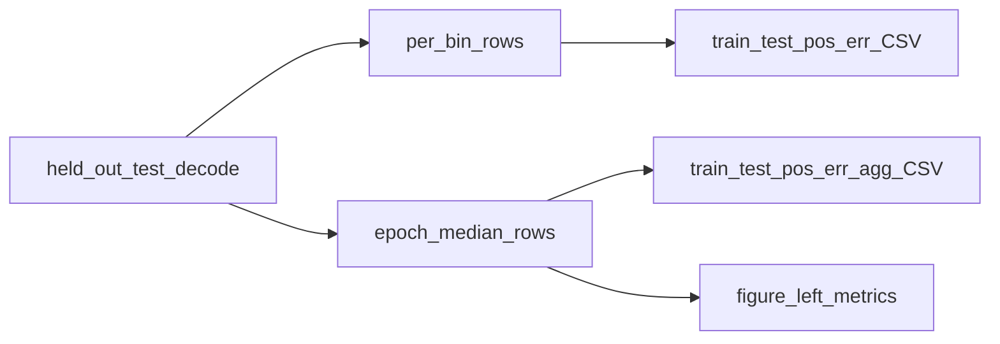

# Per-bin held-out pos-err in non-agg CSV

## Problem
`(train_test_pos_err)_tbin-*.csv` is one row per test epoch (median/mean abs err). That cannot explain a surprising epoch median (e.g. Lap 29 = 54.2) when few bins are valid/masked.

## Approach
Build a long **per-bin** DataFrame inside the same comparison loop that already computes epoch aggregates, write that as the non-agg CSV, and keep the epoch-level DF for figure join + `_agg`.

Locked defaults:
- Non-agg file key stays `train_test_pos_err` (same filename pattern).
- Rows = **all** time bins in each held-out test epoch (not only valid), with `is_valid` so masked/NaN bins are visible.
- Epoch-level DF still built/returned for left metrics column + `train_test_pos_err_agg`.

## Code changes

### 1. Emit per-bin rows in comparison builder
In [`build_single_measured_decoded_position_comparison`](h:/TEMP/Spike3DEnv_ExploreUpgrade/Spike3DWorkEnv/pyPhoPlaceCellAnalysis/src/pyphoplacecellanalysis/General/Pipeline/Stages/ComputationFunctions/MultiContextComputationFunctions/DirectionalPlacefieldGlobalComputationFunctions.py) (~5281–5411):

For each epoch, after computing `timebin_is_valid_for_both` / measured / decoded arrays, append one row per bin:

- `t`, `time_bin_index`
- `measured` (measured_pos_column_name value), `decoded`
- `abs_err_cm` = `|decoded - measured|` (NaN if either non-finite)
- `is_valid` (finite + active mask)
- `is_active` if spike-count mask provided
- epoch identity: `lap_id`, `start`, `stop` (same copy logic as `diff_row`)
- when 1D lin_pos comparison runs: `measured_lin_pos`, `abs_err_cm_1D`

Add field on `MeasuredDecodedPositionComparison`:

`decoded_measured_bin_diff_df: pd.DataFrame`

(concat of those rows; empty DF if no epochs).

### 2. Assemble + export in compute/export helpers
In `compute_kdiba_train_test_position_error_dfs`:

- From `_test_decoder_results_dict`, concat each decoder’s `measured_decoded_position_comparion.decoded_measured_bin_diff_df` with `decoder_name` / `session_name` / `time_bin_size` → `train_test_pos_err_bins_df`.
- Keep existing epoch `train_test_pos_err_df` + `train_test_pos_err_agg_df`.
- Return `(train_test_pos_err_df, train_test_pos_err_agg_df, train_test_pos_err_bins_df)`.

In `export_kdiba_train_test_position_error_csvs`:

- Write **bins** to `(train_test_pos_err)_tbin-*.csv` (replaces previous epoch-row content).
- Still write `(train_test_pos_err_agg)_tbin-*.csv` from epoch aggregates.
- Return `(out_paths, train_test_pos_err_df, train_test_pos_err_agg_df, train_test_pos_err_bins_df)` so figure/completion keep using epoch DF for metrics.

### 3. Callers
Update unpack sites in [`batch_user_completion_helpers.py`](h:/TEMP/Spike3DEnv_ExploreUpgrade/Spike3DWorkEnv/pyPhoPlaceCellAnalysis/src/pyphoplacecellanalysis/General/Batch/BatchJobCompletion/UserCompletionHelpers/batch_user_completion_helpers.py):

- `compute_and_export_kdiba_train_test_position_error_completion_function`
- `generalized_decode_epochs_dict_and_export_results_completion_function`

Stash `train_test_pos_err_bins_df` on callback_outputs alongside the epoch DF.

## Diagnose Lap 29 after export

```python
bins = pd.read_csv('...(train_test_pos_err)_tbin-0.025.csv')
bins[(bins.lap_id == 29) & (bins.decoder_name == '<gt>')][['t','abs_err_cm_1D','abs_err_cm','is_valid','is_active']]
```

