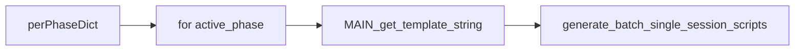

# Per-phase completion dicts in qclus12

Edit only [ProcessBatchOutputs_qclus12_Only.ipy](h:\TEMP\Spike3DEnv_ExploreUpgrade\Spike3DWorkEnv\Spike3D\ProcessBatchOutputs_qclus12_Only.ipy). Do not change `pythonScriptTemplating.py` phase defaults or `qclus1246789`.

The per-phase map at lines 126–144 is the **entire** completion list for that phase (replace, not merge).

## Why the current wiring fails

- Lines 237–241 still call `active_phase.get_custom_user_completion_functions_dict(...)` **before** the loop (`active_phase` is undefined) and still reference the old flat `phase_any_run_custom_user_completion_functions_dict`.
- The resulting `custom_user_completion_function_template_code` is reused for every phase at line 450.
- Passing `override=None` into `MAIN_get_template_string` would install the mega set. An explicit `{}` is required for a phase with no completions.



## Changes

**1. Keep the map; treat missing phase as empty.** Leave the dict you wrote. After it:

```python
_is_kdiba_session: bool = True
```

**2. Delete the pre-loop template build** (lines 237–241). Suffix/kwargs stay shared.

**3. Build the template inside** `for active_phase in phases_to_generate:` **before** `get_run_configuration`:

```python
custom_user_completion_functions_dict = phase_any_run_custom_user_completion_functions_dict_dict.get(active_phase, {})
custom_user_completion_function_template_code, custom_user_completion_functions_dict = MAIN_get_template_string(
    BATCH_DATE_TO_USE=BATCH_DATE_TO_USE,
    collected_outputs_path=collected_outputs_path,
    override_custom_user_completion_functions_dict=custom_user_completion_functions_dict,  # never None
)
print(f'completion_functions: {list(custom_user_completion_functions_dict.keys())}')
active_phase_dict = active_phase.get_run_configuration(
    custom_user_completion_function_template_code=custom_user_completion_function_template_code,
    extra_extended_computations_include_includelist=extra_extended_computations_include_includelist,
)
```

Do **not** call `get_custom_user_completion_functions_dict` here; that would re-merge phase3 defaults onto `final_run`.

**4. Resulting per-phase scripts**

- `clean_run`: `kdiba_session_post_fixup_completion_function` only
- `continued_run`: sweep, eval, generalized decode, `save_custom`
- `final_run`: eval, wcorr, generalized decode, `save_custom`

Shared `custom_user_completion_function_override_kwargs_dict` can stay as-is; unused keys are ignored.

No helper/library changes. No other `ProcessBatchOutputs_*.ipy` files.