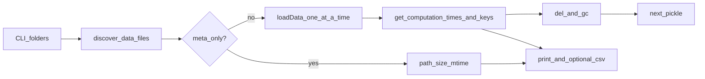

# Pipeline pickle progress inventory script

## Constraint (honest)

There is **no** API to read nested `computation_times` / computed keys without unpickling. Pickle is a sequential stream; progress lives inside `ComputationResult` objects after a full `loadData`. Optimizations:

- `--meta-only`: filesystem inventory only (path, size, mtime) — no unpickle
- Default progress mode: open `'rb'`, never save, process **one file at a time**, extract, `del` + `gc.collect()` before the next
- `--local-only`: skip the heavier paired `output/global_computation_results*.pkl` loads

## Placement

New script: [`Spike3D/scripts/inventory_pipeline_pickle_progress.py`](h:\TEMP\Spike3DEnv_ExploreUpgrade\Spike3DWorkEnv\Spike3D\scripts\inventory_pipeline_pickle_progress.py) (same pattern as [`archive_qclus_75ms_pickles.py`](h:\TEMP\Spike3DEnv_ExploreUpgrade\Spike3DWorkEnv\Spike3D\scripts\archive_qclus_75ms_pickles.py)).

No new library module unless extraction helpers grow beyond what fits cleanly in the script.

## Discovery

Reuse [`discover_data_files`](h:\TEMP\Spike3DEnv_ExploreUpgrade\Spike3DWorkEnv\pyPhoCoreHelpers\src\pyphocorehelpers\Filesystem\path_helpers.py) over each CLI folder:

- Local: `*loadedSessPickle*.pkl`
- Global (unless `--local-only`): `output/*global_computation_results*.pkl`

Pair globals to locals by session basedir + matching custom suffix when possible; unpaired globals still get their own row.

## Load + extract (progress mode)

For each local pickle, in sequence:

1. `loadData(path)` from [`Loading.py`](h:\TEMP\Spike3DEnv_ExploreUpgrade\Spike3DWorkEnv\pyPhoPlaceCellAnalysis\src\pyphoplacecellanalysis\General\Pipeline\Stages\Loading.py) (read-only; never call `save_*`)
2. Unwrap if needed to a `NeuropyPipeline`
3. Extract:
   - `last_completed_stage`
   - `get_computation_times()` → any_most_recent, per-epoch latest, per-fn times
   - local `computation_results` keys + each result’s `computed_data` / `computation_times` keys
   - incomplete/failed summaries via `_get_computation_results_progress` / `get_failed_computations` when available
4. If not `--local-only` and a paired global pickle exists: `load_pickled_global_computation_results(...)` (or `loadData` on the global file alone for unpaired globals), then global `computed_data` keys + `computation_times`
5. Drop references and GC before next file

Skip `batch_evaluate_required_computations` / `reload_default_computation_functions` in v1 (validator merge is slower and not required for “what’s already in the pickle”).

## CLI

```bash
python scripts/inventory_pipeline_pickle_progress.py FOLDER [FOLDER ...] \
  [--meta-only] [--local-only] [--csv OUT.csv] [--glob-local PATTERN] [--recursive/--no-recursive]
```

- Positional folders required
- Print a compact table (one row per pickle or per session pair)
- `--csv` writes the same rows
- Per-file load errors recorded as failed rows; continue to next file

## Output columns (core)

- `kind` (`local` / `global`), `path`, `size_bytes`, `mtime`
- On successful load: `last_completed_stage`, `any_most_recent_computation_time`, `local_computed_fn_names`, `global_computed_data_keys` / `global_computation_fn_names`, `error` if load failed



## Out of scope

- Writing progress JSON sidecars on save
- Stub/partial Unpickler to skip ndarray payloads (fragile with dill; not reliable enough for v1)
- Loading `global_batch_result.pkl` / `BatchRun.to_dataframe` (separate batch-status path)
- Editing notebooks
