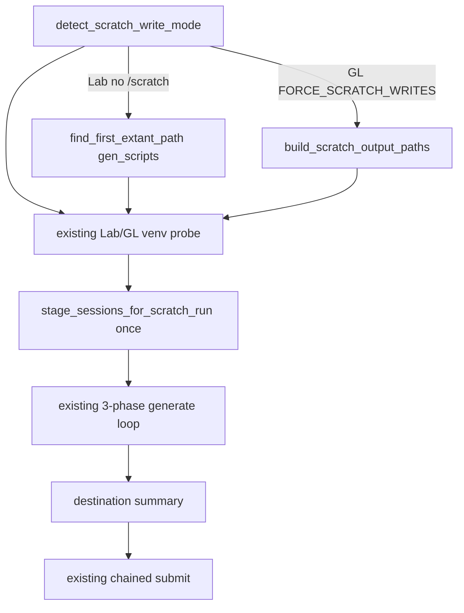

# Port GL updates into qclus12 sequential pipeline

Edit only [ProcessBatchOutputs_qclus12_Only.ipy](h:\TEMP\Spike3DEnv_ExploreUpgrade\Spike3DWorkEnv\Spike3D\ProcessBatchOutputs_qclus12_Only.ipy). Do not change [ProcessBatchOutputs_qclus1246789_Only.ipy](h:\TEMP\Spike3DEnv_ExploreUpgrade\Spike3DWorkEnv\Spike3D\ProcessBatchOutputs_qclus1246789_Only.ipy) or the helper in [pythonScriptTemplating.py](h:\TEMP\Spike3DEnv_ExploreUpgrade\Spike3DWorkEnv\pyPhoPlaceCellAnalysis\src\pyphoplacecellanalysis\General\Batch\pythonScriptTemplating.py) (`GreatlakesTurboToScratchHelpers` already exists there).

The last shared commit is `7331329a` (tbin filename suffix). After that, qclus1246789 has the GL turbo-to-scratch work (`1513f558` … `c8de30d5`), pickle overwrite guard, and headless clipboard. qclus12 has none of those, but already has the unique 3-stage chain (`c44a8b3b` / `f88dd5be`).



## Preserve (do not overwrite)

Keep qclus12 identity and sequential runner:

- `phases_to_generate = [clean_run, continued_run, final_run]` and `batch_execution_target = 'linux_standalone'`
- qclu `[1, 2]`, `_tbin_25ms`, `phase_any_run_custom_user_completion_functions_dict = None`
- Lab venv probing (`~/repos/Spike3D/.venv`, `SPIKE3D_REPO_ROOT`)
- Phase loop + `write_chained_submit_script` / retry scripts
- Dates (`2026-10-20_Lab`), session list, figure names, 25ms sweep kwargs

## Port from qclus1246789

**1. Import helper** next to the existing templating import (~line 60). Keep chain imports. Do not copy leftover `shutil` / `convert_filelist_to_new_parent` / `build_cross_root_copydict` / `copy_movedict` from qclus1246789.

```python
from pyphoplacecellanalysis.General.Batch.pythonScriptTemplating import GreatlakesTurboToScratchHelpers  # GL Turbo->Scratch workaround; drop when Turbo is R/W again
```

**2. Replace hardcoded gen_scripts path block** (~lines 77–92) with the qclus1246789 detect/redirect/assert block (~A 79–110): `FORCE_SCRATCH_WRITES`, `detect_scratch_write_mode`, `build_scratch_output_paths` vs extant-path fallback, `mkdir(parents=True, exist_ok=True)`, `assert_output_paths_not_on_turbo`. On Lab this is a no-op unless `/scratch` exists.

**3. Init per-session write-root override** after `build_concrete_session_folders` (~line 167):

```python
print(f'global_data_root_parent_path (session discovery / read root): {global_data_root_parent_path}')
session_global_data_root_parent_paths: Optional[Dict[IdentifyingContext, Path]] = None
```

**4. Stage sessions once** after venv probe (~line 371), **before** `session_basedirs_dict` (~line 373), using qclus12’s shared variables (not `active_phase_dict.get`):

```python
if use_scratch_writes:
    good_session_concrete_folders, session_global_data_root_parent_paths, global_data_root_parent_path = GreatlakesTurboToScratchHelpers.stage_sessions_for_scratch_run(
        turbo_session_folders=good_session_concrete_folders, source_data_root=global_data_root_parent_path,
        pickle_suffix=override_custom_pickle_suffix, tbin_suffix=decoding_time_bin_filename_suffix, skip_if_dest_newer_or_equal=True)
```

Missing local pickle on `clean_run` only prints a WARN in the helper; that is expected and non-fatal.

**5. Pass override into generate** (~line 417): add `session_global_data_root_parent_paths=session_global_data_root_parent_paths` beside `session_batch_basedirs=...`.

**6. Destination summary** after the phase loop (~line 471), before chained submit. Print scripts/collected/write-root plus per-session local vs global pickle paths using `override_custom_pickle_suffix` and `decoding_time_bin_filename_suffix`. Adapt the header: `clean_run` **does** write `loadedSessPickle`; later phases write `output/global_computation_results{suffix}{tbin}.pkl`. Skip qclus1246789’s generated-script listing (already printed per phase); skip jupyter listing (`should_generate_run_notebooks=False`).

**7. Headless clipboard** — define `_try_copy_to_clipboard` once near `also_show_figure_script_outputs`, and use it at the chained-submit copy (~line 488) instead of bare `copy_to_clipboard`.

**8. Small general pickle kwargs**

- `backup_previous_session_files_completion_function`: change hardcoded `'2026-10-20'` (~line 288) to `f'{BATCH_DATE_TO_USE}'`
- Add `compute_2D=False` on `generalized_specific_epochs_decoding` (~line 278) and on `generalized_decode_epochs_dict_and_export_results_completion_function` (~line 300), matching qclus1246789 and the existing `non_PBE_epochs_results` kwarg in qclus12

## Explicitly do not port

These are the 75ms incremental / GL-single-phase recipe, not general:

- qclu `[1,2,4,6,7,8,9]`, 0.075 bins, `_GL` date, single `active_phase = final_run`
- Explicit tbin-only completion dict (keep `None` so the mega set still runs)
- Local-pickle freeze: `should_save_local_pipeline_pkl=False`, `skip_save_on_initial_load=True`, and `save_custom_session_files_completion_function(..., enable_save_pipeline_pkl=False)` — these would break `clean_run`
- Tbin-only include / force-recompute lists, 75ms-only sweep `[0.075]`, `force_recompute_all_decoding=False` / `save_hdf=True` decoder kwargs
- Simplified GL-only venv defaults, `should_generate_run_notebooks=True`, flat sbatch cell, leftover unused path-copy imports
