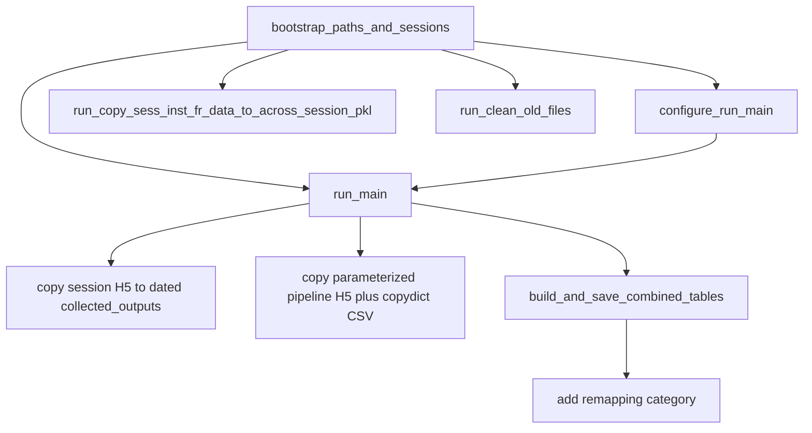

# Convert PostBatchCopyResults notebook to a GL SSH script

Create [`Spike3D/PostBatchCopyResults.py`](h:\TEMP\Spike3DEnv_ExploreUpgrade\Spike3DWorkEnv\Spike3D\PostBatchCopyResults.py) next to the existing notebook. Leave [`PostBatchCopyResults.ipynb`](h:\TEMP\Spike3DEnv_ExploreUpgrade\Spike3DWorkEnv\Spike3D\PostBatchCopyResults.ipynb) unchanged.

CLI style follows [`scripts/archive_qclus_75ms_pickles.py`](h:\TEMP\Spike3DEnv_ExploreUpgrade\Spike3DWorkEnv\Spike3D\scripts\archive_qclus_75ms_pickles.py) (`argparse`, `--dry-run` default / `--execute`, `main() -> int`). Headless matplotlib setup matches [`ProcessBatchOutputs_qclus1246789_Only.ipy`](h:\TEMP\Spike3DEnv_ExploreUpgrade\Spike3DWorkEnv\Spike3D\ProcessBatchOutputs_qclus1246789_Only.ipy): `MPLBACKEND=Agg`, `QT_QPA_PLATFORM=offscreen`.

## Run-group mapping

The notebook has only three tags. `run-main` currently tags only the job-suffix config cell; the actual copy/table pipeline is untagged. The script will treat **untagged working cells as part of `run_main`**.



- **`bootstrap_paths_and_sessions`** (cell 2, always first): resolve `scripts_output_path`, `collected_outputs_path`, `collected_figures_path`, `global_data_root_parent_path`; build `included_session_contexts` and `ConcreteSessionFolder` lists. Drop Jupyter magics (`%config`, `%pdb`, `%autoreload`), `InteractiveShell`, ipywidgets, and `display`.
- **`configure_run_main`** (cell 3, tag `run-main`): active qclu `[1,2,4,6,7,8,9]`, `frateThresh_2.0`, `job_suffix` + `_tbin_25ms`. Keep the commented alternate configs as comments.
- **`run_main`**: copy session `.h5` into `collected_outputs/{BATCH_DATE_TO_USE}/` (cells 7–8, `is_dryrun` from CLI); build parameterized `copy_h5_dict` and write `session_h5_files_copydict_{BATCH_DATE_TO_USE}.csv` (cells 17, 23); glob collected `*_pipeline_with*.h5`, filter by cutoff date and `job_suffix`, **pair H5 files to sessions by `session_name` in the filename** (replace the notebook’s fragile `.reverse()` / pasted-output pairing in cells 38–41); call `AcrossSessionTables.build_and_save_all_combined_tables`; re-read CSV dtypes (cell 45); `_add_cell_remapping_category` (cell 46). Optional `--copy-figures` (cell 15) and `--post-compute` (cells 55–56).
- **`run_copy_sess_inst_fr_data_to_across_session_pkl`** (cell 27): `copy_session_inst_fr_data_to_across_session_pkl(...)` with `instantaneous_time_bin_size_seconds_list = [0.001, 1000.0]`.
- **`run_clean_old_files`** (cell 70): `OldFileArchiver.remove_backup_files_from_session_data_folders` with the notebook’s pattern dicts and cutoff `datetime(2025, 2, 20)`. Optional `--archive-collected-outputs` for cell 72 (`is_dry_run` from CLI).

## CLI

```bash
# Preview copies/cleanup (default dry-run)
python PostBatchCopyResults.py --run-main
python PostBatchCopyResults.py --run-clean-old-files

# Apply
python PostBatchCopyResults.py --run-main --execute
python PostBatchCopyResults.py --run-copy-sess-inst-fr --execute
python PostBatchCopyResults.py --all --execute
```

Flags:
- `--run-main`, `--run-copy-sess-inst-fr`, `--run-clean-old-files`, `--all`
- `--dry-run` (default) / `--execute`
- `--batch-day-date` (default `2026-10-29`), `--host-tag` (default `GL`) → `BATCH_DATE_TO_USE = f'{date}_{tag}'`
- `--result-date` (default `2026-10-20`) for inst-FR / glob / cutoff (notebook currently uses 10-20 while `BATCH_DAY_DATE` is 10-29)
- `--data-root` optional override

Require at least one run-group flag. Default dry-run so a first SSH invocation cannot delete/overwrite.

## Headless adaptations

- No `%` magics, no `display()`, no `DryRunExecutionWidget` / `filesystem_path_folder_contents_widget`.
- Skip inspect-only cells, empty cells, pasted error/output literals (38, 41), undefined `_across_session_pkl_output_basename_fn` (cell 18), session-discovery one-offs (65–68), and Qt5Agg plotting (cell 51). Plotting stays off unless `--plotting` is passed (then still Agg, `save_figure=True`).
- Print paths and copy/delete summaries instead of widgets.

## Shared context object

Use an `@define` `PostBatchCopyContext` holding resolved paths, session lists, `job_suffix`, dates, and `is_dryrun`. Each `run_*` function takes this context plus only the kwargs it needs. Nested helpers (basename fn, `normalize_str`, session↔H5 matching) go inside the caller as `_subfn_*` when they are single-use.

Keep the notebook’s known-path candidate lists and `find_first_extant_path` so the same script works on GL, Lab, and Windows.
