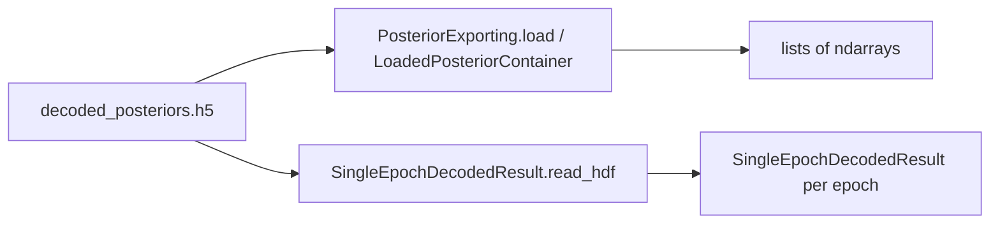

# Posterior HDF5 recover test notebook

## Goal

Create [`Spike3D/posterior_hdf5_test.ipynb`](h:\TEMP\Spike3DEnv_ExploreUpgrade\Spike3DWorkEnv\Spike3D\posterior_hdf5_test.ipynb) (Spike3D repo root, same level as `PostBatchCopyResults.ipynb`) that:

1. Discovers and filters `(decoded_posteriors)_tbin-*.h5` files the same way as the archive notebook cells under `# 2024-11-26 - decoded_posteriors from HDF5 files`.
2. Loads the existing array-based path (`LoadedPosteriorContainer`).
3. Recovers the original per-epoch objects with `SingleEpochDecodedResult.read_hdf` (new HDF5 deserializable API).

No library/code changes — notebook only.

## What was originally saved

Batch exports write **per-epoch** [`SingleEpochDecodedResult`](h:\TEMP\Spike3DEnv_ExploreUpgrade\Spike3DWorkEnv\pyPhoPlaceCellAnalysis\src\pyphoplacecellanalysis\Analysis\Decoder\reconstruction.py) groups via [`PosteriorExporting.save_decoded_posteriors_to_HDF5`](h:\TEMP\Spike3DEnv_ExploreUpgrade\Spike3DWorkEnv\pyPhoPlaceCellAnalysis\src\pyphoplacecellanalysis\Pho2D\data_exporting.py) (default `save_full_object=True` → includes `p_x_given_n_full`).

On-disk key pattern:

`{session…}/save_decoded_posteriors_to_HDF5/{decoder}/{laps|ripple}/{zero_padded_epoch_idx}/`

[`DecodedFilterEpochsResult.read_hdf`](h:\TEMP\Spike3DEnv_ExploreUpgrade\Spike3DWorkEnv\pyPhoPlaceCellAnalysis\src\pyphoplacecellanalysis\Analysis\Decoder\reconstruction.py) uses a different `{key}/epochs/{i}` layout and will **not** be used on these batch files.



## Notebook cells (concise)

### 1. Setup
- `%load_ext autoreload` / `%autoreload 3`, standard typing/path/pandas imports (no Qt GUI unless needed).
- Imports: `find_first_extant_path`, `load_across_sessions_exported_h5_files`, `get_only_most_recent_session_files`, `PosteriorExporting`, `LoadedPosteriorContainer`, `SingleEpochDecodedResult`, `HDF5_Helper`.

### 2. Resolve `collected_outputs_directory`
Copy the archive’s `known_collected_outputs_paths` + `find_first_extant_path` cell (including `K:/scratch/collected_outputs`).

### 3. Index H5 files
```python
cuttoff_date = datetime(2026, 11, 2)
parsed_h5_files_df, h5_contexts_paths_dict = load_across_sessions_exported_h5_files(
    collected_outputs_directory=collected_outputs_directory, cuttoff_date=cuttoff_date, debug_print=True)
```

### 4. Filter to decoded posteriors (archive parity)
Same constraints as archive:
- `file_type == 'decoded_posteriors'`
- `matching_custom_replay_name_str = 'withNormalComputedReplays-qclu-[1, 2, 4, 6, 7, 8, 9]-frateThresh-2.0'`
- `compare_custom_replay_name_col_name = '_comparable_custom_replay_name'`
- `decoding_time_bin_size_str = '0.025'`
- `get_only_most_recent_session_files(...)`
- Build `decoded_posteriors_h5_files: List[Path]`

### 5. Array load (existing path)
```python
all_sessions_exported_posteriors_dict, all_sessions_exported_posteriors_data_only_dict = LoadedPosteriorContainer.load_batch_hdf5_exports(
    exported_posterior_data_h5_files=decoded_posteriors_h5_files)
```

### 6. Recover original objects (new path)
For a chosen file (first path, or loop all):

1. `found_groups = HDF5_Helper.find_groups_by_name(load_path, 'save_decoded_posteriors_to_HDF5')`
2. Walk children: decoder → `laps`/`ripple` → epoch index groups.
3. For each epoch group key:
   `restored = SingleEpochDecodedResult.read_hdf(load_path, key=epoch_group_key)`
4. Store as nested dict, e.g.  
   `restored_by_decoder_epochs[decoder][epochs_name][epoch_idx] = restored`

Smoke checks in a follow-up cell:
- `type(restored)`, `restored.p_x_given_n.shape`, `restored.nbins`, presence of full vs legacy (`'p_x_given_n_full' in h5py group` / attr `save_full_object`).
- Spot-compare one epoch’s x-marginal against `LoadedPosteriorContainer` / `load_decoded_posteriors_from_HDF5` arrays for the same decoder/epoch index (legacy dataset `p_x_given_n` is the x-marginal).

## Defaults locked in

- Notebook path: [`Spike3D/posterior_hdf5_test.ipynb`](h:\TEMP\Spike3DEnv_ExploreUpgrade\Spike3DWorkEnv\Spike3D\posterior_hdf5_test.ipynb)
- Recovered type: **`SingleEpochDecodedResult`** (not `DecodedFilterEpochsResult`)
- Keep both loaders: archive-style arrays + object `read_hdf`
- Filter values copied from the archive notebook’s current active settings

## Out of scope

- Changing `PosteriorExporting` / reconstruction APIs
- Reassembling full `DecodedFilterEpochsResult` containers from batch H5
- Editing the archive notebook
