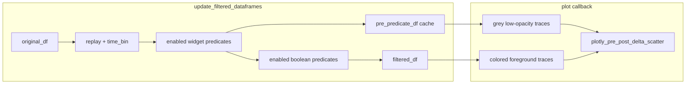

# Pre-predicate grey background for Figure 4 scatter

## Scope (per your choice)

**Background dataset** = rows that pass:
- Replay Name + Time Bin Size (always applied)
- Any **enabled column-widget predicates** (`*_widget`, e.g. `decoder_identifier_widget`, `trained_compute_epochs_widget`)

**Foreground dataset** = current behavior: background set **plus** all enabled boolean/checkbox predicates (`is_track_body`, `is_long_duration`, shuffle `sig_*`, etc.).

When no boolean predicates are enabled, background and foreground are identical — skip the background layer (no double-draw).

## Architecture

## 1. Cache pre-predicate dataframe during filtering

**File:** [`pyPhoPlaceCellAnalysis/src/pyphoplacecellanalysis/SpecificResults/PhoDiba2023Paper.py`](h:\TEMP\Spike3DEnv_ExploreUpgrade\Spike3DWorkEnv\pyPhoPlaceCellAnalysis\src\pyphoplacecellanalysis\SpecificResults\PhoDiba2023Paper.py)

- Add `_pre_predicate_df_dict: Dict[str, pd.DataFrame]` (non-serialized field, same pattern as `_filtered_df_dict`).
- In `update_filtered_dataframes` (~10472–10523), **split the predicate loop** into two passes on the same `df['is_filter_included']` mask:
  1. **Widget pass:** enabled predicates where `name.endswith('_widget')` or `name` is a column-widget predicate from `_iter_column_filter_dimensions()` (exclude `replay_name` / `time_bin_size` — already applied).
  2. **Snapshot:** `self._pre_predicate_df_dict[filtered_name] = deepcopy(df[df['is_filter_included']])` (preserve `data_context` in `.attrs` like other copies).
  3. **Boolean pass:** remaining enabled predicates (everything not handled in widget pass).
- Add read-only helper `pre_predicate_plot_df` property (mirrors `active_plot_df`) keyed off `active_plot_df_name`.

## 2. UI toggle (default True)

**Same file**, `DataFrameFilter._setup_widgets` / `display`:

- Add `show_pre_predicate_background: bool = non_serialized_field(default=True)`.
- Add `widgets.Checkbox(value=True, description='Show pre-predicate background')` in the top control row (near predicate list).
- `observe(..., self._on_widget_change)` so toggling triggers replot via existing debounced pipeline (no filter logic change).

## 3. Plot layering in Plotly helper

**File:** [`pyPhoPlaceCellAnalysis/src/pyphoplacecellanalysis/Pho2D/plotly/Extensions/plotly_helpers.py`](h:\TEMP\Spike3DEnv_ExploreUpgrade\Spike3DWorkEnv\pyPhoPlaceCellAnalysis\src\pyphoplacecellanalysis\Pho2D\plotly\Extensions\plotly_helpers.py)

Extend `plotly_pre_post_delta_scatter(...)` with optional kwargs (passed through from `_helper_perform_plot_pre_post_delta_scatter` via existing `**kwargs`):

| Kwarg | Default | Role |
|-------|---------|------|
| `background_data_results_df` | `None` | Pre-predicate dataframe |
| `background_scatter_opacity` | ~0.2 | Grey scatter |
| `background_hist_opacity` | ~0.25 | Grey marginal hists |

**Rendering order** (after `fig.data = []` on rebuild):

1. If background df provided and row count differs from foreground (or index set differs): add **background** pre-Δ hist, scatter, post-Δ hist **first**.
   - Force a single grey series: temporary column e.g. `_pre_predicate_layer='background'` with `color_discrete_sequence=['rgba(160,160,160,0.35)']` (override time_bin_size coloring for background only).
   - `showlegend=False`, distinct `legendgroup='__pre_predicate_bg__'`, `hoverinfo='skip'` on background traces.
2. Add **foreground** traces exactly as today (time_bin_size colors, opacity 0.5, etc.).

**Histogram scale:** extend the existing `should_set_hist_same_magnitude_axes` / `hist_count_max` logic so max counts/densities are computed from **both** background and foreground histogram traces before applying shared x-axis ranges on cols 1 and 3.

Extract a small inner helper (same function) to avoid duplicating the pre/scatter/post trace loop — one call for background styling, one for foreground.

## 4. Wire the interactive plot callback

**File:** [`PhoDiba2023Paper.py`](h:\TEMP\Spike3DEnv_ExploreUpgrade\Spike3DWorkEnv\pyPhoPlaceCellAnalysis\src\pyphoplacecellanalysis\SpecificResults\PhoDiba2023Paper.py), `_build_plot_callback` → `_build_filter_changed_plotly_plotting_callback_fn` (~10218–10252):

When `df_filter.show_pre_predicate_background` and figure widget mode:

- Resolve `bg_df = df_filter.pre_predicate_plot_df` (deepcopy, same hover/customdata prep as foreground if cheap; hover can stay foreground-only).
- Skip if `len(bg_df) == len(plot_df)` and same index (no boolean filtering effect).
- Pass `background_data_results_df=bg_df` into `_new_perform_plot_pre_post_delta_scatter_with_embedded_context(...)`.

No notebook changes required unless you want the toggle documented in [`PhoDibaPaper2024_FULL_ARCHIVE_2026-08-31.ipynb`](h:\TEMP\Spike3DEnv_ExploreUpgrade\Spike3DWorkEnv\Spike3D\EXTERNAL\PhoDibaPaper2024Book\PhoDibaPaper2024_FULL_ARCHIVE_2026-08-31.ipynb) (ask before editing per project rules).

## 5. Optional follow-up (out of scope unless you want it)

Publication export via `FigureS8._perform_plot_iteratively_constrained` could reuse the same kwargs (background = post-widget constrained `base_df`, foreground = `Final` `active`) — not required for the interactive Figure 4 explorer shown in your screenshot.

## Verification

- In notebook: enable several boolean predicates; confirm grey cloud + hists behind purple/colored filtered points; toggle checkbox off → background disappears.
- Confirm marginal histogram shared axis still scales to the larger of background vs foreground counts.
- Edge case: zero foreground rows still shows background (existing empty-filter annotation path unchanged).
