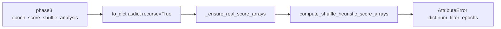

# Preserve `DecodedFilterEpochsResult` through shuffle modernization

The Great Lakes crash is `first_result.num_filter_epochs` in [`compute_shuffle_heuristic_score_arrays`](h:/TEMP/Spike3DEnv_ExploreUpgrade/Spike3DWorkEnv/pyPhoPlaceCellAnalysis/src/pyphoplacecellanalysis/Analysis/Decoder/heuristic_replay_scoring.py) when `first_result` is a **dict**. That happens because the completion function “modernizes” an existing `DecodedEpochScoreShuffle` with recursive `attrs.asdict` (`to_dict()`), which converts nested `DecodedFilterEpochsResult` values in `real_decoder_ripple_filter_epochs_decoder_result_dict`.



## 1. Non-recursive modernize on `DecodedEpochScoreShuffle`

In [`SequenceBasedComputations.py`](h:/TEMP/Spike3DEnv_ExploreUpgrade/Spike3DWorkEnv/pyPhoPlaceCellAnalysis/src/pyphoplacecellanalysis/General/Pipeline/Stages/ComputationFunctions/MultiContextComputationFunctions/SequenceBasedComputations.py), add a classmethod (single-line signature) used by all reconstruct sites:

```python
@classmethod
def modernize_from_instance(cls, obj: Optional["DecodedEpochScoreShuffle"]) -> Optional["DecodedEpochScoreShuffle"]:
    from attrs import asdict
    from neuropy.utils.mixins.indexing_helpers import get_dict_subset
    if obj is None:
        return None
    field_dict = obj if isinstance(obj, dict) else asdict(obj, recurse=False)
    return cls(**get_dict_subset(field_dict, subset_excludelist=['_VersionedResultMixin_version']))
```

`recurse=False` keeps nested `DecodedFilterEpochsResult` (and other attrs objects) as objects while still rebinding onto the current class so new fields get defaults.

Replace the three production reconstructs:

- [`batch_user_completion_helpers.py`](h:/TEMP/Spike3DEnv_ExploreUpgrade/Spike3DWorkEnv/pyPhoPlaceCellAnalysis/src/pyphoplacecellanalysis/General/Batch/BatchJobCompletion/UserCompletionHelpers/batch_user_completion_helpers.py) ~L1551 (`compute_and_export_session_epoch_score_shuffles_completion_function`)
- same file ~L1813 (`compute_and_export_session_alternative_replay_wcorr_shuffles_completion_function`)
- [`batch_completion_helpers.py`](h:/TEMP/Spike3DEnv_ExploreUpgrade/Spike3DWorkEnv/pyPhoPlaceCellAnalysis/src/pyphoplacecellanalysis/General/Batch/BatchJobCompletion/UserCompletionHelpers/batch_completion_helpers.py) ~L768 (`finalize_output_shuffled_epoch_scores`)

Pattern:

```python
epoch_score_shuffles = DecodedEpochScoreShuffle.modernize_from_instance(epoch_score_shuffles)
```

Do **not** change `AttrsBasedClassHelperMixin.to_dict()` (still recursive; other serializers depend on it).

## 2. Coerce leftover dict-valued decode maps

Add `_coerce_decoded_epochs_result_dict` on `DecodedEpochScoreShuffle` (or a nearby module-level helper): if a value is a `dict` with `num_filter_epochs`, rebuild `DecodedFilterEpochsResult` using only known attrs field names. Leave `None` and already-typed results alone.

Use it in:

- `_ensure_real_score_arrays` before heuristic/radon scoring (assign back onto `self.real_decoder_ripple_filter_epochs_decoder_result_dict`)
- `_shuffle_and_decode_scores` is not required if `_try_all_templates_decode` still returns objects; the stored **real** dict is the failure path

Also skip re-scoring when metrics already exist so `compute_shuffles(num_shuffles=2)` at the start of the completion function does not rebuild real heuristics from a corrupted dict:

- heuristics: skip if `'travel'` (or equivalent sentinel) is already in `self.real_score_arrays`
- radon: skip if `'radon_score'` is already present

## 3. Tests

In [`tests/test_epoch_score_shuffle.py`](h:/TEMP/Spike3DEnv_ExploreUpgrade/Spike3DWorkEnv/pyPhoPlaceCellAnalysis/tests/test_epoch_score_shuffle.py):

- Change `test_batch_reconstruct_from_to_dict_subset` to `DecodedEpochScoreShuffle.modernize_from_instance` (not `WCorrShuffle(**get_dict_subset(obj.to_dict(), ...))`)
- Give the source object a `real_decoder_ripple_filter_epochs_decoder_result_dict` of `_DecodedResultMock` instances and assert the rebuilt values still have `.num_filter_epochs` (same object identity is fine)
- Add a unit test that `_coerce_decoded_epochs_result_dict` / `_ensure_real_score_arrays` can take `{name: {'num_filter_epochs': n, ...}}` without `AttributeError`
- Add a test that `_ensure_real_score_arrays` does not call `compute_shuffle_heuristic_score_arrays` when `'travel'` is already in `real_score_arrays`

Do not change the `global_per_time_bin_laps_0.075_dropped` skip; that is a separate missing-context warning.

## Out of scope

- Renaming remaining `WCorrShuffle` aliases
- The `NoneType` export warning in `determine_percent_correctly_decoded_contexts`
- Global `to_dict()` recurse behavior on `AttrsBasedClassHelperMixin`
