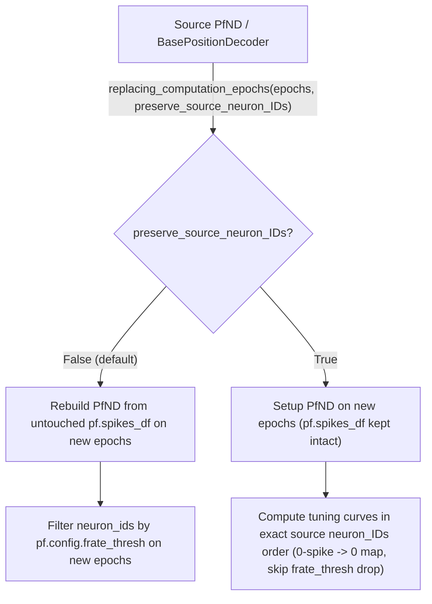

# Add `preserve_source_neuron_IDs` to `replacing_computation_epochs`

## Overview

Restore `pf.spikes_df` as the untouched full-session spikes DataFrame across `get_by_id`, and add `preserve_source_neuron_IDs: bool = False` to `replacing_computation_epochs`:
- When `preserve_source_neuron_IDs=False` (default): rebuilds `PfND` from `pf.spikes_df` on the new epochs and applies `pf.config.frate_thresh` just like a fresh initial computation (discovering any neurons in `pf.spikes_df` whose firing rate in the new epochs exceeds `frate_thresh`).
- When `preserve_source_neuron_IDs=True`: preserves the exact `neuron_IDs` (both membership and ordering) from the source `PfND` / decoder on the new epochs without dropping units that fall below `frate_thresh` or have zero spikes in the new epochs, while keeping `pf.spikes_df` unmodified.

## Planned Changes

### 1. `NeuroPy`: `PfND.compute`, `PfND.get_by_id`, and `PfND.replacing_computation_epochs`
File: [NeuroPy/neuropy/analyses/placefields.py](NeuroPy/neuropy/analyses/placefields.py)

- **Revert `pf.spikes_df` mutation in `PfND.get_by_id`** (`lines 1405-1415`):
  - Remove `lines 1410-1411` that sliced `copy_pf.spikes_df`, restoring the `# spikes_df shouldn't ever be updated` invariant (`line 871`) while keeping `copy_pf._filtered_spikes_df` slicing and `copy_pf.compute()`.
- **Support exact source neuron IDs in `PfND.compute`** (`lines 1091-1187`):
  - Update signature to `def compute(self, exact_neuron_ids: Optional[NDArray] = None, exact_neuron_extended_ids: Optional[Sequence] = None):`.
  - When `exact_neuron_ids is None`: keep 100% of existing grouping and `self.config.frate_thresh` filtering behavior.
  - When `exact_neuron_ids is not None`:
    - Filter `self._filtered_spikes_df` to `np.isin(self._filtered_spikes_df['aclu'].to_numpy(), target_ids)`.
    - Iterate `for a_neuron_id in target_ids:` in **exact `target_ids` order** (closing loop with `## END for a_neuron_id in target_ids...`), extracting `cell_spike_times` from the `'aclu'` group when present or `np.empty((0,), dtype=float)` when a curated neuron fired `0` speed-filtered spikes in the new epochs (which `Pf1D._compute_tuning_map`, `Pf2D._compute_tuning_map`, and `PlacefieldND._compute_tuning_map` turn into zero-rate tuning maps). Handle `len(target_ids) == 0` with empty `(0, *occupancy.shape)` arrays.
    - Bypass `self.config.frate_thresh` neuron dropping (preserving `self.config.frate_thresh` metadata on `self.config`) and align `neuron_extended_ids` 1-to-1 with `target_ids` from `exact_neuron_extended_ids` (falling back to `self.spikes_df.spikes.neuron_probe_tuple_ids` or `NeuronExtendedIdentity(-1, -1, int(nid), qclu=-1)`).
- **Add `preserve_source_neuron_IDs: bool = False` to `PfND.replacing_computation_epochs`** (`lines 1418-1423`):
  - Signature: `def replacing_computation_epochs(self, epochs: Union[Epoch, pd.DataFrame], preserve_source_neuron_IDs: bool = False, _source_neuron_ids: Optional[NDArray] = None) -> "PfND":`.
  - When `False`: build `PfND(spikes_df=copy_epoch_replaced_pf1D.spikes_df, position=copy_epoch_replaced_pf1D.position, epochs=new_epochs_obj, config=deepcopy(copy_epoch_replaced_pf1D.config), compute_on_init=True)`.
  - When `True`: resolve `target_ids` from `_source_neuron_ids` if provided else `np.asarray(self.ratemap.neuron_ids)` (and `self.ratemap.neuron_extended_ids`), instantiate `PfND(..., setup_on_init=True, compute_on_init=False)`, filter `rebuilt_pf._filtered_spikes_df` to `target_ids`, and call `rebuilt_pf.compute(exact_neuron_ids=target_ids, exact_neuron_extended_ids=...)`.

### 2. `pyPhoPlaceCellAnalysis`: Decoder `get_by_id` and `replacing_computation_epochs`
- [pyPhoPlaceCellAnalysis/src/pyphoplacecellanalysis/Analysis/Decoder/reconstruction.py](pyPhoPlaceCellAnalysis/src/pyphoplacecellanalysis/Analysis/Decoder/reconstruction.py):
  - **`BasePositionDecoder.get_by_id`** (`lines 2950-2951`) and **`BayesianPlacemapPositionDecoder.get_by_id`** (`lines 4370-4371`): remove the 2 lines that sliced `sliced_pf.spikes_df` / `neuron_sliced_pf.spikes_df` (leaving `BayesianPlacemapPositionDecoder.spikes_df` slicing at `lines 4380-4382` intact since that is the stateful decoder's decoded-spikes table).
  - **`BasePositionDecoder.replacing_computation_epochs`** (`lines 2976-2984`):
    - Update signature to `def replacing_computation_epochs(self, epochs: Union[Epoch, pd.DataFrame], preserve_source_neuron_IDs: bool = False):`.
    - Pass `preserve_source_neuron_IDs=preserve_source_neuron_IDs` and `_source_neuron_ids=(np.asarray(self.neuron_IDs) if (preserve_source_neuron_IDs and (self.neuron_IDs is not None)) else None)` to `self.pf.replacing_computation_epochs(...)`.
    - Copy scalar decoder config attributes (`should_discount_silence`, `drop_negative_contributing_terms_mode`, `reliability_modifier_mode`, `minimum_rate_eps`) onto `updated_decoder`.
- [pyPhoPlaceCellAnalysis/src/pyphoplacecellanalysis/Analysis/Decoder/reconstruction_dst.py](pyPhoPlaceCellAnalysis/src/pyphoplacecellanalysis/Analysis/Decoder/reconstruction_dst.py):
  - **`BayesianPlacemapPositionDecoderDST.get_by_id`** (`lines 202-203`): remove the 2 lines that sliced `neuron_sliced_pf.spikes_df`.
- [pyPhoPlaceCellAnalysis/src/pyphoplacecellanalysis/Analysis/Decoder/rtc_clusterless_decoder.py](pyPhoPlaceCellAnalysis/src/pyphoplacecellanalysis/Analysis/Decoder/rtc_clusterless_decoder.py) (`lines 163-173`) & [pyPhoPlaceCellAnalysis/src/pyphoplacecellanalysis/Analysis/Decoder/spyglass_clusterless_decoder.py](pyPhoPlaceCellAnalysis/src/pyphoplacecellanalysis/Analysis/Decoder/spyglass_clusterless_decoder.py) (`lines 181-192`):
  - Add `preserve_source_neuron_IDs: bool = False` to `replacing_computation_epochs` and forward it to `self.pf.replacing_computation_epochs(...)`.

### 3. Wire `TrainTestSplit` Call Sites to `preserve_source_neuron_IDs=True`
- [pyPhoPlaceCellAnalysis/src/pyphoplacecellanalysis/General/Pipeline/Stages/ComputationFunctions/MultiContextComputationFunctions/DirectionalPlacefieldGlobalComputationFunctions.py](pyPhoPlaceCellAnalysis/src/pyphoplacecellanalysis/General/Pipeline/Stages/ComputationFunctions/MultiContextComputationFunctions/DirectionalPlacefieldGlobalComputationFunctions.py) (`lines 6530-6544`):
  - Remove the manual `curr_pf1D.spikes_df`, `curr_pf1D._filtered_spikes_df`, and `curr_pf1D.config.frate_thresh = 0.0` mutations (`lines 6531-6537`), and call `curr_pf1D.replacing_computation_epochs(deepcopy(curr_lap_period_epoch_obj), preserve_source_neuron_IDs=True, _source_neuron_ids=np.asarray(a_1D_decoder.neuron_IDs))`.
- [pyPhoPlaceCellAnalysis/src/pyphoplacecellanalysis/SpecificResults/PendingNotebookCode.py](pyPhoPlaceCellAnalysis/src/pyphoplacecellanalysis/SpecificResults/PendingNotebookCode.py) (`line 19129`):
  - Update `_single_compute_train_test_split_epochs_decoders` to call `deepcopy(a_decoder).replacing_computation_epochs(epochs=deepcopy(curr_epoch_period_epoch_obj), preserve_source_neuron_IDs=True)`.
- Non-subset / distinct-epoch callers (`EpochComputationFunctions.py:218,224`, `PendingNotebookCode.py:11098`) remain at the default `preserve_source_neuron_IDs=False`.

### 4. Tests & Verification
- [pyPhoPlaceCellAnalysis/tests/test_decoders.py](pyPhoPlaceCellAnalysis/tests/test_decoders.py) (`lines 418-503`):
  - Update `TestGetByIdSlicesPfSpikesDfForEpochReplacement` (and rename or expand test methods) to assert:
    - `get_by_id` leaves `pf.spikes_df` untouched (`[1, 2, 99]`).
    - `replacing_computation_epochs(new_epochs, preserve_source_neuron_IDs=False)` (default) refilters `neuron_ids` from `pf.spikes_df` using `pf.config.frate_thresh` on `new_epochs` (including recovering a cell that was sub-threshold in old epochs and exceeds `frate_thresh` in `new_epochs`).
    - `replacing_computation_epochs(train_epochs, preserve_source_neuron_IDs=True)` preserves exact source `neuron_IDs` (`[1, 2]`, custom order `[2, 1]`, and a curated neuron with `0` spikes or `< frate_thresh` in `train_epochs`) and prevents phantom silence jumps.
- [pyPhoPlaceCellAnalysis/tests/test_rtc_clusterless_decoder.py](pyPhoPlaceCellAnalysis/tests/test_rtc_clusterless_decoder.py) (`line 51`) & [pyPhoPlaceCellAnalysis/tests/test_spyglass_clusterless_decoder.py](pyPhoPlaceCellAnalysis/tests/test_spyglass_clusterless_decoder.py) (`line 58`):
  - Update `_MockPfND.replacing_computation_epochs` signatures to accept `preserve_source_neuron_IDs: bool = False`.