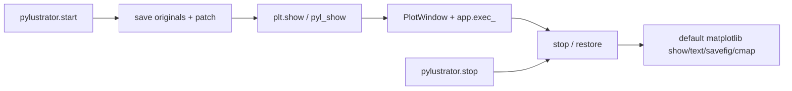

# Restore matplotlib hooks after pylustrator (Jupyter-safe)

## Problem

[`pylustrator.start()`](h:\TEMP\Spike3DEnv_ExploreUpgrade\Spike3DWorkEnv\pylustrator\pylustrator\__init__.py) → [`QtGuiDrag.initialize`](h:\TEMP\Spike3DEnv_ExploreUpgrade\Spike3DWorkEnv\pylustrator\pylustrator\QtGuiDrag.py) permanently replaces `plt.show` with `pyl_show` and wraps class methods (`Axes.text`, `Figure.text`, `Figure.savefig`, `Colormap.__call__`). Originals for `plt.show` / `plt.figure` are saved, but:

- Active path `pyl_show` never restores them (only the unused `show()` does at lines 274–277).
- Class-method originals are never saved, so they cannot be restored.
- Repeated `start()` re-wraps `text`/`savefig` (nested wrappers).
- No public uninstall API — Jupyter users must restart the kernel.

## Approach

Centralize hook state in [`QtGuiDrag.py`](h:\TEMP\Spike3DEnv_ExploreUpgrade\Spike3DWorkEnv\pylustrator\pylustrator\QtGuiDrag.py), export `stop` as the public undo for `start`, and restore after the editor event loop exits.



## Implementation (package only)

### 1. Hook state + idempotent `initialize`

In [`QtGuiDrag.py`](h:\TEMP\Spike3DEnv_ExploreUpgrade\Spike3DWorkEnv\pylustrator\pylustrator\QtGuiDrag.py):

- Add module flag `_hooks_installed: bool = False`.
- On first install only, store originals:
  - `plt.show`, `plt.figure` (already partially there as `old_pltshow` / `old_pltfigure`)
  - `Axes.text`, `Figure.text`, `Figure.savefig`, `Colormap.__call__`
  - whether `Figure._pylustrator_init` was already present
- If `_hooks_installed` is already True, return early (no re-wrap).
- Keep assigning `plt.show = pyl_show` (do not wire the dead custom `figure()` unless we also document it; current `initialize` does not patch `plt.figure` — leave that as-is; still restore `plt.figure` if it was ever overwritten).

### 2. Public `stop()` / `uninstall`

Add `def stop() -> bool:` in `QtGuiDrag.py` that:

- Restores all saved originals onto `plt` / class attributes
- Deletes `Figure._pylustrator_init` when we added it
- Clears `_hooks_installed` and the saved-original slots
- Returns `True` if something was restored, `False` if hooks were not installed (safe no-op)
- Does not destroy the process `QApplication` (leaving it is normal on Qt; avoid surprising Jupyter)

Export as:

```python
# __init__.py
from .QtGuiDrag import initialize as start
from .QtGuiDrag import stop
# add "stop" to __all__
```

Alias: also bind `uninstall = stop` only if needed for discoverability — prefer a single name `stop` to match `start`.

### 3. Auto-restore after editor close (Jupyter robustness)

At the end of `pyl_show`, after `app.exec_()` returns (or when `hide_window=True` finishes setup without an event loop that the tests use), call `stop()` so subsequent notebook cells use default matplotlib again.

Notebook usage becomes:

```python
pylustrator.start()
# ... build figure ...
plt.show()  # opens editor; on close, hooks are removed
# later cells: normal plt.show / inline backend again
```

To edit again, call `pylustrator.start()` once more. Update docstring of `initialize` to state this (and that `plt.figure` is not currently overloaded, matching code).

Refactor the unused `show()` restore block to call the same `stop()` helper so there is one restore path (optional cleanup of dead `show`/`figure` if they remain unused — leave them if tests/docs reference them; just route restore through `stop`).

### 4. Docs / API surface

- [`docs/api.rst`](h:\TEMP\Spike3DEnv_ExploreUpgrade\Spike3DWorkEnv\pylustrator\docs\api.rst): add `autofunction:: pylustrator.stop`
- [`docs/styling.rst`](h:\TEMP\Spike3DEnv_ExploreUpgrade\Spike3DWorkEnv\pylustrator\docs\styling.rst) / [`docs/index.rst`](h:\TEMP\Spike3DEnv_ExploreUpgrade\Spike3DWorkEnv\pylustrator\docs\index.rst): short note that after the editor closes (or after `pylustrator.stop()`), default `plt.show` is restored; call `start()` again to re-enter edit mode
- Brief note in [`CLAUDE.md`](h:\TEMP\Spike3DEnv_ExploreUpgrade\Spike3DWorkEnv\pylustrator\CLAUDE.md) if it documents `start`

### 5. Tests

Add a focused non-GUI unit test (no Qt window required) e.g. [`tests/test_hooks.py`](h:\TEMP\Spike3DEnv_ExploreUpgrade\Spike3DWorkEnv\pylustrator\tests\test_hooks.py):

- Capture identity of `plt.show` / `Axes.text` before `start`
- After `start`, assert `plt.show` is `pyl_show` (or not the original)
- Second `start()` does not change `Axes.text` identity again (idempotent)
- `stop()` restores originals; second `stop()` is no-op (`False`)
- `start()` after `stop()` works again

Existing GUI tests that call `start()` + `plt.show(hide_window=True)` must still pass: with auto-`stop()` after `pyl_show`, those tests should either call `start()` again if they show twice, or rely on per-test `start()` — check [`tests/base_test_class.py`](h:\TEMP\Spike3DEnv_ExploreUpgrade\Spike3DWorkEnv\pylustrator\tests\base_test_class.py) and adjust if a single `start` is shared across multiple shows.

## Out of scope

- Rewriting JupyterLab / VS Code cell-write JS in [`jupyter_cells.py`](h:\TEMP\Spike3DEnv_ExploreUpgrade\Spike3DWorkEnv\pylustrator\pylustrator\jupyter_cells.py) (classic `Jupyter.notebook` API)
- `StartColorChooser` / `QtGui.initialize` restore (separate path; not the main editor hook)
- Spike3D notebook edits
- Version bump beyond documenting the new API
