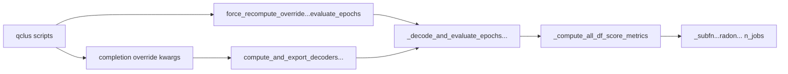

# Thread Radon skip + `n_jobs` from qclus batch scripts

## Problem

Two independent hardcodes break GL-safe Radon control:

1. Completion recompute hardcodes skip off:

```895:895:h:/TEMP/Spike3DEnv_ExploreUpgrade/Spike3DWorkEnv/pyPhoPlaceCellAnalysis/src/pyphoplacecellanalysis/General/Batch/BatchJobCompletion/UserCompletionHelpers/batch_user_completion_helpers.py
computation_kwargs_list=[{'should_skip_radon_transform': False}], ...
```

2. Score metrics hardcode 6 cores (never accepts a kwarg):

```8074:8075:h:/TEMP/Spike3DEnv_ExploreUpgrade/Spike3DWorkEnv/pyPhoPlaceCellAnalysis/src/pyphoplacecellanalysis/General/Pipeline/Stages/ComputationFunctions/MultiContextComputationFunctions/DirectionalPlacefieldGlobalComputationFunctions.py
nlines=8192, margin=4.0,
n_jobs=6)
```

`_decode_and_evaluate_epochs_using_directional_decoders` only accepts `should_skip_radon_transform`, so even `force_recompute_override_computation_kwargs_dict` cannot pass `n_jobs` today.



## Approach

Thread both knobs end-to-end. Defaults stay current behavior (`should_skip_radon_transform=False`, `n_jobs=6`). Qclus drivers pass `should_skip_radon_transform=True` and `n_jobs=1`.

## Changes

### 1. Computation path — [`DirectionalPlacefieldGlobalComputationFunctions.py`](h:/TEMP/Spike3DEnv_ExploreUpgrade/Spike3DWorkEnv/pyPhoPlaceCellAnalysis/src/pyphoplacecellanalysis/General/Pipeline/Stages/ComputationFunctions/MultiContextComputationFunctions/DirectionalPlacefieldGlobalComputationFunctions.py)

- `_compute_all_df_score_metrics(..., should_skip_radon_transform=False, n_jobs: int = 6, ...)` — use `n_jobs` instead of hardcoded `6`.
- `_compute_arbitrary_epochs_all_df_score_metrics` — same (`n_jobs` param; replace hardcoded `6`) so the sibling path stays consistent.
- `_decode_and_evaluate_epochs_using_directional_decoders(..., should_skip_radon_transform=False, n_jobs: int = 6)` — forward `n_jobs` into `_compute_all_df_score_metrics`.

### 2. Parameters class — [`SpecificComputationParameterTypes.py`](h:/TEMP/Spike3DEnv_ExploreUpgrade/Spike3DWorkEnv/pyPhoPlaceCellAnalysis/src/pyphoplacecellanalysis/General/Model/SpecificComputationParameterTypes.py)

- On `directional_decoders_evaluate_epochs_Parameters`, add `n_jobs: int = 6` (+ matching `param.Integer`) beside `should_skip_radon_transform`.

### 3. Completion helper — [`batch_user_completion_helpers.py`](h:/TEMP/Spike3DEnv_ExploreUpgrade/Spike3DWorkEnv/pyPhoPlaceCellAnalysis/src/pyphoplacecellanalysis/General/Batch/BatchJobCompletion/UserCompletionHelpers/batch_user_completion_helpers.py)

- Add `should_skip_radon_transform: bool = False` and `n_jobs: int = 6` to `compute_and_export_decoders_epochs_decoding_and_evaluation_dfs_completion_function`.
- Replace hardcoded kwargs with:
  `computation_kwargs_list=[{'should_skip_radon_transform': should_skip_radon_transform, 'n_jobs': n_jobs}]`.

### 4. Other hardcoded path — [`batch_completion_helpers.py`](h:/TEMP/Spike3DEnv_ExploreUpgrade/Spike3DWorkEnv/pyPhoPlaceCellAnalysis/src/pyphoplacecellanalysis/General/Batch/BatchJobCompletion/UserCompletionHelpers/batch_completion_helpers.py)

- At the `directional_decoders_evaluate_epochs` recompute (~309), pass `should_skip_radon_transform` / `n_jobs` from that helper’s existing kwargs (add params with same defaults if missing). Ensures that path is not left on multi-core.

### 5. Qclus drivers

In both [`ProcessBatchOutputs_qclus12_Only.ipy`](h:/TEMP/Spike3DEnv_ExploreUpgrade/Spike3DWorkEnv/Spike3D/ProcessBatchOutputs_qclus12_Only.ipy) and [`ProcessBatchOutputs_qclus1246789_Only.ipy`](h:/TEMP/Spike3DEnv_ExploreUpgrade/Spike3DWorkEnv/Spike3D/ProcessBatchOutputs_qclus1246789_Only.ipy):

- `force_recompute_override_computation_kwargs_dict['directional_decoders_evaluate_epochs']`:
  `{'should_skip_radon_transform': True, 'n_jobs': 1}`
- `custom_user_completion_function_override_kwargs_dict['compute_and_export_decoders_epochs_decoding_and_evaluation_dfs_completion_function']`:
  add `should_skip_radon_transform=True, n_jobs=1`

No template changes — both override dicts already inject into generated scripts.
