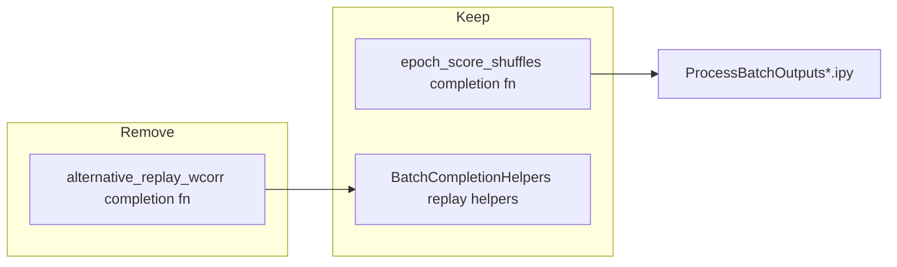

# Remove deprecated alternative-replay wcorr completion function

## Target function

[`batch_user_completion_helpers.py`](h:\TEMP\Spike3DEnv_ExploreUpgrade\Spike3DWorkEnv\pyPhoPlaceCellAnalysis\src\pyphoplacecellanalysis\General\Batch\BatchJobCompletion\UserCompletionHelpers\batch_user_completion_helpers.py) lines **1677–1974**: `compute_and_export_session_alternative_replay_wcorr_shuffles_completion_function` — alternative replay epoch variants + per-variant wcorr shuffle export (superseded by [`compute_and_export_session_epoch_score_shuffles_completion_function`](h:\TEMP\Spike3DEnv_ExploreUpgrade\Spike3DWorkEnv\pyPhoPlaceCellAnalysis\src\pyphoplacecellanalysis\General\Batch\BatchJobCompletion\UserCompletionHelpers\batch_user_completion_helpers.py) and current multi-phase batch recipes).

**Out of scope (unless you ask later):** [`EXTERNAL/DEVELOPER_NOTES/...`](h:\TEMP\Spike3DEnv_ExploreUpgrade\Spike3DWorkEnv\Spike3D\EXTERNAL\DEVELOPER_NOTES\DataStructureDocumentation\compute_and_export_session_alternative_replay_wcorr_shuffles_completion_function_results.md), stale [`.cursor/plans/*.plan.md`](h:\TEMP\Spike3DEnv_ExploreUpgrade\Spike3DWorkEnv\Spike3D\.cursor\plans), and low-level helpers in [`batch_completion_helpers.py`](h:\TEMP\Spike3DEnv_ExploreUpgrade\Spike3DWorkEnv\pyPhoPlaceCellAnalysis\src\pyphoplacecellanalysis\General\Batch\BatchJobCompletion\UserCompletionHelpers\batch_completion_helpers.py) (`compute_all_replay_epoch_variations`, `overwrite_replay_epochs_and_recompute`, `plot_replay_wcorr_histogram`) — they remain usable from notebooks/PendingNotebookCode; only metadata `used_by` links to the removed completion fn get cleared.

## 1. pyPhoPlaceCellAnalysis — delete definition and registrations

| Location | Change |
|----------|--------|
| [`batch_user_completion_helpers.py`](h:\TEMP\Spike3DEnv_ExploreUpgrade\Spike3DWorkEnv\pyPhoPlaceCellAnalysis\src\pyphoplacecellanalysis\General\Batch\BatchJobCompletion\UserCompletionHelpers\batch_user_completion_helpers.py) L1677–1974 | Delete entire function (decorator through `return across_session_results_extended_dict`). Next block starts at `# cell_first_spikes_characteristics` (~L1977). |
| Same file, `MAIN_get_template_string` (~L5364) | Remove dict entry `'compute_and_export_session_alternative_replay_wcorr_shuffles_completion_function': ...` so `MAIN_get_template_string(..., override=None)` no longer embeds or imports a missing symbol. |
| [`pythonScriptTemplating.py`](h:\TEMP\Spike3DEnv_ExploreUpgrade\Spike3DWorkEnv\pyPhoPlaceCellAnalysis\src\pyphoplacecellanalysis\General\Batch\pythonScriptTemplating.py) L177 | Drop `compute_and_export_session_alternative_replay_wcorr_shuffles_completion_function` from the lazy import in `ProcessingScriptPhases.get_custom_user_completion_functions_dict`. |
| Same file, commented blocks ~L208, ~L217 | Remove commented dict lines that still name the deleted function (avoids confusing grep hits). |
| [`batch_completion_helpers.py`](h:\TEMP\Spike3DEnv_ExploreUpgrade\Spike3DWorkEnv\pyPhoPlaceCellAnalysis\src\pyphoplacecellanalysis\General\Batch\BatchJobCompletion\UserCompletionHelpers\batch_completion_helpers.py) ~L659, ~L900 | Set `@function_attributes(..., used_by=['compute_and_export_session_alternative_replay_wcorr_shuffles_completion_function'], ...)` → `used_by=[]` on `compute_all_replay_epoch_variations` and `plot_replay_wcorr_histogram`. |

**Sanity check:** `rg compute_and_export_session_alternative_replay_wcorr_shuffles pyPhoPlaceCellAnalysis` should return zero hits after edits.

## 2. Spike3D batch scripts (`.ipy`)

Update all four active generators (same pattern in each):

- [`ProcessBatchOutputs_qclus1246789_Only.ipy`](h:\TEMP\Spike3DEnv_ExploreUpgrade\Spike3DWorkEnv\Spike3D\ProcessBatchOutputs_qclus1246789_Only.ipy)
- [`ProcessBatchOutputs.ipy`](h:\TEMP\Spike3DEnv_ExploreUpgrade\Spike3DWorkEnv\Spike3D\ProcessBatchOutputs.ipy)
- [`ProcessBatchOutputs_NWB_WMaze_Batch.ipy`](h:\TEMP\Spike3DEnv_ExploreUpgrade\Spike3DWorkEnv\Spike3D\ProcessBatchOutputs_NWB_WMaze_Batch.ipy)
- [`ProcessBatchOutputs_Bapun_Batch.ipy`](h:\TEMP\Spike3DEnv_ExploreUpgrade\Spike3DWorkEnv\Spike3D\ProcessBatchOutputs_Bapun_Batch.ipy)

Per file:

1. Remove symbol from the long `batch_user_completion_helpers import ...` line (~L69–78).
2. Remove the `'compute_and_export_session_alternative_replay_wcorr_shuffles_completion_function': dict(...)` entry from `custom_user_completion_function_override_kwargs_dict` (~L364 / ~L318 / ~L444 / ~L404).
3. Tweak comments that describe the “mega set” as including `alternative_replay` (e.g. [`ProcessBatchOutputs_qclus1246789_Only.ipy`](h:\TEMP\Spike3DEnv_ExploreUpgrade\Spike3DWorkEnv\Spike3D\ProcessBatchOutputs_qclus1246789_Only.ipy) ~L124) so they match the trimmed default template.

No replacement kwargs are needed — active phase dicts in `ProcessBatchOutputs_qclus1246789_Only.ipy` already use `compute_and_export_session_epoch_score_shuffles_completion_function` and do not register the alternative-replay fn.

## 3. Notebooks (approved scope)

**Primary (hand-edited):**

| Notebook | Action |
|----------|--------|
| [`ReviewOfWork_2026-04-01.ipynb`](h:\TEMP\Spike3DEnv_ExploreUpgrade\Spike3DWorkEnv\Spike3D\ReviewOfWork_2026-04-01.ipynb) | Remove subsection **toc21_1_6** (“Call `compute_and_export_session_alternative_replay_wcorr_shuffles_completion_function`”): markdown heading + import/call/assert/deepcopy cells (~11 string hits). Leave adjacent **epoch_score_shuffles** section intact. |
| [`BatchInteractiveProcessing_2024-12-03.ipynb`](h:\TEMP\Spike3DEnv_ExploreUpgrade\Spike3DWorkEnv\Spike3D\BatchInteractiveProcessing_2024-12-03.ipynb) | Remove import of deleted fn; delete commented registration line ~L222. |
| [`EXTERNAL/PhoDibaPaper2024Book/notebooks.ipynb`](h:\TEMP\Spike3DEnv_ExploreUpgrade\Spike3DWorkEnv\Spike3D\EXTERNAL\PhoDibaPaper2024Book\notebooks.ipynb), [`neptune_result_fetching.ipynb`](h:\TEMP\Spike3DEnv_ExploreUpgrade\Spike3DWorkEnv\Spike3D\EXTERNAL\PhoDibaPaper2024Book\neptune_result_fetching.ipynb) | Remove or reword file-tree / doc lines that list `compute_and_export_session_alternative_replay_wcorr_shuffles_completion_function_results.pkl` (historical outputs can stay on disk; notebook text should not imply the fn still exists). |

**Bulk archive notebooks (~50 under [`EXTERNAL/TESTING/OLD/`](h:\TEMP\Spike3DEnv_ExploreUpgrade\Spike3DWorkEnv\Spike3D\EXTERNAL\TESTING\OLD)) + [`SCRATCH/2023-11-13 - Programmatic ipynb Processing.ipynb`](h:\TEMP\Spike3DEnv_ExploreUpgrade\Spike3DWorkEnv\Spike3D\SCRATCH\2023-11-13%20-%20Programmatic%20ipynb%20Processing.ipynb):**

- Run a single repo-wide text pass on `*.ipynb` under `Spike3D/` (excluding nothing in OLD): strip import tokens, dict keys, and commented registrations containing the long function name.
- For OLD `ReviewOfWork_*` copies that mirror the live notebook’s dedicated section, optional: remove the same cell block if present (same grep anchor as toc21_1_6); otherwise import/key cleanup is enough for archived snapshots.

## 4. Verification

1. `rg compute_and_export_session_alternative_replay_wcorr_shuffles` over `pyPhoPlaceCellAnalysis` + `Spike3D` (limit to `.py`, `.ipy`, `.ipynb`) — expect zero hits except intentionally excluded EXTERNAL developer docs / `.cursor/plans`.
2. Smoke import: `python -c "from pyphoplacecellanalysis.General.Batch.BatchJobCompletion.UserCompletionHelpers import batch_user_completion_helpers as m; m.MAIN_get_template_string('test', __import__('pathlib').Path('.'))"` (or equivalent) to ensure default template dict resolves without `NameError`.
3. Skim [`ProcessBatchOutputs_qclus1246789_Only.ipy`](h:\TEMP\Spike3DEnv_ExploreUpgrade\Spike3DWorkEnv\Spike3D\ProcessBatchOutputs_qclus1246789_Only.ipy) phase dicts still list only intended completion functions.
