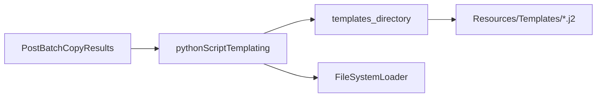

# Replace pkg_resources template paths in pyPhoPlaceCellAnalysis

## Why the current pin does not help

[`setuptools>=78.1.0,<81`](h:\TEMP\Spike3DEnv_ExploreUpgrade\Spike3DWorkEnv\Spike3D\pyproject.toml) only keeps `pkg_resources` available; **importing** it still emits `UserWarning`. The warning in your trace comes from [`pythonScriptTemplating.py`](h:\TEMP\Spike3DEnv_ExploreUpgrade\Spike3DWorkEnv\pyPhoPlaceCellAnalysis\src\pyphoplacecellanalysis\General\Batch\pythonScriptTemplating.py) line 8, which runs on every import of `GreatlakesTurboToScratchHelpers` from [`PostBatchCopyResults.py`](h:\TEMP\Spike3DEnv_ExploreUpgrade\Spike3DWorkEnv\Spike3D\PostBatchCopyResults.py).

## Equivalent replacement (not `import pkg_resources`)

`pkg_resources.resource_filename('pyphoplacecellanalysis.Resources', 'Templates')` returns a **real directory string** for Jinja2 `FileSystemLoader`. The direct equivalent for this package layout ( [`Resources/__init__.py`](h:\TEMP\Spike3DEnv_ExploreUpgrade\Spike3DWorkEnv\pyPhoPlaceCellAnalysis\src\pyphoplacecellanalysis\Resources\__init__.py) + sibling [`Resources/Templates/`](h:\TEMP\Spike3DEnv_ExploreUpgrade\Spike3DWorkEnv\pyPhoPlaceCellAnalysis\src\pyphoplacecellanalysis\Resources\Templates) ) is:

```python
from pathlib import Path

def templates_directory() -> str:
    return str(Path(__file__).resolve().parent / "Templates")
```

- Same return type and semantics as `resource_filename` for editable installs and hatchling wheels (Templates ships next to `Resources/__init__.py`).
- Keeps existing `Environment(loader=FileSystemLoader(template_path))` calls unchanged (minimal risk).
- Avoids `importlib.resources.as_file()`, which is **not** a drop-in for a long-lived loader path (temp extraction lifetime).

**Not using** Jinja2 `PackageLoader` here: pinned [`jinja2==3.0.3`](h:\TEMP\Spike3DEnv_ExploreUpgrade\Spike3DWorkEnv\pyPhoPlaceCellAnalysis\pyproject.toml) may still touch `pkg_resources` internally in some code paths; `FileSystemLoader` + path helper is the safest like-for-like swap.

## Implementation

### 1. Add shared helper on Resources package

In [`Resources/__init__.py`](h:\TEMP\Spike3DEnv_ExploreUpgrade\Spike3DWorkEnv\pyPhoPlaceCellAnalysis\src\pyphoplacecellanalysis\Resources\__init__.py), add `templates_directory() -> str` (after existing imports), with a one-line docstring noting it replaces `pkg_resources.resource_filename(..., 'Templates')`.

### 2. Update three call sites (6 usages)

| File | Changes |
|------|---------|
| [`General/Batch/pythonScriptTemplating.py`](h:\TEMP\Spike3DEnv_ExploreUpgrade\Spike3DWorkEnv\pyPhoPlaceCellAnalysis\src\pyphoplacecellanalysis\General\Batch\pythonScriptTemplating.py) | Remove module-level `import pkg_resources`. Import `templates_directory`. Replace 3× `resource_filename(...)` at lines ~1072, ~1428, ~1486. |
| [`General/PipelineParameterClassTemplating.py`](h:\TEMP\Spike3DEnv_ExploreUpgrade\Spike3DWorkEnv\pyPhoPlaceCellAnalysis\src\pyphoplacecellanalysis\General\PipelineParameterClassTemplating.py) | Remove lazy `import pkg_resources` inside method; use `templates_directory()` at ~138 and ~178. |
| [`General/Batch/NeptuneAiHelpers.py`](h:\TEMP\Spike3DEnv_ExploreUpgrade\Spike3DWorkEnv\pyPhoPlaceCellAnalysis\src\pyphoplacecellanalysis\General\Batch\NeptuneAiHelpers.py) | Same at ~200/232; preserve tab indentation in that function. |

Pattern at each site:

```python
from pyphoplacecellanalysis.Resources import templates_directory

template_path = templates_directory()
env = Environment(loader=FileSystemLoader(template_path))
```

### 3. Verify

- Grep `pyPhoPlaceCellAnalysis` for `pkg_resources` → expect **zero** matches.
- Quick smoke: `python -W default -c "from pyphoplacecellanalysis.General.Batch.pythonScriptTemplating import GreatlakesTurboToScratchHelpers; print('ok')"` — should not print the setuptools `pkg_resources` deprecation warning.
- Re-run your cluster command for `PostBatchCopyResults.py --run-copy-scratch-to-turbo ...` and confirm the **pythonScriptTemplating** warning is gone (hdf5storage warnings may still appear elsewhere; out of scope per your choice).

## Out of scope

- [`hdf5storage`](h:\TEMP\Spike3DEnv_ExploreUpgrade\Spike3DWorkEnv\Spike3D) / third-party `pkg_resources` imports.
- Aligning [`pyPhoPlaceCellAnalysis/pyproject.toml`](h:\TEMP\Spike3DEnv_ExploreUpgrade\Spike3DWorkEnv\pyPhoPlaceCellAnalysis\pyproject.toml) `setuptools>=78.1.0` with Spike3D’s `<81` cap (optional follow-up).


