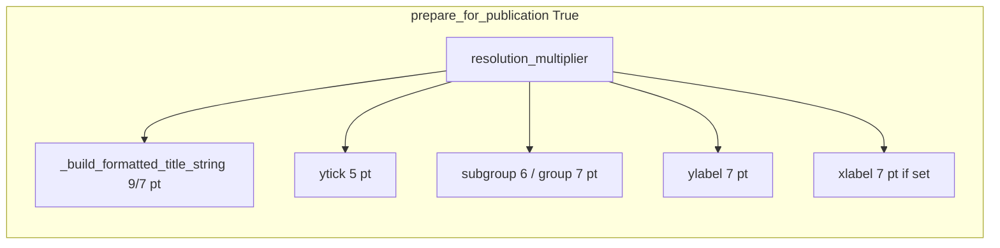

# Use resolution_multiplier for all create_plot text sizes

## Problem

In [`PaperFigureTwo.create_plot`](h:\TEMP\Spike3DEnv_ExploreUpgrade\Spike3DWorkEnv\pyPhoPlaceCellAnalysis\src\pyphoplacecellanalysis\SpecificResults\PhoDiba2023Paper.py) (~6655–6826):

- `resolution_multiplier` is **hardcoded to `2.0`** (line 6661), with `1.0` commented out — so publication text cannot be rendered at true journal point sizes.
- When `prepare_for_publication=True`, the multiplier is applied to flexitext title/subtitle (via `_build_formatted_title_string`), y-tick labels, and grouped x labels (6pt / 7pt subgroups), but **`ax.set_ylabel(ylabel)` / `ax.set_xlabel(xlabel)` have no fontsize** and stay at matplotlib defaults (~10–12pt), which is why `1.0` “doesn’t work” without doubling everything else.

```6820:6826:h:\TEMP\Spike3DEnv_ExploreUpgrade\Spike3DWorkEnv\pyPhoPlaceCellAnalysis\src\pyphoplacecellanalysis\SpecificResults\PhoDiba2023Paper.py
        if prepare_for_publication:
            # Group (LdCs/SdCs) 7pt; subgroup (pre-/post-Δ) 6pt; y-tick numbers 5pt (publication default)

            ytick_fs = float(PhoPublicationFigureHelper.rc_context_kwargs(prepare_for_publication=True)['ytick.labelsize']) * resolution_multiplier
            subgroup_fs, group_fs = (6.0 * resolution_multiplier), (7.0 * resolution_multiplier)
            text_objects['publication_xgroup_axis'] = cls._apply_publication_grouped_xticklabels(ax, group_labels=publication_group_labels, subgroup_labelsize=subgroup_fs, group_labelsize=group_fs)
            ax.tick_params(axis='y', labelsize=ytick_fs)
```

**Out of scope (per your choice):** Fig4 `_apply_fig3_axis_label_sizes` — unchanged.

## Implementation

### 1. Configurable multiplier in `create_plot`

Near the top of `create_plot` (with other `kwargs.pop`s, ~6678):

- `resolution_multiplier: float = float(kwargs.pop('resolution_multiplier', 1.0))`
- Remove the local hardcoded `2.0` and commented `1.0`.

Callers (`fig_2_*`, `display`, etc.) can pass `resolution_multiplier=2.0` when previewing at 2× point sizes; default matches plotly/batch conventions elsewhere in the repo (`1.0`).

### 2. Scale ylabel (and xlabel) in the publication block

In the existing `if prepare_for_publication:` block, after tick/group label setup:

- Define **`axis_label_fs = 7.0 * resolution_multiplier`** (same base as `group_fs`, matching the comment’s publication tier).
- Apply explicitly:
  - `ax.yaxis.label.set_size(axis_label_fs)` (ylabel is always set at ~6796)
  - If `xlabel` is non-empty: `ax.xaxis.label.set_size(axis_label_fs)`

Using `set_size` on the label artists avoids reordering `set_ylabel` / `set_xlabel` calls and preserves LaTeX strings from `_coerce_axis_label`.

### 3. Align `_build_formatted_title_string` default

Change the default parameter on `_build_formatted_title_string` from `resolution_multiplier: float = 2.0` to **`1.0`** (~6590) so defaults stay consistent when that helper is called without an explicit multiplier.

### 4. Docstring touch (optional, one line)

Note in `create_plot` docstring that `resolution_multiplier` scales publication-mode text (title/subtitle when auto-sized, ticks, grouped x labels, y/x axis labels) and is accepted via `**kwargs`.

## Verification (manual)

- `PaperFigureTwo.display(..., prepare_for_publication=True, resolution_multiplier=1.0)`: ylabel, y-ticks, grouped x labels, and flexitext title should all look proportionally small (5–9pt effective).
- Same call with `resolution_multiplier=2.0`: all of the above should double together without changing relative proportions.
- Non-publication path unchanged (no new fontsize logic when `prepare_for_publication=False`).


