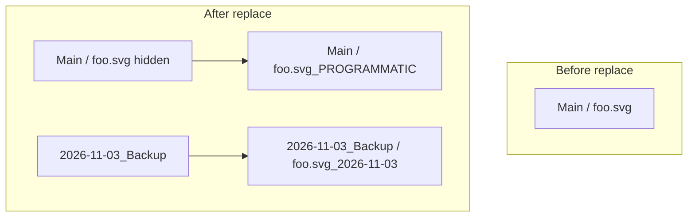

# Root-level backup folder for layer replacement

## Current behavior

In [`layers.py`](h:\TEMP\Spike3DEnv_ExploreUpgrade\Spike3DWorkEnv\Spike3D\EXTERNAL\VectorCraft_Scripting\src\vectorcraft_scripting\layers.py), when `backup_layers=True`:

```233:236:h:\TEMP\Spike3DEnv_ExploreUpgrade\Spike3DWorkEnv\Spike3D\EXTERNAL\VectorCraft_Scripting\src\vectorcraft_scripting\layers.py
            if existing_ids and backup_layers:
                backup_layer_name = live.unique_name(f"{a_layer_name}_{dated}")
                backup_ids = live.duplicate(existing_ids)
                live.execute('object.setProps', {'ids': backup_ids, 'name': backup_layer_name, 'visible': (not hide_backup)})
```

Duplicates stay as **siblings** of the source (e.g. under `Main`), cluttering the active tree. Replacement placement via `_subfn_place_as_sibling` is unchanged and should remain as-is.

## Target behavior



- **One root backup layer per run date**: `{dated}_Backup` (e.g. `2026-11-03_Backup`), where `dated` still comes from `backup_suffix` or `datetime.now().strftime('%Y-%m-%d')`.
- **Reuse** an existing top-level layer with that exact name when present (same-day re-runs append into the same folder).
- **Create** the root layer only when `backup_layers=True` and at least one layer will be backed up (lazy: on first backup in the loop).
- **Each backup item**: still named `{a_layer_name}_{dated}` via `live.unique_name(...)` (your choice).
- **Move** duplicated node(s) **into** the backup root layer (not left as siblings under `Main`).
- **`hide_backup`**: apply to the backup root layer visibility when created; keep per-item `visible` consistent with current `hide_backup` on duplicates.
- **Replacements**: no change to `_subfn_place_as_sibling` / `_subfn_new_sibling_layer`.

## Implementation (single file focus)

All logic lives in [`Layers.replace_layers`](h:\TEMP\Spike3DEnv_ExploreUpgrade\Spike3DWorkEnv\Spike3D\EXTERNAL\VectorCraft_Scripting\src\vectorcraft_scripting\layers.py):

1. **Cache backup root across the layer loop**
   - Before the `for a_layer_name, ...` loop, init `backup_root_id: Optional[Any] = None` and `backup_root_name: Optional[str] = None`.
   - Add nested helper `_subfn_ensure_backup_root(dated: str) -> Tuple[Any, str]`:
     - Target name: `f"{dated}_Backup"` (use `live.unique_name` only if a *non-root* collision exists; prefer exact reuse of an existing **top-level** Layer with that name).
     - If missing: `layer.new` with `visible: not hide_backup`, then position at the bottom of the layer stack (inspect top-level layers from `inspect_document`, `layer.move` with `place: 'below'` on the last root layer — same API already used with `place: 'above'`).
     - Return `(id, name)`.

2. **Move duplicates into backup root**
   - After `live.duplicate` + `object.setProps` (rename + visibility), call `layer.move` with `target=backup_root_id`.
   - **API note**: VectorCraft’s accepted `place` value for nesting is not documented in-repo (only `'above'` is used today). Implement with `'inside'` first; if the control engine rejects it, probe `engine_commands()` / try `'into'` or `'below'` on the backup root’s last child (minimal fallback in the helper only).

3. **Source picking must ignore backup copies**
   - Today `_subfn_pick_source` only skips nodes under a `_PROGRAMMATIC` ancestor. Once backups share the same base name pattern and live under `{dated}_Backup`, `find_by_name(a_layer_name, exact=True)` could return stale matches if we ever name backups exactly like the source — with `{name}_{dated}` suffix, exact source lookup is still safe **unless** the source itself ends with that suffix.
   - Add `_subfn_inside_backup_root(node_id, parent_by_id)`: walk parents; if any ancestor is a top-level Layer whose name ends with `_Backup`, treat as inside backup storage.
   - Extend `_subfn_pick_source` to drop matches where `_subfn_inside_backup_root` is true (future-proof if naming changes).

4. **Refresh parent map after structural moves**
   - After creating/moving into backup root, call `_subfn_inspect_parents()` before placement so `_subfn_place_as_sibling` still sees correct `parent_by_id`.

5. **Reporting**
   - Extend each result row with `backup_root` / `backup_root_id` (same values for all rows in one `replace_layers` call when backups ran).
   - Update class/function docstrings (lines 107–111, 279–280) to describe root backup folder instead of “dated sibling”.

6. **Docs / notebook comments (minimal)**
   - Update the one-line description in [`README.md`](h:\TEMP\Spike3DEnv_ExploreUpgrade\Spike3DWorkEnv\Spike3D\EXTERNAL\VectorCraft_Scripting\README.md) (replace_layers section).
   - Update the notebook comment on `backup_layers_with_date` only if you want it aligned (optional; per notebook rule, ask before editing `.ipynb` unless you confirm).

## Verification (manual, with VectorCraft running)

- Run the notebook cell (or README snippet) with `backup_layers=True` on `figS3_TimeBinDurationOnDecodingPerform.pdf` and three SVG layers.
- Confirm Layers panel: `Main` holds hidden originals + `_PROGRAMMATIC` replacements; single `YYYY-MM-DD_Backup` root contains `{name}_{date}` copies; no dated siblings left under `Main`.
- Re-run same day: new backups land in the **same** `{date}_Backup` layer; idempotent delete of `{name}_PROGRAMMATIC` still works.
- Undo group still rolls back root creation + moves + replacements in one step.

## Out of scope

- No change to `live.backup_document()` (filesystem `_BAK/` copies).
- No legacy “sibling backup” mode unless you later ask for a flag.
