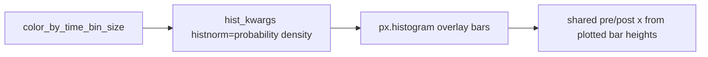

# Figure S3 histogram density normalization

## Problem

S3 overlays several `time_bin_size` series. Absolute histogram counts scale with bin duration (more bins → more rows), so raw-count side histograms cannot be compared. Existing publication plots correctly keep raw counts for single-bin Figure 4 / S8 / S9.

[`plotly_pre_post_delta_scatter`](h:\TEMP\Spike3DEnv_ExploreUpgrade\Spike3DWorkEnv\pyPhoPlaceCellAnalysis\src\pyphoplacecellanalysis\Pho2D\plotly\Extensions\plotly_helpers.py) defaults hist kwargs **without** `histnorm`. Shared pre/post magnitude uses raw `np.histogram` counts from `a_trace.y` (~950–957), which is wrong once bars are density-normalized.

## Approach

Gate density mode on `color_by_time_bin_size` only (same flag as S3 coloring). Use Plotly’s `histnorm='probability density'` (already used by `_helper_build_figure` for multi-tbin exploratory plots).



## Edits

### 1. Set density hist kwargs for S3 — [`PhoDiba2023Paper.py`](h:\TEMP\Spike3DEnv_ExploreUpgrade\Spike3DWorkEnv\pyPhoPlaceCellAnalysis\src\pyphoplacecellanalysis\SpecificResults\PhoDiba2023Paper.py)

In `_perform_plot_iteratively_constrained` (~3304), when building `_tbin_color_kwargs` / `hist_kwargs` for `color_by_time_bin_size`:

```python
_tbin_hist_kwargs = dict(color='time_bin_size', histnorm='probability density')
_plot_kwargs['hist_kwargs'] = deepcopy(_tbin_hist_kwargs)
```

Keep scatter/common color kwargs as today (`color='time_bin_size'` only).

In `_helper_perform_plot_pre_post_delta_scatter` (~7881), when `color_by_time_bin_size`:

```python
hist_kwargs['color'] = "time_bin_size"
hist_kwargs['histnorm'] = 'probability density'
```

(merged later with FigureS8’s `hist_kwargs`, so density survives). Do **not** change the non-S3 publication black/raw-count path.

### 2. Shared magnitude axes under density — [`plotly_helpers.py`](h:\TEMP\Spike3DEnv_ExploreUpgrade\Spike3DWorkEnv\pyPhoPlaceCellAnalysis\src\pyphoplacecellanalysis\Pho2D\plotly\Extensions\plotly_helpers.py)

In `plotly_pre_post_delta_scatter`, when `should_set_hist_same_magnitude_axes` and `hist_kwargs` contains a non-empty `histnorm`, compute the shared max from the **plotted** horizontal-bar magnitudes (`a_trace.x`), not raw counts of `a_trace.y`. Keep the existing raw-count path when `histnorm` is absent (Figure 4 / S8 / S9).

Leave `should_set_hist_same_magnitude_axes=True` for S3 so pre-Δ and post-Δ density axes stay comparable.

## Out of scope

- No change to summary four-bar / stats for S3 (still off).
- No change to single-bin publication histogram appearance.