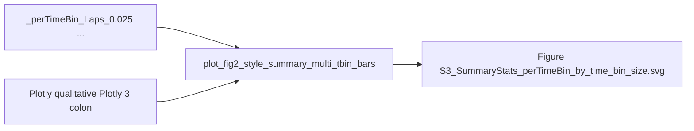

# Figure S3 single multi–time-bin summary bars

## Goal

One summary figure for S3: **side-by-side bars for each `time_bin_size`**, color-matched to the main S3 scatter (`px.colors.qualitative.Plotly[3:]` with t-bins ordered by float, same as [`_subfn_build_categorical_color_kwargs`](h:\TEMP\Spike3DEnv_ExploreUpgrade\Spike3DWorkEnv\pyPhoPlaceCellAnalysis\src\pyphoplacecellanalysis\Pho2D\plotly\Extensions\plotly_helpers.py)).

Layout (chosen default): keep the four condition columns; within each column, N opaque bars (one per t-bin), same color across Laps/PBEs for a given t-bin.



## 1. Shared t-bin color map helper

Add on `FigureS8` (or `PrePostDeltaDistributionComparison`) in [`PhoDiba2023Paper.py`](h:\TEMP\Spike3DEnv_ExploreUpgrade\Spike3DWorkEnv\pyPhoPlaceCellAnalysis\src\pyphoplacecellanalysis\SpecificResults\PhoDiba2023Paper.py):

```python
@classmethod
def time_bin_size_discrete_color_map(cls, time_bin_sizes) -> Dict[str, str]:
    # ordered = _sorted_split_values(..., 'time_bin_size')
    # colors = plotly.express.colors.qualitative.Plotly[3:]
    # return {tbin: colors[i % len(colors)] for i, tbin in enumerate(ordered)}
```

Use this for the summary bars so colors stay aligned with S3 scatter/hist series.

## 2. New plotter: `PrePostDeltaDistributionComparison.plot_fig2_style_summary_multi_tbin_bars`

Inputs:

- `results_by_tbin: Dict[str, Tuple[laps_results, pbe_results]]` (or build from `pre_post_delta_stats_results_dict` + ordered tbin keys)
- `time_bin_color_map: Dict[str, str]`
- Same save/publication kwargs as `plot_fig2_style_summary_four_bar` (`export_folder`, `fig_file_name`, animal markers, etc.)

Behavior:

- X groups at positions `0,1,2,3`: Laps pre/post, PBEs pre/post (same labels as today’s four-bar)
- For each group, place `N` bars centered on that x with width `~0.7/N`, colored by `time_bin_color_map[tbin]`
- Bar height = session-mean of `mean_pre` / `mean_post` (mean across sessions), with animal-marker session scatters + paired pre→post lines per t-bin (reuse dodge/marker logic from the existing four-bar)
- Significance brackets: per t-bin, connect that t-bin’s Laps pre↔post and PBEs pre↔post using each run dict’s `p_value`
- Legend: patches for each `time_bin_size` (seconds); keep animal marker legend if present
- No heuristic-passing series (S3 has heuristics off)
- Save one SVG/PDF via the same `FigureCollector` / `build_and_write_to_file` path as the four-bar

Prefer calling `PaperFigureTwo.create_plot` with expanded `y_values` / `bar_x` / `bar_width` / `bar_colors` lists (`4*N` entries), matching the heuristic-split pattern already in `plot_fig2_style_summary_four_bar`.

## 3. Wire Figure S3 summary in `FigureS8.main_all_figs`

When `fig_color_by_time_bin_size` and stats keys are t-bin-suffixed:

- Collect ordered t-bin group names (existing `_subfn_iter_summary_four_bar_specs` / `_sorted_split_values`)
- Build `results_by_tbin` and `time_bin_size_discrete_color_map`
- Call **once** `plot_fig2_style_summary_multi_tbin_bars(...)`
- Store on `_out_figs_dict_dict_dict['fig_summary']`
- **Skip** the per-tbin four-bar loop and vertical SVG/PDF stacking for S3

Figure 4 / S8 / S9 keep the existing single or animal-split four-bar path.

## Out of scope

- Changing S3 scatter/hist coloring
- Heuristic overlay on this summary
- Changing how per-tbin stats are computed (already stratified)