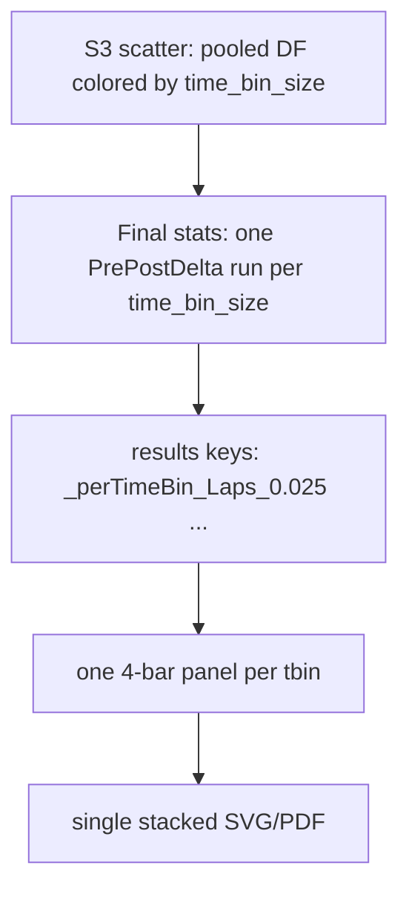

# Figure S3 per–time-bin summary stats

## Goal

One summary figure for Figure S3 that shows the pre/post session-mean effect **for each `time_bin_size`**, without changing overlaid multi-tbin scatters or Figure 4 / S8 / S9.

## Approach

Reuse the existing S9 pattern: compute stats under keys `_perTimeBin_Laps_{tbin}` / `_perTimeBin_PBEs_{tbin}`, emit one `plot_fig2_style_summary_four_bar` panel per t-bin, then `SVGHelpers.concatenate_svgs_vertically` into a single file.

Do **not** set `split_by_column='time_bin_size'` (that would also split scatters). Stratify **stats only** when `color_by_time_bin_size=True`.

## Edits — [`PhoDiba2023Paper.py`](h:\TEMP\Spike3DEnv_ExploreUpgrade\Spike3DWorkEnv\pyPhoPlaceCellAnalysis\src\pyphoplacecellanalysis\SpecificResults\PhoDiba2023Paper.py)

### 1. Stratify Final stats by `time_bin_size` (`_perform_plot_iteratively_constrained` / `_export_stage`)

When `should_compute_or_annotate_stats` and `k == 'Final'` and `color_by_time_bin_size` and `time_bin_size.nunique() > 1`:

- For each unique t-bin (numeric sort), subset `group_df`, run `_compute_pre_post_delta_stats`
- Store `_out_stats_dict['Final'][str(tbin)] = {'all': (...)}` (no pooled `None` key — pooled `_perTimeBin_Laps` would short-circuit `_subfn_iter_summary_four_bar_specs`)
- Keep existing pooled path when not `color_by_time_bin_size` (or only one t-bin)
- Leave scatter plotting pooled (unchanged)

### 2. Numeric sort for t-bin group names

In `_sorted_split_values`, when `split_by_column == 'time_bin_size'`, sort by `float(s)` (fallback string).

### 3. Figure S3 config + summary stack label (`main_all_figs`)

Update default Figure S3 config:

- `'should_compute_stats': True`
- `'separate_laps_pbes_figures': False` so each t-bin is one Laps+PBEs 4-bar panel (then one stacked SVG of those panels)

Before calling `main`, capture `fig_color_by_time_bin_size = fig_config_dict.get('color_by_time_bin_size', False)`.

In the summary block:

- Order groups with `_sorted_split_values(..., split_by_column='time_bin_size' if fig_color_by_time_bin_size else (split_by_column or 'animal'))`
- Title each panel `Decoded $P_{Short}$ | t_bin={group_name}s` when `fig_color_by_time_bin_size`
- Stack filename use `by_time_bin_size` when `fig_color_by_time_bin_size` (today falls back to `by_animal` because `split_by_column` is None)

Existing animal-split summary path for S9 unchanged.

## Out of scope

- No new multi-series 4-bar API (N t-bins on one axes)
- No heuristic-passing series on S3 summary
- No scatter annotations (`enable_add_stats_to_figures` stays False)