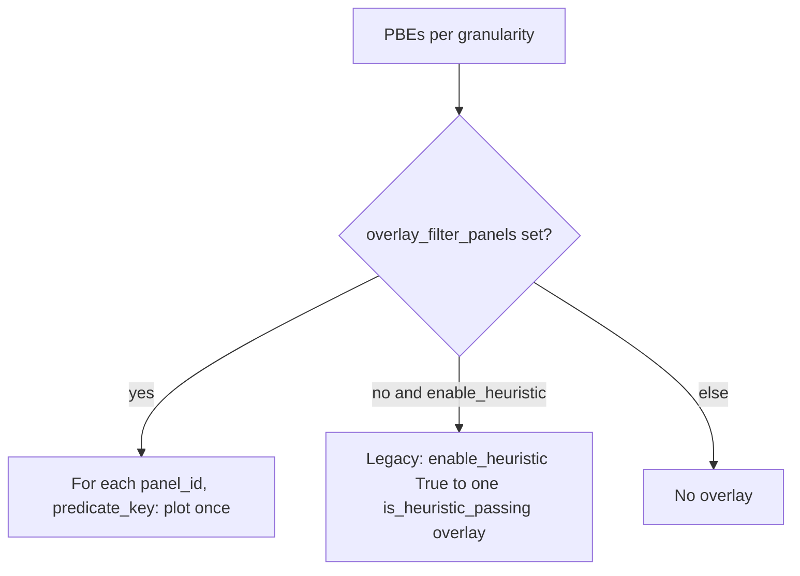

# S8 dual named overlay-filter panels

## Goal

Figure S8 exports **two** PBE `_perTimeBin` overlay scatters (F8a, F8b). Each uses today’s overlay style (grey = all constrained PBEs; green = predicate-passing) but the predicate comes from a **named key** in `additional_filter_predicates`, not a hard-coded `is_heuristic_passing`.

Defaults (overridable in `figures_config_dict`):

- F8a → `sig_spearman_z`
- F8b → `is_heuristic_passing`

## Config shape

In notebook + `FigureS8.main_all_figs` defaults for Figure S8:

```python
'Figure S8': {
    ...
    'enabled_granularities': ('_perTimeBin',),
    'enabled_epoch_kinds': ('PBEs',),
    'overlay_filter_panels': (
        ('F8a', 'sig_spearman_z'),
        ('F8b', 'is_heuristic_passing'),
    ),
},
```

S9 stays a single animal-split heuristic overlay (`enable_heuristic_filtered_outputs=True`); no dual panels unless added later.

## Code changes ([PhoDiba2023Paper.py](h:/TEMP/Spike3DEnv_ExploreUpgrade/Spike3DWorkEnv/pyPhoPlaceCellAnalysis/src/pyphoplacecellanalysis/SpecificResults/PhoDiba2023Paper.py))

### 1. Generalize overlay in `_perform_plot_iteratively_constrained`

Replace boolean `should_overlay_heuristic_filter` with:

- `overlay_filter_predicate_key: Optional[str] = None`

When set:

- resolve `additional_filter_predicates[overlay_filter_predicate_key]`
- same overlay path as today (passing → foreground + green; full `group_df` → `background_data_results_df`)
- stats stage key / debug keys use the predicate name (e.g. `sig_spearman_z`), not hard-coded `heuristic_passing`
- title suffix: ` ({overlay_filter_predicate_key})`

Keep a thin compat shim: `should_overlay_heuristic_filter=True` maps to `overlay_filter_predicate_key='is_heuristic_passing'`.

### 2. Drive panels from `main`

Add `overlay_filter_panels: Optional[Sequence[Tuple[str, str]]] = None` to `FigureS8.main`.

For each enabled epoch kind (PBEs for S8):



- Export suffix / basename include panel id, e.g. `ScatterOverTime_PBEs_perTimeBin_F8a`
- Stats result keys: `_perTimeBin_PBEs_F8a` plus sibling `_perTimeBin_PBEs_F8a_sig_spearman_z` (and likewise F8b / `is_heuristic_passing`)

### 3. Summary four-bar heuristic sibling

`_subfn_iter_summary_four_bar_specs` currently looks for `*_PBEs_heuristic_passing`. Also accept `*_is_heuristic_passing` so existing summary wiring still finds heuristic-passing stats when Laps are re-enabled later. No change required for current S8 (Laps skipped → summary already WARNs/skips).

### 4. Notebook

Update Figure S8 entry in the `figures_config_dict` cell to pass `overlay_filter_panels` with the two defaults above (granularity/epoch_kind flags already present).

## Out of scope

- Changing overlay colors per panel (both keep `HEURISTIC_PASSING_COLOR` green)
- Dual panels for S9
- Re-enabling Laps scatter / summary for S8
