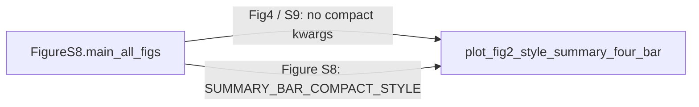

# Isolate S8 summary sizing from shared four-bar defaults

## Problem

[`plot_fig2_style_summary_four_bar`](h:\TEMP\Spike3DEnv_ExploreUpgrade\Spike3DWorkEnv\pyPhoPlaceCellAnalysis\src\pyphoplacecellanalysis\SpecificResults\PhoDiba2023Paper.py) is shared by Figure 4, S8, S9 (via `FigureS8.main_all_figs`). Recent defaults now force every caller:

- `figsize = 0.75 * rc` both dims
- forced scatter `s` / thinner edge linewidths
- `bbox_inches='tight', pad_inches=0.25` on all saves

Fig4 previously used separate Laps/PBEs panels at **half width, full height**, default mpl scatter `s`, `markersize=6`, and SVG save **without** tight bbox.

## Approach

Restore legacy defaults inside the shared function; inject an S8-only style dict at the `main_all_figs` call site when `fig_name == 'Figure S8'`.



## Changes in [`PhoDiba2023Paper.py`](h:\TEMP\Spike3DEnv_ExploreUpgrade\Spike3DWorkEnv\pyPhoPlaceCellAnalysis\src\pyphoplacecellanalysis\SpecificResults\PhoDiba2023Paper.py)

### 1. `FigureS8` constants for S8 compact summary style

Near existing color constants, add something like:

```python
SUMMARY_BAR_COMPACT_STYLE: Dict[str, Any] = dict(
    figsize_scale=0.75,          # both width and height vs rc figure.figsize
    scatter_s=8.0,
    legend_markersize=4.0,
    save_bbox_inches='tight',
    save_pad_inches=0.25,
)
```

(Use the compact marker sizes from the intentional S8 shrink, not the near-default `s=18` currently in the shared defaults.)

### 2. Restore shared `plot_fig2_style_summary_four_bar` defaults

- Remove unconditional `kwargs['figsize'] = 0.75 * rc`.
- Restore panel figsize logic:

```python
if 'figsize' not in panel_kwargs:
    rc_w, rc_h = mpl.rcParams['figure.figsize']
    if 'figsize_scale' in panel_kwargs:  # popped earlier into a local
        scale = float(figsize_scale)
        panel_kwargs['figsize'] = (rc_w * scale, rc_h * scale)
    else:
        width_scale = 1.0 if panel_has_extras else 0.5
        panel_kwargs['figsize'] = (rc_w * width_scale, float(rc_h))
```

- Pop optional kwargs with **legacy defaults**:
  - `figsize_scale=None` (means use width_scale rule above; when set, apply to both dims for panel + combined path)
  - `scatter_s=None` → do **not** put `s` in `scatter_kwargs` (mpl default)
  - `legend_markersize=6.0`
  - `save_bbox_inches=None`, `save_pad_inches=0.0` → SVG/`build_and_write_to_file` omit tight unless provided
- Default `scatter_kwargs` back to `edgecolors='white', linewidths=0.4, zorder=4` (+ `s` only if `scatter_s` is not None).
- Combined (non-separate) path: only set figsize when `figsize_scale` is provided; otherwise leave create_plot figsize unset (pre-S8).

### 3. Wire S8-only kwargs in `main_all_figs`

Where `plot_kwargs` is built (~6645) before `plot_fig2_style_summary_four_bar`:

```python
if fig_name == 'Figure S8':
    plot_kwargs.update(cls.SUMMARY_BAR_COMPACT_STYLE)
```

No notebook edits required; S8 picks up the compact style automatically. Fig4/S9 keep restored defaults.

## Out of scope

- Figure S3 multi-tbin path (`plot_fig2_style_summary_multi_tbin_bars`) — already separate.
- Changing VectorCraft placement templates.
- Applying compact style to S9 (only `Figure S8` by name).
