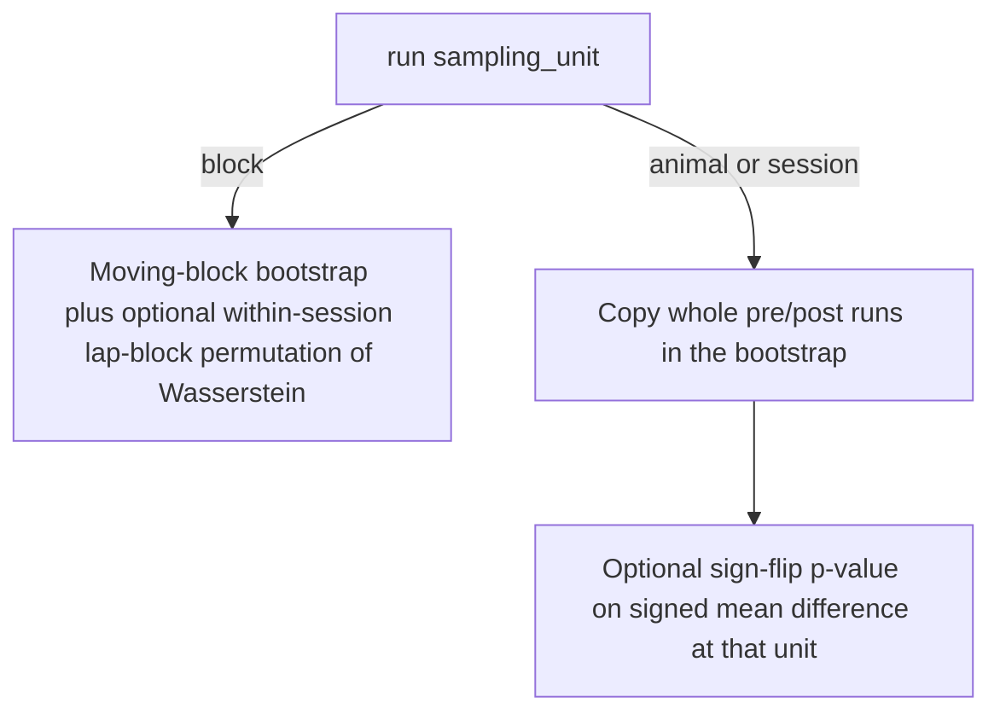

# Safe animal/session tests via `sampling_unit`

Add one kwarg on [`run()`](h:\TEMP\Spike3DEnv_ExploreUpgrade\Spike3DWorkEnv\pyPhoPlaceCellAnalysis\src\pyphoplacecellanalysis\SpecificResults\PendingNotebookCode.py) in `PrePostDeltaDistributionComparison`. Default stays the current lap-block path so existing notebook calls do not change.

```python
def run(self, perform_block_permutation_test=False, n_permutations=2000, sampling_unit='block'):
```

Valid values: `'block'` | `'animal'` | `'session'` (plain strings, not Enum, so notebook autoreload cannot break identity checks).



## What `'animal'` / `'session'` change

**Bootstrap.** [`_hierarchical_bootstrap`](h:\TEMP\Spike3DEnv_ExploreUpgrade\Spike3DWorkEnv\pyPhoPlaceCellAnalysis\src\pyphoplacecellanalysis\SpecificResults\PendingNotebookCode.py) already resamples animals, then sessions. For cluster units, skip [`_moving_block_resample_lap_ids`](h:\TEMP\Spike3DEnv_ExploreUpgrade\Spike3DWorkEnv\pyPhoPlaceCellAnalysis\src\pyphoplacecellanalysis\SpecificResults\PendingNotebookCode.py) and copy each run's `lap_ids` intact. Still resample animals and sessions. Also store a 95% CI for the **mean of unit-level** `mean_difference_post_minus_pre` (this is the quantity the p-value tests). Keep the existing Wasserstein CI as a descriptive interval; it cannot test a signed null.

**P-value.** Wasserstein is unchanged if you swap pre and post, so a paired cluster test cannot use it. When `perform_block_permutation_test=True` and `sampling_unit` is `'animal'` or `'session'`, run a two-sided **sign-flip permutation** of the unit-level signed mean difference (`post.mean() - pre.mean()`):

- Animal: one effect per animal (every animal already has both conditions).
- Session: one effect per session that has both conditions; skip one-sided sessions.
- If `2**n_units <= n_permutations` and `n_units <= 20`, enumerate all sign assignments (exact). Otherwise Monte Carlo with `(1 + count) / (n_permutations + 1)`.
- Top-level `p_value` is this test. `permutation_results` records `effect='mean_difference_post_minus_pre'`, `sampling_unit`, `n_units`, `exact` vs `monte_carlo`, and a status string that says this is a paired cluster test, not lap-block exchangeability.

**`'block'`.** Unchanged: moving-block bootstrap and optional within-session lap-block Wasserstein permutation.

## Code changes (one file)

[`PendingNotebookCode.py`](h:\TEMP\Spike3DEnv_ExploreUpgrade\Spike3DWorkEnv\pyPhoPlaceCellAnalysis\src\pyphoplacecellanalysis\SpecificResults\PendingNotebookCode.py) only:

- Extend `_hierarchical_bootstrap` with a `resample_within_run: bool` (True for `'block'`).
- Add `_session_effect_rows()` to build the same mean/median/Wasserstein columns as `animal_summary`, one row per session with both conditions.
- Add `_paired_sign_permutation_test(effects, n_permutations)` for the sign-flip test.
- In `run()`: validate `sampling_unit`; choose bootstrap mode; if permutation requested, dispatch to `_block_permutation_test` vs the paired test; add `sampling_unit`, `p_value_effect`, `session_summary` (when computed), and `mean_difference_bootstrap_95ci` (cluster modes only) to the return dict.
- Update the class and `run()` docstrings to state: cluster modes do not resample laps or time bins; the p-value is for the signed mean difference; session-level tests treat sessions as exchangeable and therefore ignore within-animal dependence.

Do not edit notebooks. Existing `run()` calls keep `'block'` by default.

## Usage

```python
pre_post_delta_results = comparison.run(
    perform_block_permutation_test=True,
    sampling_unit='animal',  # or 'session'
)
```
