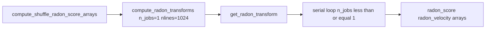

# Safe single-thread shuffle Radon

## Problem

Shuffle radon already exists behind `enable_radon_shuffle_scoring`, but [`compute_shuffle_radon_score_arrays`](h:\TEMP\Spike3DEnv_ExploreUpgrade\Spike3DWorkEnv\pyPhoPlaceCellAnalysis\src\pyphoplacecellanalysis\General\Pipeline\Stages\ComputationFunctions\MultiContextComputationFunctions\SequenceBasedComputations.py) calls `DecodedFilterEpochsResult.compute_radon_transforms` with **no** `n_jobs` / `nlines`, so it inherits:

- `nlines=8192`
- `n_jobs=4` → `joblib.Parallel` in [`get_radon_transform`](h:\TEMP\Spike3DEnv_ExploreUpgrade\Spike3DWorkEnv\pyPhoPlaceCellAnalysis\src\pyphoplacecellanalysis\Analysis\Decoder\decoder_result.py) (the GL freeze risk)
- `debug_print=True` hardcoded in [`reconstruction.py`](h:\TEMP\Spike3DEnv_ExploreUpgrade\Spike3DWorkEnv\pyPhoPlaceCellAnalysis\src\pyphoplacecellanalysis\Analysis\Decoder\reconstruction.py) (~1419)

[`ProcessBatchOutputs_qclus1246789_Only.ipy`](h:\TEMP\Spike3DEnv_ExploreUpgrade\Spike3DWorkEnv\Spike3D\ProcessBatchOutputs_qclus1246789_Only.ipy) also conflicts: force-recompute sets `enable_radon_shuffle_scoring=True` (~376) while flat override sets `wcorr_shuffle_analysis.enable_radon_shuffle_scoring: False` (~387).

**Chosen shuffle defaults:** `n_jobs=1`, `nlines=1024` (~8× fewer test lines than 8192), `margin=8` (unchanged), `debug_print=False`. Pipeline / non-shuffle radon left alone.

## 1. Thread safe kwargs through shuffle radon

In [`SequenceBasedComputations.py`](h:\TEMP\Spike3DEnv_ExploreUpgrade\Spike3DWorkEnv\pyPhoPlaceCellAnalysis\src\pyphoplacecellanalysis\General\Pipeline\Stages\ComputationFunctions\MultiContextComputationFunctions\SequenceBasedComputations.py):

- Add class-level constants near `SCORE_EXTREME_MODE`:
  - `SHUFFLE_RADON_NLINES = 1024`
  - `SHUFFLE_RADON_N_JOBS = 1`
  - `SHUFFLE_RADON_MARGIN = 8`
- Extend `compute_shuffle_radon_score_arrays(..., nlines=None, margin=None, n_jobs=None)` to use those constants when args are `None`.
- Pass them into `a_result.compute_radon_transforms(..., nlines=..., margin=..., n_jobs=..., enable_return_neighbors_arr=False, debug_print=False)`.

## 2. Allow `debug_print=False` on the wrapper

In [`reconstruction.py`](h:\TEMP\Spike3DEnv_ExploreUpgrade\Spike3DWorkEnv\pyPhoPlaceCellAnalysis\src\pyphoplacecellanalysis\Analysis\Decoder\reconstruction.py) `DecodedFilterEpochsResult.compute_radon_transforms`:

- Add `debug_print: bool = True` to the signature (keep current default for non-shuffle callers).
- Forward it to `get_radon_transform` instead of hardcoding `True`.

## 3. Enable radon for shuffle by default (safe path only)

Once kwargs are enforced:

- Set `enable_radon_shuffle_scoring` default to **`True`** on `DecodedEpochScoreShuffle`, `perform_epoch_score_shuffle_analysis` / `perform_wcorr_shuffle_analysis`, and [`wcorr_shuffle_analysis_Parameters`](h:\TEMP\Spike3DEnv_ExploreUpgrade\Spike3DWorkEnv\pyPhoPlaceCellAnalysis\src\pyphoplacecellanalysis\General\Model\SpecificComputationParameterTypes.py) (attrs field + PARAM).
- Keep `__setstate__` fill for missing flag as `True` only if you want old pickles to opt in on next compute; prefer leaving `__setstate__` fill at **`False`** so loaded incomplete results do not silently start radon until the next explicit compute with the new default.

## 4. Overlay / transfer parity

In [`PhoDiba2023Paper.py`](h:\TEMP\Spike3DEnv_ExploreUpgrade\Spike3DWorkEnv\pyPhoPlaceCellAnalysis\src\pyphoplacecellanalysis\SpecificResults\PhoDiba2023Paper.py) (~117–119):

- Add `'radon_score'` to `SHUFFLE_TRANSFER_METRIC_NAMES`.
- Add `'radon_score_z'`, `'best_overall_radon_score_z'` to `SHUFFLE_OVERLAY_KEYS`.
- Add `'radon_score_z'` to `DEFAULT_OVERLAY_INCLUDED_COLUMNS`.

Raw/z columns still come from the existing `real_score_arrays` / `SCORE_EXTREME_MODE` wide-DF path (`radon_score_*`, `radon_velocity_*`).

## 5. Align the qclus batch notebook overrides

In [`ProcessBatchOutputs_qclus1246789_Only.ipy`](h:\TEMP\Spike3DEnv_ExploreUpgrade\Spike3DWorkEnv\Spike3D\ProcessBatchOutputs_qclus1246789_Only.ipy):

- Keep `epoch_score_shuffle_analysis.enable_radon_shuffle_scoring=True`.
- Change `wcorr_shuffle_analysis.enable_radon_shuffle_scoring` flat override from `False` → **`True`** so it no longer fights the force-recompute dict.

Do not change `directional_decoders_evaluate_epochs` radon settings in that notebook (already `n_jobs=1` / skip as configured).

## 6. Tests

In [`tests/test_epoch_score_shuffle.py`](h:\TEMP\Spike3DEnv_ExploreUpgrade\Spike3DWorkEnv\pyPhoPlaceCellAnalysis\tests\test_epoch_score_shuffle.py):

- Patch `DecodedFilterEpochsResult.compute_radon_transforms` (or call `compute_shuffle_radon_score_arrays` with a mock result) and assert the call uses `n_jobs=1` and `nlines=1024`.
- Assert `SCORE_EXTREME_MODE` still has `radon_score` / `radon_velocity`.

## Out of scope

- Changing pipeline `_compute_all_df_score_metrics` radon (`nlines=8192`, `n_jobs` from evaluate_epochs).
- Changing NeuroPy `radon_transform` algorithm.
- Enabling neighbors arrays (`enable_return_neighbors_arr` stays `False`).
