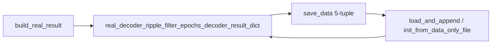

# Persist real decode results on WCorrShuffle

## Problem
[`build_real_result`](h:/TEMP/Spike3DEnv_ExploreUpgrade/Spike3DWorkEnv/pyPhoPlaceCellAnalysis/src/pyphoplacecellanalysis/General/Pipeline/Stages/ComputationFunctions/MultiContextComputationFunctions/SequenceBasedComputations.py) already returns `real_decoder_ripple_filter_epochs_decoder_result_dict`, but [`init_from_templates`](h:/TEMP/Spike3DEnv_ExploreUpgrade/Spike3DWorkEnv/pyPhoPlaceCellAnalysis/src/pyphoplacecellanalysis/General/Pipeline/Stages/ComputationFunctions/MultiContextComputationFunctions/SequenceBasedComputations.py) discards it and only stores `real_decoder_ripple_weighted_corr_arr`. [`save_data`](h:/TEMP/Spike3DEnv_ExploreUpgrade/Spike3DWorkEnv/pyPhoPlaceCellAnalysis/src/pyphoplacecellanalysis/General/Pipeline/Stages/ComputationFunctions/MultiContextComputationFunctions/SequenceBasedComputations.py) therefore cannot export real posteriors.

## Approach
Always keep the real ripple decode dict on the object (one set of epochs — not gated by `enable_saving_entire_decoded_shuffle_result`, which only controls the large per-shuffle list). Append it as a **5th** pickle element so existing 3/4-tuple files still load.

## Changes (single file)
[`SequenceBasedComputations.py`](h:/TEMP/Spike3DEnv_ExploreUpgrade/Spike3DWorkEnv/pyPhoPlaceCellAnalysis/src/pyphoplacecellanalysis/General/Pipeline/Stages/ComputationFunctions/MultiContextComputationFunctions/SequenceBasedComputations.py)

1. **New field** on `WCorrShuffle` (next to `real_decoder_ripple_weighted_corr_arr`):
   - `real_decoder_ripple_filter_epochs_decoder_result_dict: Optional[DecodedEpochsResultsDict] = serialized_field(default=None, repr=False)`

2. **`init_from_templates`**: pass the dict from `build_real_result` into the constructor (stop discarding it).

3. **`save_data`**: extend payload to
   `(output_extracted_result_wcorrs_list, real_decoder_ripple_weighted_corr_arr, output_all_shuffles_decoded_results_list, all_shuffles_wcorr_array, real_decoder_ripple_filter_epochs_decoder_result_dict)`

4. **Loaders — backward compatible**:
   - `load_and_append_shuffle_data`: keep current 4-way unpack + `*rest`; if `rest` has the real dict and `self.real_decoder_ripple_filter_epochs_decoder_result_dict is None`, assign it (do not replace an existing non-None real).
   - `init_from_data_only_file`: fix current 3-tuple unpack bug; accept 3/4/5-tuple and set wcorr list, real wcorr arr, shuffle decoded list, optional stacked wcorr array (ignored for object rebuild), and optional real decode dict.

5. **Docstring** on `save_data` noting the 5-tuple layout and that older pickles omit the last element.

No notebook edits; consumers use `wcorr_ripple_shuffle.real_decoder_ripple_filter_epochs_decoder_result_dict[decoder].p_x_given_n_list[ei]` after recompute/save with the new code.
