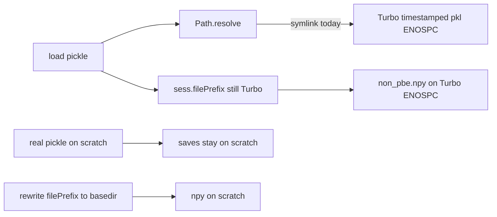

# One-shot scratch writes for qclus1246789 GL

Jobs already use a scratch `session_basedir`. They still fail because (1) the local pickle is a **symlink**, so `.resolve()` and `save_pipeline` write timestamped backups on Turbo, and (2) pickled `sess.filePrefix` still points at Turbo, and `post_load_fixup_sess_basedirs` will not rewrite it while that Turbo parent exists — so `non_pbe.npy` is saved on Turbo and hits ENOSPC.

## 1. Staging in [ProcessBatchOutputs_qclus1246789_Only.ipy](h:\TEMP\Spike3DEnv_ExploreUpgrade\Spike3DWorkEnv\Spike3D\ProcessBatchOutputs_qclus1246789_Only.ipy)

Replace symlink staging with copy + cleanup:

- Before copying, **unlink leftover Turbo-pointing symlinks** under each scratch session folder (the previous per-file linking run). Do not delete real files. Recreate `output/` as a real directory.
- **Copy** (not symlink) the exact local pickle: `loadedSessPickle_withNormalComputedReplays-qclu_[1, 2, 4, 6, 7, 8, 9]-frateThresh_2.0.pkl`. If dest is a symlink, unlink it first then `shutil.copy2`.
- **Copy** `output/global_computation_results_...-tbin_75ms.pkl` if it exists; otherwise leave `output/` empty for `final_run` to write it.
- Do not copy `.h5`. Do not glob other pickles.
- Keep the one sibling layout link `/scratch/.../halechr/KDIBA` → `Data/KDIBA` (does not point at Turbo).
- Bake `session_basedirs_dict` from the unresolved scratch tree (`/scratch/.../Data/KDIBA/...`).

Remove `ensure_load_only_symlink`. Keep prints to a few lines per session (`cleaned N symlinks`, `copied local`, `copied/missing global`).

## 2. Force save paths onto scratch at load (required, small library)

`.ipy` staging alone cannot intercept `post_compute_validate` — that runs inside the job before completion functions and currently saves `non_pbe.npy` via Turbo `filePrefix`.

In [`NeuropyPipeline.py`](h:\TEMP\Spike3DEnv_ExploreUpgrade\Spike3DWorkEnv\pyPhoPlaceCellAnalysis\src\pyphoplacecellanalysis\General\Pipeline\NeuropyPipeline.py) `_ensure_unpickled_session_up_to_date` (already sets `config.basepath = basedir` when it differs), also set:

`a_sess.filePrefix = Path(basedir).joinpath(a_sess.filePrefix.name)` when `filePrefix` is set and not already under `basedir`.

`basedir` here is already the scratch `curr_session_basedir` passed into `try_init_from_saved_pickle_or_reload_if_needed`.

In [`Computation.py`](h:\TEMP\Spike3DEnv_ExploreUpgrade\Spike3DWorkEnv\pyPhoPlaceCellAnalysis\src\pyphoplacecellanalysis\General\Pipeline\Stages\Computation.py) `post_load_fixup_sess_basedirs`: when `force_update` is True, rewrite `filePrefix` to `updated_session_basepath / filePrefix.name` even if the old Turbo parent still exists.

In [`batch_user_completion_helpers.py`](h:\TEMP\Spike3DEnv_ExploreUpgrade\Spike3DWorkEnv\pyPhoPlaceCellAnalysis\src\pyphoplacecellanalysis\General\Batch\BatchJobCompletion\UserCompletionHelpers\batch_user_completion_helpers.py) `FINAL_UPDATE_FILEPATHS`, pass `updated_session_basepath=Path(curr_active_pipeline.sess.basepath)` only after the load rewrite above; no extra driver hook needed if load already set scratch `basepath`/`filePrefix`.

Together: pickle backups land next to the real scratch pickle; `non_pbe.npy` lands under scratch `filePrefix`; global pickle writes under scratch `output/`.

## 3. Out of scope

- No other `ProcessBatchOutputs_*.ipy` files.
- Do not copy anything else. `final_run` loads the copied local pickle.
