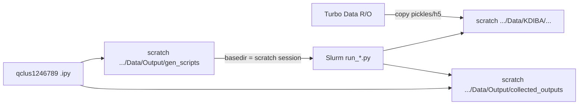

# Scratch write fallback for qclus1246789 batch

Modify only [ProcessBatchOutputs_qclus1246789_Only.ipy](h:\TEMP\Spike3DEnv_ExploreUpgrade\Spike3DWorkEnv\Spike3D\ProcessBatchOutputs_qclus1246789_Only.ipy). No library/template changes. Generated jobs already bake `curr_session_basedir` and `collected_outputs_path` from this driver ([python_template.py.j2](h:\TEMP\Spike3DEnv_ExploreUpgrade\Spike3DWorkEnv\pyPhoPlaceCellAnalysis\src\pyphoplacecellanalysis\Resources\Templates\python_template.py.j2) line 44; completion-header template in `batch_user_completion_helpers.py`).

Chosen staging: **copy pickle/h5 mutables only** (no Turbo `.dat`/`.xml` symlinks). This matches a `final_run` that loads existing qclus pickles. Do not use `clean_run` in this mode.



## Paths (GL)

- Turbo source: `/nfs/turbo/umms-kdiba/Data` (keep as the **read** root for discovering sessions)
- Scratch data: `/scratch/kdiba_root/kdiba99/halechr/Data`
- Scratch outputs: `/scratch/kdiba_root/kdiba99/halechr/Data/Output/gen_scripts` and sibling `collected_outputs`

Flag near the path block:

```python
FORCE_SCRATCH_WRITES: bool = True  # set False when Turbo is writable again
```

Activate only when that flag is True **and** the scratch Data root exists (no-op on Apogee/Windows). Create Output dirs with `mkdir(parents=True, exist_ok=True)` so `find_first_extant_path` is not required — the current `known_scripts_output_paths` list never includes this GL scratch path and would otherwise land on a Turbo/cloud gen_scripts folder.

Print immediately after resolution:

- `scripts_output_path`
- `collected_outputs_path`
- `turbo_data_root` vs `scratch_data_root`

## Stage mutables, then retarget basedirs

After `included_session_contexts` is set, still discover sessions on Turbo via existing `known_global_data_root_parent_paths` / `ConcreteSessionFolder.build_concrete_session_folders`.

Then copy into the parallel scratch tree using existing helpers (`discover_syncable_result_files`, `build_cross_root_copydict`, `copy_movedict` from [path_helpers.py](h:\TEMP\Spike3DEnv_ExploreUpgrade\Spike3DWorkEnv\pyPhoCoreHelpers\src\pyphocorehelpers\Filesystem\path_helpers.py) / [concrete_session_folder.py](h:\TEMP\Spike3DEnv_ExploreUpgrade\Spike3DWorkEnv\pyPhoPlaceCellAnalysis\src\pyphoplacecellanalysis\General\Batch\concrete_session_folder.py)):

- `include_preprocessing_npy=False`
- Extra globs (canonical unsuffixed names miss the qclus/tbin files this batch actually uses):
  - `loadedSessPickle*.pkl`
  - `output/global_computation_results*.pkl`
  - `output/pipeline*.h5`
  - `output/pipeline_results*.h5`
- `skip_if_dest_newer_or_equal=True` so a previous scratch run is not clobbered by older Turbo copies
- `mkdir` each scratch `session/` and `session/output/` even if no files copied yet (so later saves have a dest)

Per session print:

```
[SCRATCH STAGE] kdiba_gor01_one_2006-6-08_14-26-15
  turbo:   /nfs/turbo/.../2006-6-08_14-26-15
  scratch: /scratch/.../Data/KDIBA/gor01/one/2006-6-08_14-26-15
  copied:  src -> dest
  skipped: dest newer/missing src
```

Rebuild `good_session_concrete_folders` and `session_basedirs_dict` from the **scratch** basedirs so `generate_batch_single_session_scripts(...)` bakes scratch into every `run_*.py`. Keep `session_global_data_root_parent_paths` pointing at the scratch data root.

Warn if the required local pickle is missing on both Turbo and scratch:

`loadedSessPickle_withNormalComputedReplays-qclu_[1, 2, 4, 6, 7, 8, 9]-frateThresh_2.0.pkl`

A missing `-tbin_75ms` global pickle is OK (`final_run` rebuilds it on scratch).

## Print created driver outputs

After `generate_batch_single_session_scripts`, print a destination summary (in addition to existing sbatch lines):

- `scripts_output_path`, `collected_outputs_path`
- each generated `run_*.py`, `figures_*.py`, `.sh`
- each scratch session basedir (where pickle/h5 will be written)
- expected per-session save names using current suffix + `-tbin_75ms`

Jobs already print `session_basedir`; the baked `collected_outputs_path` in the completion header will now be the scratch sibling.

## Constraints / out of scope

- Leave `active_phase = ProcessingScriptPhases.final_run` (copy-mutables-only cannot rebuild from raw).
- Do not change other `ProcessBatchOutputs_*.ipy` files.
- Do not write results back to Turbo.
- If a computation re-opens raw `.dat`/`.npy` under the rewritten scratch `sess.basepath`, that job will fail — expected with this staging choice.
