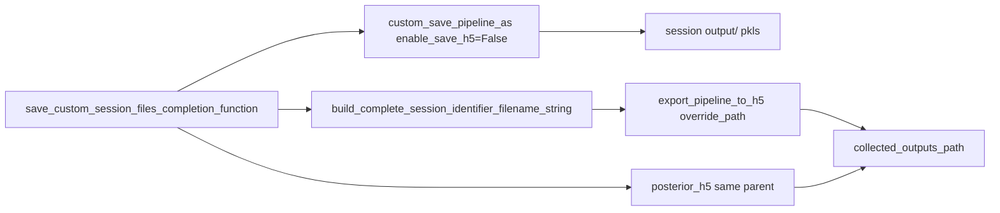

# Session pipeline H5 → collected_outputs

## Current behavior

In [`batch_user_completion_helpers.py`](h:\TEMP\Spike3DEnv_ExploreUpgrade\Spike3DWorkEnv\pyPhoPlaceCellAnalysis\src\pyphoplacecellanalysis\General\Batch\BatchJobCompletion\UserCompletionHelpers\batch_user_completion_helpers.py), `save_custom_session_files_completion_function` does two different H5 exports:

- **Session pipeline H5** (`enable_save_h5`): via `custom_save_pipeline_as` → `helper_perform_pickle_pipeline` → `export_pipeline_to_h5(override_filename=...)`, which resolves under the session folder (`get_output_path()/pipeline{custom_suffix}.h5`).
- **Posteriors H5** (`should_write_posterior_h5`): under `self.collected_outputs_path` via `PosteriorExporting.build_custom_export_to_h5_path(..., parent_output_path=active_export_parent_output_path)`.

```2608:2633:h:\TEMP\Spike3DEnv_ExploreUpgrade\Spike3DWorkEnv\pyPhoPlaceCellAnalysis\src\pyphoplacecellanalysis\General\Batch\BatchJobCompletion\UserCompletionHelpers\batch_user_completion_helpers.py
    if should_write_posterior_h5:
        active_export_parent_output_path: Path = self.collected_outputs_path.resolve()
        ...
            posteriors_save_path: Path = PosteriorExporting.build_custom_export_to_h5_path(curr_active_pipeline, output_date_str=None, data_identifier_str='(decoded_posteriors)', a_tbin_size=directional_decoders_epochs_decode_result.ripple_decoding_time_bin_size, parent_output_path=active_export_parent_output_path)
```

`export_pipeline_to_h5` already accepts a full `override_path` file path — no change needed there.

## Chosen approach

Change **only** `save_custom_session_files_completion_function` (not global `custom_save_pipeline_as` callers):

1. When saving pkls and/or h5, call `custom_save_pipeline_as(..., enable_save_h5=False)` so pickles stay in the session folder and no session-folder H5 is written.
2. When `enable_save_h5=True`, build a collected_outputs path with the same helper family as posteriors:

```python
hdf5_output_path, _, _ = curr_active_pipeline.build_complete_session_identifier_filename_string(
    output_date_str=self.BATCH_DATE_TO_USE,
    data_identifier_str='(pipeline_results)',
    parent_output_path=self.collected_outputs_path.resolve(),
    out_extension='.h5',
)
```

3. Write with `curr_active_pipeline.export_pipeline_to_h5(override_path=hdf5_output_path)`.
4. Record the path in `custom_save_filepaths_dict['pipeline_h5']` and existing callback fields (`hdf5_output_path`, `session_files_dict`).
5. Update the function docstring to state session pipeline H5 goes under `collected_outputs` (session-identifier name), not session `output/`.

Why full session-identifier names: `pipeline{custom_suffix}.h5` alone is not session-unique, so dumping it flat into `collected_outputs` would collide across sessions. Matching posterior naming avoids that.



## Files to edit

- [`batch_user_completion_helpers.py`](h:\TEMP\Spike3DEnv_ExploreUpgrade\Spike3DWorkEnv\pyPhoPlaceCellAnalysis\src\pyphoplacecellanalysis\General\Batch\BatchJobCompletion\UserCompletionHelpers\batch_user_completion_helpers.py) — `save_custom_session_files_completion_function` only (~2536–2664).

## Out of scope

- Notebook cell in `ReviewOfWork_2026-04-01.ipynb` — no change; existing `enable_save_h5=True` call will pick up the new path.
- `NeuropyPipeline.custom_save_pipeline_as` / `helper_perform_pickle_pipeline` defaults — leave session-folder behavior for other callers.
- Pickle outputs — remain in the session folder.