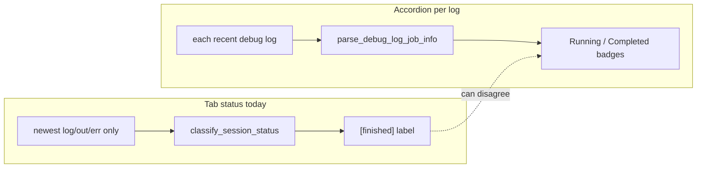

# Session log browser tab labels

## Problem

Left tab text is built in [`_build_session_log_browser_html`](C:\Users\pho\repos\PhoGlobusHelpers\src\phoglobushelpers\gen_scripts_log_status.py) as:

```1001:1007:C:\Users\pho\repos\PhoGlobusHelpers\src\phoglobushelpers\gen_scripts_log_status.py
        session_name = Path(parent_path).name
        status = status_by_parent.get(parent_path, "?")
        ...
        tab_label = html.escape(f"[{status}] {session_name}")
```

- **`status`** comes from [`build_session_status_df`](C:\Users\pho\repos\PhoGlobusHelpers\src\phoglobushelpers\gen_scripts_log_status.py) → [`classify_session_status`](C:\Users\pho\repos\PhoGlobusHelpers\src\phoglobushelpers\gen_scripts_log_status.py), which uses only the **newest** `.log`/`.out`/`.err` per session (`n_most_recent_files=1`) and **file-size heuristics** (`out_size >= 1800` ⇒ `"finished"`).
- Each accordion row already calls [`parse_debug_log_job_info`](C:\Users\pho\repos\PhoGlobusHelpers\src\phoglobushelpers\gen_scripts_log_status.py) on **every** log in the tab (`most_recent_n_logs`, e.g. 4 in your notebook cell). A newer log can look “finished” by `.out` size while older logs in the same tab are still **`Running`**.

So tabs can show `[finished] run_kdiba_...` while job badges inside say **Running** — inconsistent with your intent.



## Intended behavior (confirmed)

1. **Running jobs override false “finished” on tabs**: For each session tab, count logs in that tab whose parsed `job_status == "Running"`. If the file heuristic status is **`finished`** and **`n_running > 0`**, show **`[+N]`** instead of **`[finished]`** (same bracket style). Other heuristic statuses (`running`, `failed`, `stale`, …) stay as **`[{status}]`** even if some logs are Running (only replace the misleading finished case).
2. **Shorter session names**: Strip the literal prefix **`run_kdiba_`** from folder names **only when** every visible session’s stripped name is unique (if any collision, keep full folder names for all tabs so nothing becomes ambiguous).

No notebook change required unless you want to re-run the existing cell after the library update.

## Implementation (single file)

All changes in [`gen_scripts_log_status.py`](C:\Users\pho\repos\PhoGlobusHelpers\src\phoglobushelpers\gen_scripts_log_status.py):

### 1. Small pure helpers (testable)

- **`_RUN_KDIBA_SESSION_PREFIX = "run_kdiba_"`**
- **`_session_tab_display_names(parent_paths: Sequence[str]) -> dict[str, str]`**  
  - Map each `parent_path` → display string.  
  - If all stripped names are unique, use stripped; else use full `Path(parent_path).name` for every path.
- **`_session_tab_status_token(heuristic_status: str, n_running_jobs: int) -> str`**  
  - If `heuristic_status == "finished"` and `n_running_jobs > 0`: return `f"+{n_running_jobs}"`.  
  - Else: return `heuristic_status` (or `"?"` fallback unchanged).
- **`_count_running_jobs_for_session_logs(session_logs, slurm_lookup, now) -> int`**  
  - For each row in `session_logs`, `read_log_tail(..., n_lines=0)` + `lookup_slurm_info_for_log` + `parse_debug_log_job_info`; increment when `job_status == "Running"`.  
  - Skip missing/unreadable logs (same guards as [`enrich_status_df_with_job_info`](C:\Users\pho\repos\PhoGlobusHelpers\src\phoglobushelpers\gen_scripts_log_status.py)).

### 2. Wire into `_build_session_log_browser_html`

Before the `for session_i, parent_path in enumerate(session_order.index)` loop:

- Build **`display_names = _session_tab_display_names(list(session_order.index))`** once.

Inside the loop, **before** appending the tab button:

- `n_running = _count_running_jobs_for_session_logs(session_logs, slurm_lookup, now)`
- `status_token = _session_tab_status_token(status, n_running)`
- `session_name = display_names[parent_path]`
- `tab_label = html.escape(f"[{status_token}] {session_name}")`

Optional micro-optimization (only if the double full-log read is noticeable): refactor the existing inner loop to parse each log once and reuse `job_info` for both counting and accordion HTML. Not required for correctness.

### 3. Unit tests

Add tests in [`tests/test_gen_scripts_log_browser_html.py`](C:\Users\pho\repos\PhoGlobusHelpers\tests\test_gen_scripts_log_browser_html.py) (or a sibling `test_gen_scripts_log_tab_labels.py`) using **minimal fake `recent_logs` / `status_df` DataFrames** and **`monkeypatch`** on `read_log_tail` to return canned log text (reuse patterns from [`tests/test_gen_scripts_log_status_job_parse.py`](C:\Users\pho\repos\PhoGlobusHelpers\tests\test_gen_scripts_log_status_job_parse.py)):

| Case | Assert fragment contains |
|------|---------------------------|
| Heuristic `finished`, one log text ⇒ Running | `[+1]` and shortened session name |
| Heuristic `finished`, all logs Completed | `[finished]` |
| Two sessions strip to same suffix | both tabs show full `run_kdiba_...` names |
| Two sessions strip to unique suffixes | both tabs omit `run_kdiba_` |

Call `_build_session_log_browser_html(...)` directly; no K: scan or notebook execution.

### 4. Out of scope (unless you ask later)

- Changing the **pandas `display_status` table** or `build_session_status_df` heuristics — your request targets **left tab labels** only.
- Stripping other prefixes (e.g. generic `run_`) — only `run_kdiba_` per your note.

## Verification

- `uv run pytest tests/test_gen_scripts_log_browser_html.py` (and new tests).
- Re-run the notebook cell with `most_recent_n_logs=4` on `K:/scratch/gen_scripts` and confirm a session with a running job no longer shows `[finished]` on the tab when any visible log is **Running**, and tab names drop `run_kdiba_` when unique.
