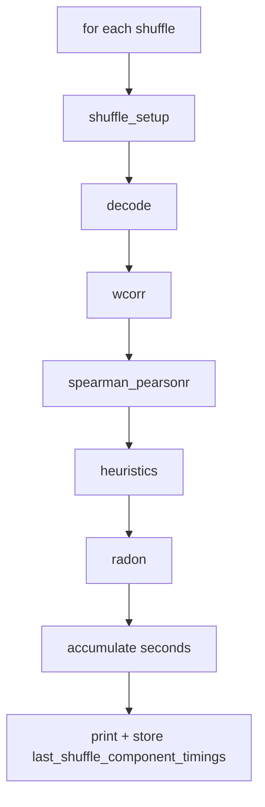

# Shuffle component performance timing

## Scope

Instrument [`_shuffle_and_decode_scores`](h:\TEMP\Spike3DEnv_ExploreUpgrade\Spike3DWorkEnv\pyPhoPlaceCellAnalysis\src\pyphoplacecellanalysis\General\Pipeline\Stages\ComputationFunctions\MultiContextComputationFunctions\SequenceBasedComputations.py) (~1137–1217) and surface totals from [`compute_shuffles`](h:\TEMP\Spike3DEnv_ExploreUpgrade\Spike3DWorkEnv\pyPhoPlaceCellAnalysis\src\pyphoplacecellanalysis\General\Pipeline\Stages\ComputationFunctions\MultiContextComputationFunctions\SequenceBasedComputations.py) (~1227+). Timing is **on by default**.

## Components timed (per shuffle, then summed)

| Key | Code region |
|-----|-------------|
| `shuffle_setup` | build shuffled decoder dict (`_shuffle_pf1D_decoder` loop) |
| `decode` | `_try_all_templates_decode(...)` |
| `wcorr` | `compute_weighted_correlations(...)` + array pack |
| `spearman_pearsonr` | `compute_shuffle_spearman_score_arrays(...)` (when epochs allow) |
| `heuristics` | `HeuristicReplayScoring.compute_shuffle_heuristic_score_arrays(...)` (if enabled) |
| `radon` | `compute_shuffle_radon_score_arrays(...)` (if enabled) |
| `shuffle_total` | full body of one shuffle iteration |

Also record overall `batch_total` for the whole `num_shuffles` loop, and in `compute_shuffles` a separate `ensure_real_scores` for `_ensure_real_score_arrays`.

Skipped components stay at `0.0` (not omitted) so the summary schema is stable.



## Implementation

### 1. Flag + storage on `DecodedEpochScoreShuffle`

- `enable_shuffle_component_timing: bool = serialized_attribute_field(default=True, ...)`
- `last_shuffle_component_timings: Optional[Dict[str, Any]] = non_serialized_field(default=None)` — not pickled as a required field; fill `None` in `__setstate__` if missing
- In `__setstate__`, default missing `enable_shuffle_component_timing` to `True`

### 2. Timing in `_shuffle_and_decode_scores`

- Add kwarg `enable_shuffle_component_timing: bool = True`
- Use `time.perf_counter()` around each block above; accumulate into a `Dict[str, float]` of totals
- After the loop, build a summary dict:

```python
{
  'n_shuffles': int,
  'batch_total_s': float,
  'totals_s': {'shuffle_setup': ..., 'decode': ..., 'wcorr': ..., 'spearman_pearsonr': ..., 'heuristics': ..., 'radon': ..., 'shuffle_total': ...},
  'mean_per_shuffle_s': {k: totals[k] / n_shuffles for k in ...},
}
```

- If timing enabled, print one compact multi-line summary (percent of `batch_total_s`, mean per shuffle)
- Return **4-tuple**: `(wcorrs_list, score_arrays_list, full_decoded_list, timing_summary)`
  - When timing disabled: still return the 4th element as `None` (keeps unpack stable)
- Update `_shuffle_and_decode_wcorrs` to unpack 4 values and ignore timing

### 3. Wire through `compute_shuffles`

- Accept optional `enable_shuffle_component_timing` override; otherwise use `self.enable_shuffle_component_timing`
- Time `_ensure_real_score_arrays` into `ensure_real_scores_s`
- Store merged summary on `self.last_shuffle_component_timings` (include `ensure_real_scores_s`)
- Pass the flag into `_shuffle_and_decode_scores`

Do **not** change pickle save payload shape (8-tuple).

### 4. Tests

In [`tests/test_epoch_score_shuffle.py`](h:\TEMP\Spike3DEnv_ExploreUpgrade\Spike3DWorkEnv\pyPhoPlaceCellAnalysis\tests\test_epoch_score_shuffle.py):

- Unit-test a tiny helper or call `_shuffle_and_decode_scores` with heavy internals patched (`_try_all_templates_decode`, `compute_weighted_correlations`, spearman/heuristic/radon) returning cheap fakes, `num_shuffles=2`, and assert:
  - 4th return has required keys
  - `totals_s` contains all component keys
  - `n_shuffles == 2`
  - `batch_total_s >= shuffle_total` totals

## Out of scope

- Timing inside NeuroPy `radon_transform` / joblib
- Changing CSV export schema
- Per-epoch radon sub-timings
