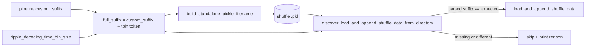

# Shuffle pickle custom suffix (incl. time_bin_size)

## Target filename (flat, legacy-parser compatible)

`{YYYY-MM-DD_HHMMAM}{full_suffix}_{data_name}_{n_shuffles}.pkl`, e.g.

`2026-10-29_1130AM_withNormalComputedReplays-qclu_[1, 2, 4, 6, 7, 9]-frateThresh_5.0-tbin_25ms_standalone_epoch_score_shuffle_data_only_700.pkl`

- `full_suffix` = pipeline `custom_suffix` (from `get_custom_pipeline_filenames_from_parameters`, already includes replay source, qclu, frateThresh and any `_export_filename_extra_suffix_parts`) + `build_decoding_time_bin_size_filename_suffix(ripple_decoding_time_bin_size=...)` (`-tbin_25ms`).
- Still matches the discovery glob `*_epoch_score_shuffle_data_*.pkl`.
- Loader is **strict only**: pickles whose parsed suffix is missing or differs from the expected suffix are skipped (no opt-in flag).

## Changes

### 1. `SequenceBasedComputations.py` (core)

File: [pyPhoPlaceCellAnalysis/.../MultiContextComputationFunctions/SequenceBasedComputations.py](h:/TEMP/Spike3DEnv_ExploreUpgrade/Spike3DWorkEnv/pyPhoPlaceCellAnalysis/src/pyphoplacecellanalysis/General/Pipeline/Stages/ComputationFunctions/MultiContextComputationFunctions/SequenceBasedComputations.py)

- **Parser** `ExportedEpochScoreShufflesPickleFilenameParser.try_parse` (L71-120): keep the existing regex, then post-split the greedy `data_name` group into:
  - `data_name`: trailing stem (`standalone_epoch_score_shuffle_data_only` / `standalone_wcorr_ripple_shuffle_data_only`, or generic `standalone_..._data_only`)
  - `custom_suffix`: everything before the stem, normalized to start with `_` (e.g. `_withNormalComputedReplays-qclu_[...]-frateThresh_5.0-tbin_25ms`); `None` for legacy unsuffixed names
  - `decoding_time_bin_size`: float via existing `parse_decoding_time_bin_size_str` on the `tbin_...` token (`None` if absent)
- **New helpers on `DecodedEpochScoreShuffle`**:
  - `get_ripple_decoding_time_bin_size(curr_active_pipeline=None) -> Optional[float]`: `all_templates_decode_kwargs['desired_ripple_decoding_time_bin_size']` (non-serialized, may be empty after unpickle) -> fall back to `.decoding_time_bin_size` of any value in `real_decoder_ripple_filter_epochs_decoder_result_dict` -> fall back to `try_get_decoding_time_bin_sizes_from_parameters(...)` on the pipeline.
  - `build_full_custom_suffix(curr_active_pipeline, ripple_decoding_time_bin_size=None, custom_suffix=None) -> str`: `custom_suffix or pipeline custom_suffix` + `build_decoding_time_bin_size_filename_suffix(ripple_decoding_time_bin_size=...)`; raise if tbin cannot be determined (prevents writing unsuffixed files).
  - `build_standalone_pickle_filename(full_custom_suffix, n_completed_shuffles, data_name='standalone_epoch_score_shuffle_data_only', date_str=None) -> str`.
- **`discover_load_and_append_shuffle_data_from_directory`** (L1436): add `with_custom_suffix: Optional[str]=None` and `curr_active_pipeline=None`; if `with_custom_suffix` is None compute it via `build_full_custom_suffix`. In the per-file loop, compare normalized parsed `custom_suffix` to expected; skip when `None` or different (print the skip reason). Keep `newer_than` and `with_data_name` (now compared against the stem only).
- **Payload metadata (belt-and-braces)**: `save_data(filepath, metadata: Optional[Dict]=None)` appends an 8th element `{'custom_suffix', 'ripple_decoding_time_bin_size', 'data_name', 'n_shuffles', 'session'}`; `load_and_append_shuffle_data(filepath, expected_custom_suffix=None)` reads `loaded_results_list[4]` if present and asserts match. Existing variadic unpack already tolerates the extra element; update the docstring (3/4/5/7/8-tuple).

### 2. Batch save/load call sites

File: [batch_user_completion_helpers.py](h:/TEMP/Spike3DEnv_ExploreUpgrade/Spike3DWorkEnv/pyPhoPlaceCellAnalysis/src/pyphoplacecellanalysis/General/Batch/BatchJobCompletion/UserCompletionHelpers/batch_user_completion_helpers.py)

- `compute_and_export_session_epoch_score_shuffles_completion_function` (L1482): compute `full_custom_suffix` once after `init_from_templates`/modernize; pass `with_custom_suffix=full_custom_suffix` to the discover call (L1568); replace the save filename (L1630-1632) with `build_standalone_pickle_filename(...)` using `get_now_rounded_time_str()`; pass `metadata=` to `save_data`. `with_data_name` keeps meaning "stem override".
- `compute_and_export_session_alternative_replay_wcorr_shuffles_completion_function` (L1881): replace the `build_complete_session_identifier_filename_string` pickle name with the new helper using the per-variant `custom_suffix` + tbin from the function's `ripple_decoding_time_bin_size` param; remove the `_prev_standalone_pkl_filename` comparison print.

File: [batch_completion_helpers.py](h:/TEMP/Spike3DEnv_ExploreUpgrade/Spike3DWorkEnv/pyPhoPlaceCellAnalysis/src/pyphoplacecellanalysis/General/Batch/BatchJobCompletion/UserCompletionHelpers/batch_completion_helpers.py)

- `finalize_output_shuffled_epoch_scores` (L854): same replacement using the passed `custom_suffix` + `wcorr_shuffles.get_ripple_decoding_time_bin_size(a_curr_active_pipeline)`.

`.mat` and CSV filenames are left unchanged.

### 3. Tests

File: [tests/test_epoch_score_shuffle.py](h:/TEMP/Spike3DEnv_ExploreUpgrade/Spike3DWorkEnv/pyPhoPlaceCellAnalysis/tests/test_epoch_score_shuffle.py)

- Parser: new suffixed name -> `custom_suffix`, `decoding_time_bin_size == 0.025`, stem, `num_shuffles`; legacy names from the docstring still parse with `custom_suffix is None`; the old `_withNewComputedReplays-qclu_[1, 2]-frateThresh_5.0_standalone_wcorr_..._29` name yields a suffix without tbin.
- `build_standalone_pickle_filename` round-trips through the parser.
- Discovery in a temp dir: matching-suffix file loads; different tbin (`75ms`) file skipped; different qclu file skipped; unsuffixed file skipped.
- 8-tuple payload loads; metadata mismatch raises.

## Notes

- `load_shuffles_newer_than = datetime(2026, 10, 26)` hardcode is untouched; with strict suffix matching it becomes redundant and can be relaxed later.
- Existing unsuffixed pickles will no longer be auto-loaded; rename them manually (append the suffix) if they should be reused.