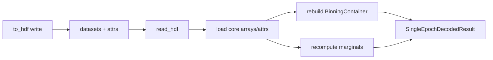

# SingleEpochDecodedResult HDF round-trip

## Goal
Restore a usable [`SingleEpochDecodedResult`](h:\TEMP\Spike3DEnv_ExploreUpgrade\Spike3DWorkEnv\pyPhoPlaceCellAnalysis\src\pyphoplacecellanalysis\Analysis\Decoder\reconstruction.py) from an HDF5 group via `read_hdf` (currently a stub returning the wrong type `"PfND"`).

## Current gap
[`to_hdf`](h:\TEMP\Spike3DEnv_ExploreUpgrade\Spike3DWorkEnv\pyPhoPlaceCellAnalysis\src\pyphoplacecellanalysis\Analysis\Decoder\reconstruction.py) (L755–874) writes:
- datasets: `p_x_given_n` (**from `marginal_x.p_x_given_n`**, not full `self.p_x_given_n`), `p_x_given_n_grey`, `most_likely_positions`, `most_likely_position_indicies`, `time_bin_edges`, `t_bin_centers`
- attrs: `nbins`, `n_xbins`, `creation_date`, flattened `epoch_info_tuple` fields

Missing for a real object: full `p_x_given_n`, `time_bin_container`, `marginal_*`, `spkcount`, `epoch_data_index`.

`PosteriorExporting.save_decoded_posteriors_to_HDF5` depends on the existing `p_x_given_n` / `p_x_given_n_grey` layout — keep that compatible.

## Approach



### 1. Minimal `to_hdf` upgrades (same class, required for fidelity)
In [`reconstruction.py` `SingleEpochDecodedResult.to_hdf`](h:\TEMP\Spike3DEnv_ExploreUpgrade\Spike3DWorkEnv\pyPhoPlaceCellAnalysis\src\pyphoplacecellanalysis\Analysis\Decoder\reconstruction.py):
- Keep writing legacy `p_x_given_n` = `marginal_x.p_x_given_n` and `p_x_given_n_grey` (PosteriorExporting compat).
- Additionally write `p_x_given_n_full` = `self.p_x_given_n`.
- Write `spkcount` dataset when not `None`.
- Set `group.attrs['epoch_data_index']` when not `None`.
- Ensure group `key` exists before writing attrs (create if needed) so attr writes are reliable even if dataset paths differ.

### 2. Implement `read_hdf` (L877–880)
Replace stub with:

```python
@classmethod
def read_hdf(cls, file_path, key: str, **kwargs) -> "SingleEpochDecodedResult":
```

Behavior:
- Accept open `h5py.File`/`Group` or path/`str`/`Path` (open read-only if path).
- Under `key`, load present datasets: prefer `p_x_given_n_full` for `p_x_given_n`; else fall back to legacy `p_x_given_n`.
- Load `most_likely_positions`, `most_likely_position_indicies`, `time_bin_edges`, optional `spkcount`, optional `t_bin_centers`.
- Read attrs: `nbins` (else derive from arrays), `epoch_data_index`, and remaining attrs → rebuild `epoch_info_tuple` via `collections.namedtuple('EpochTuple', ...)`.
- Rebuild `time_bin_container`:
  - contiguous edges `(n+1,)` → `BinningContainer(edges=..., centers=t_bin_centers or None)`
  - overlapping `(n, 2)` → `BinningContainer(centers=..., edges=..., window_start_edges=edges[:,0], window_stop_edges=edges[:,1])`
- Recompute `marginal_x` / `marginal_y` / `marginal_z` with `BasePositionDecoder.perform_build_marginals(p_x_given_n, most_likely_positions)` when possible; if most-likely arrays missing, leave marginals as best-effort / `None` rather than inventing positions without bin centers.
- Do not require `p_x_given_n_grey` for object validity (display-only).
- Return `cls(...)`.

### 3. Scope boundaries
- Do **not** change `PosteriorExporting.load_decoded_posteriors_from_HDF5` in this pass (still loads dicts of arrays).
- Do **not** implement `DecodedFilterEpochsResult` list HDF yet.
- Old HDF files without `p_x_given_n_full` still load, but for 2D the restored `p_x_given_n` may be the x-marginal only (documented in docstring).

## Files
- Primary: [`pyphoplacecellanalysis/.../Analysis/Decoder/reconstruction.py`](h:\TEMP\Spike3DEnv_ExploreUpgrade\Spike3DWorkEnv\pyPhoPlaceCellAnalysis\src\pyphoplacecellanalysis\Analysis\Decoder\reconstruction.py) — `to_hdf` + `read_hdf` on `SingleEpochDecodedResult`
