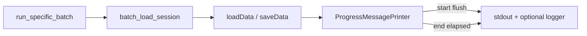

# Slurm-safe operation timing in batch logs

## Problem
Continued-phase `.log` files stop at `active_data_mode_name` while pickle load runs for hours with no start/end/elapsed markers. `ProgressMessagePrinter` already wraps load/save but uses `print(..., end=' ')` without flush, and those lines often never reach the task logger.

## Approach
Instrument the shared progress printer (covers all pickle load/save) plus a few batch milestones in `run_specific_batch`. Every timing/logging side-effect is best-effort: catch all exceptions, never introduce locks/threads, flush only the start line so the log shows the op began before a long hang.



## Slurm safety rules (non-negotiable)
- No `FileLock`, threading, or blocking waits in timing code
- Timing helpers never raise into caller (`try/except Exception: pass` around print/log/flush)
- Use `time.perf_counter()` for elapsed; wall clock only for human-readable stamps
- Flush **start** messages only (`flush=True`); do not add periodic heartbeat threads
- Prefer newline-terminated complete lines (logger + Slurm stdout both capture them)
- Logger failures must not abort the job (`new_print` wraps `logger.info` in try/except)

## Implementation

### 1. Enhance `ProgressMessagePrinter`
File: [`NeuroPy/neuropy/utils/mixins/print_helpers.py`](h:/TEMP/Spike3DEnv_ExploreUpgrade/Spike3DWorkEnv/NeuroPy/neuropy/utils/mixins/print_helpers.py)

- On `__enter__`: store `_t0 = time.perf_counter()`, print start line ending with newline + `flush=True`, including ISO wall timestamp, e.g. `[TIMING START] Loading loaded session pickle file @ 2026-10-20T08:30:14 path="..."`
- On `__exit__`: compute elapsed; print `[TIMING END] ... elapsed=1234.5s (20.6m) status=ok|error` then existing `finished_message`; always flush end line
- Preserve `returns_string` behavior; append timing text into returned string when enabled
- Keep `enable_print=False` silent (no I/O)
- Default `print_line_ending` for timed mode stays newline when timing is on (avoid buffered `end=' '` hang illusion)
- Add optional `logger: Optional[logging.Logger]=None`; if set, also `logger.info(...)` inside try/except

### 2. Safe dual-write in batch `new_print`
Files:
- [`pyPhoPlaceCellAnalysis/.../General/Batch/runBatch.py`](h:/TEMP/Spike3DEnv_ExploreUpgrade/Spike3DWorkEnv/pyPhoPlaceCellAnalysis/src/pyphoplacecellanalysis/General/Batch/runBatch.py) (`run_specific_batch` local `new_print`)
- [`Resources/Templates/python_template.py.j2`](h:/TEMP/Spike3DEnv_ExploreUpgrade/Spike3DWorkEnv/pyPhoPlaceCellAnalysis/src/pyphoplacecellanalysis/Resources/Templates/python_template.py.j2)

Change `new_print` to:
```python
def new_print(*args, **kwargs):
    try:
        kwargs.setdefault('flush', True)
        _original_print(*args, **kwargs)
    except Exception:
        pass
    try:
        curr_task_logger.info(' '.join(str(a) for a in args))
    except Exception:
        pass
```
This prevents logger/stdout failures from killing Slurm jobs and ensures start markers appear promptly.

### 3. Milestone timing in `run_specific_batch`
Same `runBatch.py`: wrap the critical silent gap with explicit markers around `batch_load_session(...)`:
- Before call: `[TIMING START] batch_load_session`
- After success/failure: `[TIMING END] batch_load_session elapsed=...s`
Use a tiny local `try/finally` with `perf_counter` (not a new lock). Optionally pass `curr_task_logger` into nothing else — keep markers via `new_print` only.

### 4. Correct `loadData` action label
File: [`Loading.py`](h:/TEMP/Spike3DEnv_ExploreUpgrade/Spike3DWorkEnv/pyPhoPlaceCellAnalysis/src/pyphoplacecellanalysis/General/Pipeline/Stages/Loading.py) line ~652

Change `action='Computing'` to `action='Loading'` for the session pickle load `ProgressMessagePrinter` so logs match intent (no behavior change).

### 5. No script regeneration required for core fix
`ProgressMessagePrinter` + `run_specific_batch` changes apply to already-generated Slurm scripts on next import. Template `new_print` hardening applies only to newly generated scripts; still worth doing for future runs.

## Expected log shape
```
[TIMING START] batch_load_session @ 2026-10-20T08:30:14
[TIMING START] Loading loaded session pickle file @ 2026-10-20T08:30:14 path=".../loadedSessPickle_....pkl"
...
[TIMING END] Loading loaded session pickle file elapsed=3842.1s (64.0m) status=ok
done.
[TIMING END] batch_load_session elapsed=3845.0s (64.1m) status=ok
```

## Out of scope
- Heartbeat threads / progress bars
- Changing pickle format or split-pickle strategy
- Regenerating all existing Slurm scripts on disk
