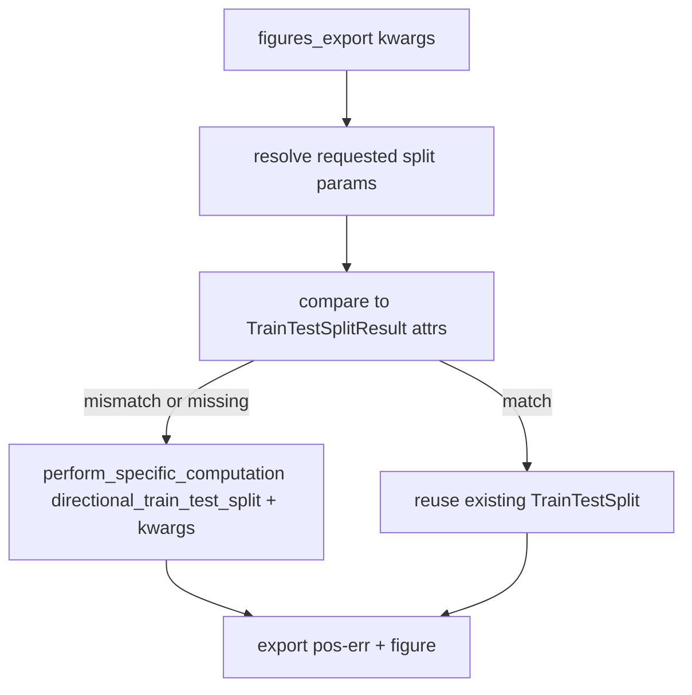

# Intelligent TrainTestSplit recompute from figure export

## Problem
`figures_export_laps_correct_decoder_side_by_side_completion_function` hardcodes `force_recompute_directional_train_test_split_result=False`, ignores TrainTestSplit kwargs, and `TrainTestSplitResult` does not store `laps_decoding_time_bin_size` / `should_filter_inactive_bins_before_split`, so overrides cannot be compared to the computed version.

## Approach
Compare requested split settings to values stored on the existing `TrainTestSplit` result; on mismatch (or missing result / missing stored fields), force-recompute via `perform_specific_computation` with an explicit `computation_kwargs_list`.

Tracked params (requested vs computed):
- `laps_decoding_time_bin_size` (figure arg `active_laps_decoding_time_bin_size`)
- `should_filter_inactive_bins_before_split`
- `min_num_spikes_per_bin_to_be_considered_active`
- `min_num_unique_active_neurons_per_time_bin`
- `train_test_full_lap` (only if explicitly passed)

Float compare with `np.isclose`. Old results lacking new attrs → treat stored as unknown → recompute when any override is requested or always when attr is missing and result exists (safer: missing attr ⇒ mismatch).



## Code changes

### 1. Persist settings on `TrainTestSplitResult`
In [`DirectionalPlacefieldGlobalComputationFunctions.py`](h:/TEMP/Spike3DEnv_ExploreUpgrade/Spike3DWorkEnv/pyPhoPlaceCellAnalysis/src/pyphoplacecellanalysis/General/Pipeline/Stages/ComputationFunctions/MultiContextComputationFunctions/DirectionalPlacefieldGlobalComputationFunctions.py) on `TrainTestSplitResult` (~6111), add serialized attrs (defaults `None`):
- `laps_decoding_time_bin_size`
- `should_filter_inactive_bins_before_split`
- `min_num_spikes_per_bin_to_be_considered_active`
- `min_num_unique_active_neurons_per_time_bin`
- `train_test_full_lap`

Set them in `_split_train_test_laps_data` after `compute_train_test_split_laps_decoders` returns (and also set on the object inside `compute_train_test_split_laps_decoders` return path if that constructs the result).

### 2. Shared resolve/mismatch helper
Add `TrainTestLapsSplitting.resolve_needs_train_test_split_recompute(curr_active_pipeline, requested: Dict) -> Tuple[bool, Dict]` near the split helpers:
- Read existing `computed_data['TrainTestSplit']`
- Build `computation_kwargs` from requested (only known keys)
- Return `(needs_recompute, computation_kwargs)` where needs_recompute if result is None or any tracked field differs / is missing on result

### 3. Pass kwargs when force-recomputing
Update `_do_train_test_split_decode_and_evaluate` to accept optional `train_test_split_computation_kwargs: Optional[Dict]=None`. When recomputing:

```python
curr_active_pipeline.perform_specific_computation(
    computation_functions_name_includelist=['directional_train_test_split'],
    computation_kwargs_list=[dict(train_test_split_computation_kwargs or {})],
    enabled_filter_names=None, fail_on_exception=True, debug_print=False)
```

Also: if `train_test_split_computation_kwargs` is provided and mismatch helper says needed, set `force_recompute_directional_train_test_split_result=True` automatically (or let callers pass the bool from the helper).

Thread the same optional dict through `compute_kdiba_train_test_position_error_dfs` → `export_kdiba_train_test_position_error_csvs` → `compute_and_export_kdiba_train_test_position_error_completion_function`.

### 4. Figure completion: detect + forward
In [`batch_user_completion_helpers.py`](h:/TEMP/Spike3DEnv_ExploreUpgrade/Spike3DWorkEnv/pyPhoPlaceCellAnalysis/src/pyphoplacecellanalysis/General/Batch/BatchJobCompletion/UserCompletionHelpers/batch_user_completion_helpers.py) `figures_export_laps_correct_decoder_side_by_side_completion_function`:

- Explicit args / pop from `kwargs` (so display does not receive them): `should_filter_inactive_bins_before_split`, `train_test_full_lap`, and allow override of mask thresholds already present.
- Build `requested = {laps_decoding_time_bin_size: active_laps_decoding_time_bin_size, should_filter_..., min_num_..., ...}` using figure defaults when not overridden.
- Call resolve helper → `needs_recompute`, `tt_kwargs`.
- Pass `force_recompute_directional_train_test_split_result=needs_recompute` and `train_test_split_computation_kwargs=tt_kwargs` into `compute_and_export_kdiba_train_test_position_error_completion_function`.

Notebook then works as:

```python
figures_export_laps_correct_decoder_side_by_side_completion_function(
    ...,
    active_laps_decoding_time_bin_size=0.025,
    should_filter_inactive_bins_before_split=False,
)
```

## Locked defaults
- Do not always recompute; only on missing result or param mismatch.
- Pos-err decode masking kwargs stay independent except when they are also used as split settings in the requested dict above.
- Do not edit the notebook unless asked.