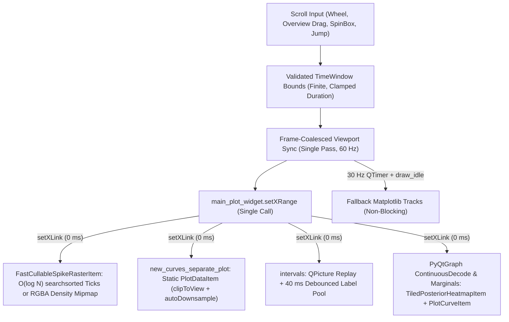

# Silky-Smooth SpikeRasterWindow Scrolling and Crash Prevention

## Architecture Overview

Currently, a single drag pixel on the overview region emits `window_scrolled` 2-4 times, runs discarded full-session `spikes_df` boolean slices and `np.unique` sorts, transforms 2x-3x duplicated session spikes inside `ScatterPlotItem.paint()`, re-slices and re-uploads `pos_df` curves twice, and triggers synchronous CPU `FigureCanvasQTAgg.draw()` across all 5 docked Matplotlib decoder/marginal canvases (~250-1000 ms total). Rapidly expanding the viewport also triggers native Qt5/OpenGL driver crashes (`useOpenGL=True` + `enableExperimental=True` across 5+ `QOpenGLWidget` docks on vendored `pyqtgraph 0.12.4.dev0`), multi-GB fancy-indexing copies in paired 2D decoder views, and unprotected PyQt5 slot exceptions (`qFatal()` -> `abort()`).

The target architecture reduces scrolling and zooming to a single coalesced 60 Hz `ViewBox` transform pass with sub-2 ms GPU/CPU blits at any window duration:



---

## Phase 1: Kernel Crash Prevention (OpenGL, Bounds, OOM, and Slot Hardening)

- **Disable forced 2D `useOpenGL` and `enableExperimental` overrides** in [pyPhoPlaceCellAnalysis/src/pyphoplacecellanalysis/GUI/PyQtPlot/Widgets/SpikeRasterWidgets/Spike2DRaster.py](pyPhoPlaceCellAnalysis/src/pyphoplacecellanalysis/GUI/PyQtPlot/Widgets/SpikeRasterWidgets/Spike2DRaster.py):
  - Change `self.params.setdefault('useOpenGL', False)` and `self.params.setdefault('enableExperimental', False)` in `Spike2DRaster.setup()`, and stop mutating global `pg.setConfigOption('useOpenGL', ...)` / `'enableExperimental'` unless explicitly requested. Guard `self.ui.main_graphics_layout_widget.useOpenGL(...)` behind `self.params.useOpenGL`.
  - This prevents spawning 5+ competing `QOpenGLWidget` FBOs inside `DockArea` and disables vendored `PlotCurveItem.paintGL()` (`glVertexPointerf` on transient arrays with unfiltered `NaN`s inside `QPainter.beginNativePainting()`).

```290:299:pyPhoPlaceCellAnalysis\src\pyphoplacecellanalysis\GUI\PyQtPlot\Widgets\SpikeRasterWidgets\Spike2DRaster.py
        self.params.setdefault('useOpenGL', True)
        self.params.setdefault('enableExperimental', True)

        # Configure pyqtgraph config:
        try:
            import OpenGL
            # pg.setConfigOption('useOpenGL', True)
            pg.setConfigOption('useOpenGL', self.params.useOpenGL)
            pg.setConfigOption('enableExperimental', self.params.enableExperimental)
```

- **Enforce finite, bounded window durations and fix duration SpinBox desync**:
  - In [pyPhoPlaceCellAnalysis/src/pyphoplacecellanalysis/General/Model/TimeWindow.py](pyPhoPlaceCellAnalysis/src/pyphoplacecellanalysis/General/Model/TimeWindow.py) and [pyPhoPlaceCellAnalysis/src/pyphoplacecellanalysis/General/Model/SpikesDataframeWindow.py](pyPhoPlaceCellAnalysis/src/pyphoplacecellanalysis/General/Model/SpikesDataframeWindow.py), validate that `new_start`, `new_end`, and `window_duration` are finite (`np.isfinite`), clamping `window_duration` to `[min_duration (0.005 s), max_duration (total_data_duration)]`.
  - In [pyPhoPlaceCellAnalysis/src/pyphoplacecellanalysis/GUI/Qt/ZoomAndNavigationSidebarControls/Spike3DRasterLeftSidebarControlBarWidget.py](pyPhoPlaceCellAnalysis/src/pyphoplacecellanalysis/GUI/Qt/ZoomAndNavigationSidebarControls/Spike3DRasterLeftSidebarControlBarWidget.py), set explicit bounds `[0.01, max(total_data_duration, 1.0)]` on `spinRenderWindowDuration` and replace unbounded `dec=True` exponential stepping with bounded step sizing.
  - Fix `Spike3DRasterWindowWidget.on_render_window_duration_valueChanged` in [pyPhoPlaceCellAnalysis/src/pyphoplacecellanalysis/GUI/Qt/SpikeRasterWindows/Spike3DRasterWindowWidget.py](pyPhoPlaceCellAnalysis/src/pyphoplacecellanalysis/GUI/Qt/SpikeRasterWindows/Spike3DRasterWindowWidget.py) so updating `spinRenderWindowDuration` immediately updates `scroll_window_region` and emits `window_scrolled` cleanly instead of executing dead guard code.

- **Eliminate Multi-GB fancy-indexing OOM in paired 2D decoder views**:
  - In [pyPhoPlaceCellAnalysis/src/pyphoplacecellanalysis/Pho2D/PyQtPlots/TimeSynchronizedPlotters/TimeSynchronizedGenericPlotterLayer.py](pyPhoPlaceCellAnalysis/src/pyphoplacecellanalysis/Pho2D/PyQtPlots/TimeSynchronizedPlotters/TimeSynchronizedGenericPlotterLayer.py) and [pyPhoPlaceCellAnalysis/src/pyphoplacecellanalysis/Pho2D/PyQtPlots/TimeSynchronizedPlotters/TimeSynchronizedPositionDecoderPlotter.py](pyPhoPlaceCellAnalysis/src/pyphoplacecellanalysis/Pho2D/PyQtPlots/TimeSynchronizedPlotters/TimeSynchronizedPositionDecoderPlotter.py), replace `_included_posterior_bin_indices_for_viewport`'s Python list / integer index array with a contiguous `slice(i0, i1)` computed via `np.searchsorted`, and compute wide-window sums over bounded chunks (e.g. 512 bins per chunk) so `main_data[:, :, i0:i1]` never allocates multi-GB temporary copies.

- **Harden `QTime`, `sys.excepthook`, and raw Qt slots against `PyQt5` `qFatal()` / `abort()`**:
  - In [pyPhoPlaceCellAnalysis/src/pyphoplacecellanalysis/GUI/Qt/PlaybackControls/Spike3DRasterBottomPlaybackControlBarWidget.py](pyPhoPlaceCellAnalysis/src/pyphoplacecellanalysis/GUI/Qt/PlaybackControls/Spike3DRasterBottomPlaybackControlBarWidget.py), guard `decompose_fractional_seconds` and `time_fractional_seconds.setter` against `NaN`/`Inf` and `< 0` or `>= 86400` s values, and add the missing `self.time_edit.blockSignals(True)` before `setTime`.
  - Fix `global _GLOBAL_spike_raster_logger` and wrap `trap_exc_during_debug` in `try/except` in [pyPhoPlaceCellAnalysis/src/pyphoplacecellanalysis/GUI/PyQtPlot/Widgets/SpikeRasterWidgets/SpikeRasterBase.py](pyPhoPlaceCellAnalysis/src/pyphoplacecellanalysis/GUI/PyQtPlot/Widgets/SpikeRasterWidgets/SpikeRasterBase.py).
  - Wrap hot `@QtCore.Slot` / `@QtCore.pyqtSlot` callbacks (`_Render2DScrollWindowPlot_on_linear_region_item_update`, `PyqtgraphTimeSynchronizedWidget.on_window_changed`, `MatplotlibTimeSynchronizedWidget.on_window_changed`, `TimeSynchronizedPositionDecoderPlotter.on_window_changed`, `IntervalRectsItem._refresh_visible_labels_from_viewbox`) with `@pyqtExceptionPrintingSlot` or `try/except`.

---

## Phase 2: Collapse Redundant Signal Cascades, DataFrame Scans, and Debug `print()` Storms

- **Fix 2x-4x `CustomLinearRegionItem` and `Render2DScrollWindowPlot` emissions**:
  - In [pyPhoPlaceCellAnalysis/src/pyphoplacecellanalysis/GUI/PyQtPlot/Widgets/GraphicsObjects/CustomLinearRegionItem.py](pyPhoPlaceCellAnalysis/src/pyphoplacecellanalysis/GUI/PyQtPlot/Widgets/GraphicsObjects/CustomLinearRegionItem.py), block signals on **both** `self.lines[0]` and `self.lines[1]` during `mouseDragEvent` before calling `setPos(...)`.
  - In [pyPhoPlaceCellAnalysis/src/pyphoplacecellanalysis/GUI/PyQtPlot/Widgets/Mixins/Render2DScrollWindowPlot.py](pyPhoPlaceCellAnalysis/src/pyphoplacecellanalysis/GUI/PyQtPlot/Widgets/Mixins/Render2DScrollWindowPlot.py), deduplicate `_Render2DScrollWindowPlot_on_linear_region_item_update` emissions when `(min_x, max_x)` is unchanged, preventing redundant emissions on `sigRegionChangeFinished` and `setRegion`.

```273:285:pyPhoPlaceCellAnalysis\src\pyphoplacecellanalysis\GUI\PyQtPlot\Widgets\GraphicsObjects\CustomLinearRegionItem.py
        self.lines[0].blockSignals(True)  # only want to update once
        for i, l in enumerate(self.lines):
            l.setPos(self.cursorOffsets[i] + ev.pos())
        self.lines[0].blockSignals(False)
        self.prepareGeometryChange()
        
        if ev.isFinish():
            self.moving = False
            self.sigRegionChangeFinished.emit(self)
        else:
            self.sigRegionChanged.emit(self)
```

- **Unify PyQtGraph track X-synchronization onto `setXLink` (1 `setXRange` per frame)**:
  - In [pyPhoPlaceCellAnalysis/src/pyphoplacecellanalysis/GUI/PyQtPlot/Widgets/SpikeRasterWidgets/Spike2DRaster.py](pyPhoPlaceCellAnalysis/src/pyphoplacecellanalysis/GUI/PyQtPlot/Widgets/SpikeRasterWidgets/Spike2DRaster.py) and [pyPhoPlaceCellAnalysis/src/pyphoplacecellanalysis/GUI/PyQtPlot/DockingWidgets/SpecificDockWidgetManipulatingMixin.py](pyPhoPlaceCellAnalysis/src/pyphoplacecellanalysis/GUI/PyQtPlot/DockingWidgets/SpecificDockWidgetManipulatingMixin.py):
    - Coalesce `window_scrolled` updates at 60 Hz (`delay=0.016, rateLimit=60`) so `main_plot_widget.setXRange(min_t, max_t, padding=0)` runs once per frame instead of twice.
    - Link all `TO_WINDOW` PyQtGraph tracks (`intervals`, `new_curves_separate_plot`, and PyQtGraph decoded tracks) via `target_plot_item.setXLink(self.plots.main_plot_widget)` rather than firing redundant per-track `on_window_changed -> setXRange + setYRange` slots.

- **Eliminate wasted per-scroll `spikes_df` slicing, `np.unique` sorting, and `pos_df` curve re-uploads**:
  - Make [pyPhoPlaceCellAnalysis/src/pyphoplacecellanalysis/General/Model/LiveWindowedData.py](pyPhoPlaceCellAnalysis/src/pyphoplacecellanalysis/General/Model/LiveWindowedData.py) compute windowed DataFrame slices lazily (or only when a subscriber requires `data_value`, using `np.searchsorted` on sorted timestamps instead of full-table `.between(...)` boolean masks), and avoid slicing twice when duration changes. Also hoist `self.active_windowed_df` outside the per-neuron loop in [pyPhoPlaceCellAnalysis/src/pyphoplacecellanalysis/GUI/PyQtPlot/Widgets/SpikeRasterWidgets/Spike3DRaster.py](pyPhoPlaceCellAnalysis/src/pyphoplacecellanalysis/GUI/PyQtPlot/Widgets/SpikeRasterWidgets/Spike3DRaster.py).
  - Cache `fragile_linear_neuron_IDXs` and `cell_ids` on [pyPhoPlaceCellAnalysis/src/pyphoplacecellanalysis/GUI/PyQtPlot/Widgets/SpikeRasterWidgets/SpikeRasterBase.py](pyPhoPlaceCellAnalysis/src/pyphoplacecellanalysis/GUI/PyQtPlot/Widgets/SpikeRasterWidgets/SpikeRasterBase.py) (invalidated on `spike_dataframe_changed_signal`), and remove `self.update_series_identity_y_values()` and the duplicate `self.TimeCurvesViewMixin_on_window_update()` call from the scroll hot path in `Spike2DRaster._update_plots()` / `perform_update_zoomed_plot()`.
  - Update `Spike2DRaster.update_3D_time_curves` / `_build_or_update_time_curves_plot` in `Spike2DRaster.py` so 2D time-curve tracks (`new_curves_separate_plot`) upload the full-session normalized `(t, y)` arrays once with `clipToView=True` and `autoDownsample=True`, letting `setXLink` handle scrolling with zero per-frame DataFrame slicing or `QPainterPath` rebuilds.

- **Disable hot-path debug `print()` calls**:
  - Set `enable_debug_print = False` on [pyPhoPlaceCellAnalysis/src/pyphoplacecellanalysis/Pho2D/PyQtPlots/TimeSynchronizedPlotters/PyqtgraphTimeSynchronizedWidget.py](pyPhoPlaceCellAnalysis/src/pyphoplacecellanalysis/Pho2D/PyQtPlots/TimeSynchronizedPlotters/PyqtgraphTimeSynchronizedWidget.py), `enable_interaction_events_debug_print = False` on `Spike3DRasterWindowWidget`, `debug_print = False` on `TimeSynchronizedPositionDecoderPlotter`, and guard the unconditional `print(...)` in `SpikeRasterBottomFrameControlsMixin_on_window_update`.

---

## Phase 3: Fast `O(log N)` Viewport-Culled Spike Rendering + Density LOD Mipmap

- **Fix 2x-3x spike duplication and `SymbolAtlas` pen bloat**:
  - In `Spike2DRaster._buildGraphics_DockedTracksLayout` (`Spike2DRaster.py:567-586`), stop adding a second `ScatterPlotItem` on `rasters[raster_overview]` and stop calling `self.plots.scatter_plot.addPoints(self.plots_data.all_spots)` a second time on `rasters[raster_window]`.
  - Make `prepare_pyqtgraph_rasterPlot_track` (`SpecificDockWidgetManipulatingMixin.py:1180-1225`) and `_setup_spike_raster_window_for_debugging` ([pyPhoPlaceCellAnalysis/src/pyphoplacecellanalysis/GUI/PyQtPlot/Widgets/SpikeRasterWidgets/spike_raster_widgets.py](pyPhoPlaceCellAnalysis/src/pyphoplacecellanalysis/GUI/PyQtPlot/Widgets/SpikeRasterWidgets/spike_raster_widgets.py)) idempotent when a track already exists instead of stacking duplicate `ScatterPlotItem`s.
  - Reuse one cached `QPen`/`QBrush` per `aclu` in `NewSimpleRaster.build_spikes_all_spots_from_df` ([pyPhoPlaceCellAnalysis/src/pyphoplacecellanalysis/General/Pipeline/Stages/DisplayFunctions/SpikeRasters.py](pyPhoPlaceCellAnalysis/src/pyphoplacecellanalysis/General/Pipeline/Stages/DisplayFunctions/SpikeRasters.py)) so `SymbolAtlas` stores `N_cells` glyphs rather than `N_spikes` glyphs.

- **Create `FastCullableSpikeRasterItem` with automatic Spike-Density LOD Mipmap**:
  - Add [pyPhoPlaceCellAnalysis/src/pyphoplacecellanalysis/GUI/PyQtPlot/Widgets/GraphicsObjects/FastCullableSpikeRasterItem.py](pyPhoPlaceCellAnalysis/src/pyphoplacecellanalysis/GUI/PyQtPlot/Widgets/GraphicsObjects/FastCullableSpikeRasterItem.py) (`pg.GraphicsObject` subclass exposing compatible `.setData`, `.addPoints`, `.clear`, `.dataBounds`, `.opts` methods for `self.plots.scatter_plot` and `self.plots.preview_overview_scatter_plot`):
    - Stores spikes sorted by timestamp in contiguous arrays (`t_sorted`, `y_sorted`, `unit_idx_sorted`) with cached `O(1)` `boundingRect` / `dataBounds` (never invalidated on pan/zoom).
    - **Tick Mode (zoomed-in / moderate windows)**: Slices `[i0, i1] = np.searchsorted(t_sorted, [min_t, max_t])` in `O(log N)`, transforms **only** those `[i0:i1]` spikes to device pixels, deduplicates colliding `(pixel_x, unit_idx)` pairs, and blits from an `N_cells`-entry `SymbolAtlas` via `QPainter.drawPixmapFragments`.
    - **Density Mipmap LOD Mode (wide windows, e.g. `> 75 s` or when `spikes_per_pixel` exceeds threshold, plus overview track)**: Precomputes a multi-resolution RGBA `uint8` spike-density mipmap pyramid (`dt = 0.025 s`, `0.10 s`, `0.50 s`, chunked into `<= 8192`-px `QImage` tiles to stay safely below Qt5's `32,767`-px rasterizer limit) using each neuron's exact `QColor`/alpha so single spikes remain crisp while dense bursts brighten smoothly. In `paint()`, draws the 1-2 visible `QImage` tiles in `< 0.2 ms` with zero dropped spikes.
    - Rebuilds sorted buffers and mipmap tiles automatically on `on_neuron_colors_changed` and `on_unit_sort_order_changed`.

---

## Phase 4: Native PyQtGraph `ContinuousDecode` & `Marginal` Tracks + Throttled Matplotlib Fallback

- **Create `TiledPosteriorHeatmapItem` (`pg.GraphicsObject`)**:
  - Add [pyPhoPlaceCellAnalysis/src/pyphoplacecellanalysis/GUI/PyQtPlot/Widgets/GraphicsObjects/TiledPosteriorHeatmapItem.py](pyPhoPlaceCellAnalysis/src/pyphoplacecellanalysis/GUI/PyQtPlot/Widgets/GraphicsObjects/TiledPosteriorHeatmapItem.py):
    - Converts a `(n_xbins, n_time_bins)` posterior matrix **once** at creation time through the exact Matplotlib colormap (`viridis` or `Oranges`, `vmin`, `vmax`, `bad_color` for `NaN`, `under_color`, `over_color`) into `uint8` RGBA, builds `1x` / `4x` / `16x` max-pooled mipmap levels along time (preserving narrow PBE/replay peaks at wide zoom), and slices them into `<= 8192`-px `QImage` tiles.
    - In `paint()`, binary-searches the 1-2 visible tiles overlapping `[min_t, max_t]` and blits via `QPainter.drawImage` in `< 0.1 ms` with zero per-scroll array work and no `32,767`-px `ImageItem` overflow.

- **Add PyQtGraph `ContinuousDecode` and `Marginal` track builders and wire menus**:
  - In [pyPhoPlaceCellAnalysis/src/pyphoplacecellanalysis/GUI/PyQtPlot/DockingWidgets/SpecificDockWidgetManipulatingMixin.py](pyPhoPlaceCellAnalysis/src/pyphoplacecellanalysis/GUI/PyQtPlot/DockingWidgets/SpecificDockWidgetManipulatingMixin.py), [pyPhoPlaceCellAnalysis/src/pyphoplacecellanalysis/General/Pipeline/Stages/ComputationFunctions/MultiContextComputationFunctions/DirectionalPlacefieldGlobalComputationFunctions.py](pyPhoPlaceCellAnalysis/src/pyphoplacecellanalysis/General/Pipeline/Stages/ComputationFunctions/MultiContextComputationFunctions/DirectionalPlacefieldGlobalComputationFunctions.py), and [pyPhoPlaceCellAnalysis/src/pyphoplacecellanalysis/GUI/Qt/Menus/SpecificMenus/DockedWidgets_MenuProvider.py](pyPhoPlaceCellAnalysis/src/pyphoplacecellanalysis/GUI/Qt/Menus/SpecificMenus/DockedWidgets_MenuProvider.py):
    - Add native PyQtGraph docked posterior and marginal track builders (`add_docked_pyqtgraph_decoded_posterior_track` and `add_docked_pyqtgraph_marginal_track`) and default `AddNewDecodedPosteriors_*` / `AddNewDecodedEpochMarginal_*` commands to PyQtGraph (`plotting_backend='pyqtgraph'`, keeping `'matplotlib'` selectable as an option).
    - Overlay measured `lin_pos` using a static `pg.PlotCurveItem` (`pen=pg.mkPen(255, 0, 0, 90, width=1.5)`, `clipToView=True`, `autoDownsample=True`, `connect='finite'`).
    - For `marginal_over_track_ID`, attach ViewBox-pinned left-edge `short` / `long` `pg.TextItem` labels and a horizontal `pg.InfiniteLine(pos=0.5, angle=0)` divider, preserving `widget.plots_data` for crosshair tracing.
    - Update `Spike3DRasterWindowWidget.update_scrolling_event_filters` so mouse-wheel scrolling works over all docked `PyqtgraphTimeSynchronizedWidget` viewports as well.

- **Throttle and fix `MatplotlibTimeSynchronizedWidget` fallback**:
  - In [pyPhoPlaceCellAnalysis/src/pyphoplacecellanalysis/Pho2D/matplotlib/MatplotlibTimeSynchronizedWidget.py](pyPhoPlaceCellAnalysis/src/pyphoplacecellanalysis/Pho2D/matplotlib/MatplotlibTimeSynchronizedWidget.py) and [pyPhoPlaceCellAnalysis/src/pyphoplacecellanalysis/Pho2D/matplotlib/CustomMatplotlibWidget.py](pyPhoPlaceCellAnalysis/src/pyphoplacecellanalysis/Pho2D/matplotlib/CustomMatplotlibWidget.py):
    - Coalesce `on_window_changed` updates via a ~30 Hz (`33 ms`) single-shot `QTimer` calling `self.ui.canvas.draw_idle()` instead of synchronous `self.ui.canvas.draw()` on every drag pixel.
    - Guard `CustomMatplotlibWidget.showEvent` so embedded/docked Matplotlib widgets do not overwrite the top-level `SpikeRasterWindow` window title.

---

## Phase 5: Verification and Performance Benchmarking

- Run existing raster tests in [pyPhoPlaceCellAnalysis/tests/test_CustomSpikeRasters.py](pyPhoPlaceCellAnalysis/tests/test_CustomSpikeRasters.py) and add an offscreen Qt regression and benchmark test suite verifying:
  - **Signal & redraw counts**: 1 scroll/drag event emits `window_scrolled` once and updates `main_plot_widget` once (no 2x-4x cascade, zero `spikes_df` full-table scans on 2D scroll).
  - **Frame latency**: `< 5 ms` per scroll/zoom frame across `15 s`, `235 s`, and `2,000 s` viewports with 5+ docked posterior/marginal/curve tracks.
  - **Crash & OOM resilience**: Rapid zoom sweeps (`0.001 s` to `10,000 s`), negative/`>= 86400 s`/`NaN` timestamp inputs, and wide-viewport `TimeSynchronizedGenericPlotterLayer` updates complete with zero uncaught slot exceptions and flat memory usage.